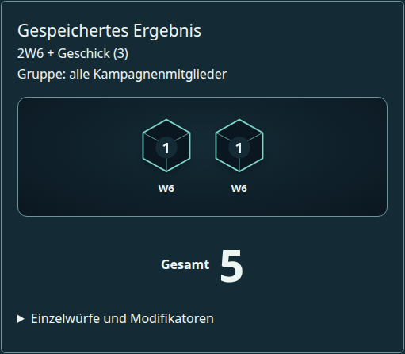
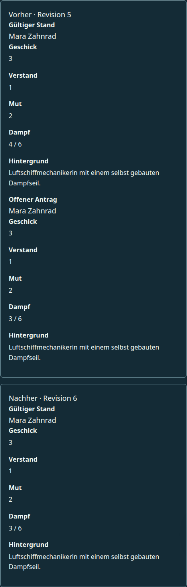

# Demokampagne: Die letzte Fracht von Nebelhafen

Ursprüngliches Probespiel: Version 0.7.0 · 14. November 2026.
Fortgeschriebener Prüfbericht bis Version 0.20.0.

**Spoilerhinweis:** Dieses Dokument zeigt die vollständige Demorunde
einschließlich privatem und verdecktem Ergebnis. Es enthält keine echten
Kampagnengeheimnisse und ist selbst kein geschützter Spielleiterbereich.
Private Inhalte gehören nicht in öffentlich erreichbare Dokumentationsdateien.

## Die angelegte Demo öffnen

[Die letzte Fracht von Nebelhafen – Demo](http://ps-dev.local/pen-paper/spielbereich/?pspp_campaign=592)

Der Link gilt nur auf der lokalen Entwicklungswebsite. Andere Installationen
erhalten weder die Kampagne noch Demokonten automatisch.
Die zuvor vorhandene **„Demo Kampagne“** wurde nicht verändert.

Es bleiben bewusst drei getrennte, nicht administrative Demokonten erhalten:

| Anzeigename | Kampagnenrolle | Figur |
|---|---|---|
| Demo-Spielleitung | Spielleiter und Kampagnenersteller | Keine Spielerfigur |
| Demo-Spielerin Mara | Spieler | Mara Zahnrad |
| Demo-Spieler Jorin | Spieler | Jorin Funkenflug |

Die Konten haben zufällig erzeugte Kennwörter, keine veröffentlichten
Standardzugänge. Für eine eigene Anmeldung bei Bedarf als Website-Administrator
ein neues Kennwort im jeweiligen Benutzerprofil setzen. Die Konten haben keine
hinterlegten persönlichen E-Mail-Adressen; eine E-Mail-Kennwortrücksetzung ist
deshalb nicht der vorgesehene Weg.

Administratoren können die Kampagne bereits über den Spielbereich öffnen.
Die Demo-Spielleitung hat nur die zusätzliche Berechtigung, Kampagnen zu
erstellen, nicht globale Administratorrechte.

## Ausgangslage

Im Steampunk-Hafen Nebelhafen liegt eine versiegelte Wetterkapsel in Kiste 17.
Sie muss vor der Abfahrt eines Luftschiffs zu Dock 3 gelangen.
Die direkte Brücke ist gesperrt, und im Frachtmanifest fehlt eine Angabe.

Mara, eine Luftschiffmechanikerin, setzt ihr Dampfseil ein.
Jorin, ein archivkundiger Kurier, untersucht die Unterlagen.
Die Spielleitung bestimmt verdeckt das verfügbare Zeitfenster.

Diese Geschichte ist ein optionales Beispiel. Im Plugin ist kein
Steampunk-Regelwerk fest eingebaut.

## Einfache Demoregeln

- Erlaubte Würfel: W6 und W20. Die Runde verwendet 2W6 für Figurenproben.
- Genau einen freigegebenen Attributwert addieren.
- Gesamt **ab 10:** gelungen.
- Gesamt **7–9:** gelungen mit einer Komplikation.
- Gesamt **bis 6:** ein Hindernis entsteht; die Gruppe braucht einen anderen Weg.
- Die Spielleitung interpretiert das Ergebnis. Diese Schwellen werden vom
  Plugin nicht automatisch ausgewertet.
- Das Dampfseil kostet nach vorheriger Vereinbarung einen Punkt Dampf,
  unabhängig vom Ergebnis. Der Verbrauch wird separat beantragt und freigegeben.

| Feld | Typ und Grenzen | Mara | Jorin |
|---|---|---:|---:|
| Geschick | Attribut, 0–4 | 3 | 1 |
| Verstand | Attribut, 0–4 | 1 | 3 |
| Mut | Attribut, 0–4 | 2 | 2 |
| Dampf, später Kesseldruck | Ressource, 0–6 | zunächst 4/6 | 4/6 |
| Hintergrund | Langer Text | Mechanikerin | Kurier |

Startwerte der Attributvorlage sind jeweils 1; die abweichenden Demowerte
wurden als Spieleranträge eingereicht und durch die Spielleitung geprüft.
Es gibt dabei keinen automatisch geprüften Punktepool.

## So verlief das Spiel gegen die eigenen Rollen

### 1. Figuren einreichen und freigeben

Beide Spieler erstellten ihren Bogen über den tatsächlichen Frontend-Endpunkt.
Zunächst existierten nur offene Anträge, noch keine gültigen Charakterstände.
Die getrennte Spielleiterrolle gab beide Anträge frei.
Erst danach wurden die Charaktere für Attributproben verwendet.

Die Erstanlage und die Freigabe stehen als getrennte Ereignisse im Protokoll.
Die bebilderte Erklärung dazu steht im [Handbuch](handbuch.md#5-charaktere-und-freigaben).

### 2. Mara und die Nebelbrücke

Mara wählte `2W6`, ihren Charakter und das Attribut **Geschick**.
Sichtbarkeit: **Gruppe**.

**Tatsächlich gespeichert: 1 + 1 + 3 = 5.**

Nach den Demoregeln entstand ein Hindernis. Die Spielleitung erzählte:
Das Dampfseil findet am gesperrten Übergang keinen brauchbaren Haltepunkt.
Die Gruppe muss die Kiste über einen längeren Servicesteg zum Dock bringen.

Das ist kein automatisch berechneter „kritischer Fehlschlag“.
Es wurde nicht erneut gewürfelt, um ein gefälligeres Ergebnis zu erhalten.
Der vorher vereinbarte Werkzeugeinsatz kostete trotzdem einen Ressourcenpunkt.

### 3. Jorin und das Frachtmanifest

Jorin wählte `2W6` und **Verstand**. Sichtbarkeit: **Privat**.

**Tatsächlich gespeichert: 2 + 4 + 3 = 9.**

Erfolg mit Komplikation: Jorin erkannte die Wetterstation als Empfängerin.
Die genaue Übergabestelle war aber unleserlich; am Dock musste die Gruppe
erst bei der Hafenregistratur nachfragen.

Jorin und die Spielleitung konnten diesen Wurf lesen. In Maras tatsächlicher
Frontend-Antwort fehlten Anlass und Ergebnis des privaten Wurfs.

### 4. Verdecktes Zeitfenster

Jorin löste zusätzlich eine ausdrücklich erlaubte verdeckte `W6`-Probe aus.
Für dieses Beispiel legte die Spielleitung fest:

- 1–2: knappes Zeitfenster;
- 3–4: normales Zeitfenster;
- 5–6: großzügiges Zeitfenster.

**Gespeichert wurde eine 5.** Ausschließlich die Spielleitung sah sie.
Jorin erhielt nur eine Speicherbestätigung ohne Ergebnis oder Wurfkennung
in der Weiterleitung; auch Mara erhielt den Eintrag nicht.

Die Spielleitung beschrieb daraus genügend Zeit für Servicesteg und Rückfrage.
Die Kapsel konnte trotz der Komplikationen übergeben werden.
Diese Erzählentscheidung steht hier im Bericht, nicht in einem bereits
vorhandenen Szenenmodul.

### 5. Eine beantragte Verbesserung ablehnen

Mara beantragte anschließend Geschick **3 → 4**.
Die Spielleitung lehnte die Verbesserung ab, weil keine Entwicklung
vereinbart worden war.

Der gültige Wert blieb **3**. Antrag und Ablehnung sind nachvollziehbar.
Die früher gespeicherte Gruppenprobe blieb unverändert bei **5**.

### 6. Den Ressourcenverbrauch freigeben

Mara beantragte separat Dampf **4/6 → 3/6**.
Vor der Freigabe blieb der gültige Stand bei 4/6; nach der Bestätigung
war er 3/6. Das persönliche Maximum blieb 6.

Der Wurf selbst hatte nichts automatisch abgezogen.
Die Vorher-/Nachher-Ansicht zeigt den offenen Antrag und seine Übernahme:

### 7. Eine Ressource gefahrlos umbenennen

Die Spielleitung benannte **„Dampf“ in „Kesseldruck“** um.
Die interne Feldkennung blieb dieselbe. Mara behielt **3/6**, Jorin **4/6**.
Alte Charakterereignisse zeigen weiterhin den damaligen Namen „Dampf“.

## Erhaltener Endstand

| Figur | Geschick | Verstand | Mut | Kesseldruck | Offener Antrag |
|---|---:|---:|---:|---:|---|
| Mara Zahnrad | 3 | 1 | 2 | 3/6 | Keiner |
| Jorin Funkenflug | 1 | 3 | 2 | 4/6 | Keiner |

Die Demo enthält **drei echte Würfe und insgesamt 13 Spielereignisse**:
zwei Regelstände, zwei Erstanlagen, zwei anfängliche Freigaben, drei Würfe
und vier Ereignisse für Ablehnung und Ressourcenfreigabe.
Es wurde kein falscher Szenenveröffentlichungseintrag erzeugt.

Zum Weiterspielen eine neue Probe mit einem neuen Anlass ausführen.
Die gespeicherten alten Ergebnisse sind keine Schaltflächen zum erneuten Würfeln.
Wer dieselbe Ausgangslage möchte, kann den Ressourcenwert über eine neue,
nachvollziehbare Charakteränderung wiederherstellen.

## Was tatsächlich geprüft wurde

Die Einrichtung erfolgte über vorhandene Pluginfunktionen, ohne direkte
SQL-Manipulation von Charakterwerten oder Würfelergebnissen.
Spieleranträge, Würfe, Freigaben und Ablehnungen liefen über echte
Frontend-HTTP-Anfragen mit getrennten authentifizierten Sitzungen.
Diese kurzlebigen Prüfsitzungen wurden anschließend wieder beendet.

| Prüfung | Beobachtung |
|---|---|
| Erstanlage mit Freigabepflicht | Zunächst nur Antrag; danach gültiger Bogen |
| Gruppenwurf | Für beide Spieler sichtbar |
| Privater Wurf | Für Jorin und Spielleitung, nicht für Mara sichtbar |
| Verdeckter Spielerwurf | Keine Zahlen für die beiden Spieler |
| Abgelehnte Verbesserung | Gültiger Wert bleibt unverändert |
| Ressourcenverbrauch | Erst nach Freigabe gültig |
| Ressourcenname ändern | Kennung, Werte und alte Historie bleiben erhalten |
| Zugriff ohne Anmeldung | Keine Kampagnen- oder Wurfinhalte |
| Private Seiten | `no-store`-Cache-Header vorhanden |
| Mobile Ergebnisansicht | Bei 390 Pixeln passend, Screenshot im Handbuch |

### Ergänzende Prüfung des Spieltischs mit Version 0.8.0

Die ursprünglichen drei Würfe und 13 Spielereignisse bleiben unverändert.
Zusätzlich wurden Maras Anwesenheit, AFK mit „Küche“, Rückkehr und das Beenden
der Statusanzeige über echte Browseraktionen geprüft. Eine echte Chatnachricht
von Mara erschien im Chat der Spielleitung. Gefälschte Moderatorrollen eines
Spielers und nicht angemeldete Chat-Zugriffe wurden zurückgewiesen.

Die neue Oberfläche wurde bei 320, 390, 768, 1024 und 1440 Pixeln ohne
horizontalen Überlauf geprüft. Zugwechsel, Konflikte, Protokollierung und der
Entzug von Mitgliedschaft beziehungsweise Moderation wurden mit getrennten,
anschließend entfernten Integrations-Testdaten geprüft, nicht durch
Veränderung der Demowerte.

**Gefundene Website-Einschränkung:** Der normale Demo-Spielleiter erhielt beim
Backend-Aufruf eine HTTP-302-Weiterleitung zur Dashboard-Adresse mit
`wdeb_on`. Die konkrete verursachende Komponente wurde in diesem Probespiel
nicht abschließend zugeordnet oder verändert. Der Zugriff auf eigene
Frontend-Kampagnendaten und Freigabeaktionen funktionierte.
Die Backend-Abbildungen stammen deshalb aus der Administratoransicht.

Das ist ein Funktions- und Ablaufcheck auf dieser Entwicklungswebsite,
keine vollständige Zertifizierung aller Plattformversionen, Plugins,
Endgeräte oder Barrierefreiheitsanforderungen.

### Ergänzende Prüfung mit Version 0.9.0

- Echte HTTP-Anmeldung temporärer Website-Benutzer, öffentliche Vorschau und
  Beitrittsanfragen geprüft. Offene Anträge gewährten keinen Spielzugriff;
  Freigabe und Ablehnung wurden über die Frontend-Spielleitung ausgeführt.
- Hintergrundbild über das echte Upload-Formular gespeichert und entfernt.
  Mitglieder erhielten eingebettete Bilddaten, Gäste keine Bilddaten oder
  öffentliche Medienadresse.
- Die getrennten Verwaltungsbereiche einschließlich der Backend-Untermenüs
  geöffnet. Die Charakterverwaltung zeigte Mara nur ihren eigenen Bogen.
- Netzwerk-Superadmin ohne Unterwebsite-Mitgliedschaft im Integrationstest
  für private Inhalte, Spieltisch und Chat-Moderation geprüft.
- Spielbereiche, Gruppenleiste, Chat und Spielleitereinstellungen bei
  320, 390, 768, 1024 und 1440 Pixeln ohne horizontalen Seitenüberlauf geprüft.
  Im abschließenden Browserlauf traten keine JavaScript- oder Netzwerkfehler auf.
- Alle fünf Integrationstests bestanden. Temporäre Kampagnen, Benutzer,
  Bilddaten und eigens angelegte Sitzungen wurden entfernt.

Die drei ursprünglichen Würfe, Charakterwerte und das Regelwerk wurden dabei
nicht geändert. Zwischenzeitliche bewusste Zugangseinstellungen durch die
Administration wurden nicht zurückgesetzt.
Die Abbildungen 09–12 zeigen die aktuelle Oberfläche.

### Ergänzende Prüfung der Universumsgrundlage mit Version 0.10.0

Eine getrennte, anschließend vollständig entfernte Testwelt wurde mit einem
normalen Spielleiterkonto im Frontend erstellt. Kampagnenauswahl, unverbindliche
Vorschau und ausdrücklich bestätigte Zuordnung wurden über die echten Formulare
ausgeführt. Geöffnete Bearbeitungsformulare und der Änderungsverlauf passten bei
320, 390, 768, 1024 und 1440 Pixeln; keine JavaScript-Fehler wurden erkannt.
Die bestehende ClassicPress-Adminleiste erzeugte beim Administratorkonto
unabhängig vom Plugin einen Überlauf von etwa fünf Pixeln bei 320 Pixeln.
Dieser fremde Oberflächenbereich wurde nicht verändert; der abschließende
Spielleitertest verwendete ein Testkonto ohne Frontend-Adminleiste.

Der zusätzliche Universums-Integrationstest prüfte insbesondere unveränderte
Regeln, offene Charakterfreigaben, alte Würfe und Mitgliedschaften sowie
Revisionskonflikte und Rücknahme bei Protokollfehlern. Alle sechs
Integrationstestsuiten bestanden. Die persistente Demokampagne wurde nicht
einem Universum zugeordnet.

Ein temporärer englischer MO-Katalog wurde kompiliert und über den normalen
Plugin-Textdomain-Loader erfolgreich geladen. Die Testübersetzung wurde danach
wieder entfernt; dauerhaft enthalten ist die POT-Vorlage, noch keine englische
Übersetzung.

### Ergänzende Prüfung der Basisbögen mit Version 0.11.0

Eine separate Prüfwelt mit zwei Kampagnen wurde über echte Frontend-Formulare
einer normalen Spielleitung bedient: Regelvorlage mit Mut, Stufe und Ausdauer
anlegen, Basisbogen erstellen, die Vorlage ausdrücklich übernehmen und
denselben Bogen einmal gemeinsam und einmal als unabhängige Kopie aufnehmen.
Nur bereits aufgenommene Teilnehmer konnten übernommen werden.

Lokale Auflagen setzten Mut auf 2 und Stufe auf 1. Anschließend wurde Mut im
Basisbogen von 5 auf 8 erhöht: Die gemeinsame Runde behielt ihre freigegebene
Auflage 2, die unabhängige Kopie blieb bei 5. Das separate Spielerkonto sah
seinen effektiven Bogen, aber weder die private Weltbeschreibung noch das
Auflagenformular. Sein tatsächlicher Attributwurf verwendete Mut 2 und
protokollierte die verwendete Basisrevision 2.

Geöffnete Regel- und Auflagenformulare sowie Spielerbogen und Würfeloberfläche
passten bei 320, 390, 768, 1024 und 1440 Pixeln ohne horizontalen Überlauf;
es wurden keine JavaScript-Fehler erkannt. Die Abbildungen 13 und 14 im
Handbuch stammen aus dieser Prüfwelt. Temporäre Charaktere, Würfe, Ereignisse,
Chat-Sitzungscaches und Konten wurden danach entfernt. Die Regeln, beiden
Charakterstände und drei ursprünglichen Würfe der persistenten Demo wurden
vorher und nachher verglichen und blieben unverändert.

Alle sieben Integrationstestsuiten bestanden. Der neue Kontexttest deckt
zusätzlich Revisionskonflikte, gemeinsame Fortschritte ohne Auflagen,
Zurücknehmen von Auflagen, Spielerfreigaben für unabhängige Kopien, unveränderte
historische Würfe, fehlende Basisbögen, beschädigte Kontextdaten und
Rücknahme bei fehlgeschlagener Protokollveröffentlichung ab.

### Ergänzende Prüfung des Kartentischs mit Version 0.12.0

Eine getrennte Prüfrunde mit Spielleitung und zwei Spielerkonten wurde über
die tatsächlichen Frontend-Formulare bedient. Eine selbst erzeugte schematische
PNG-Prüfkarte wurde privat hochgeladen, mit einem Spieler- und einem NPC-Marker
versehen und zunächst nur in der privaten Inhaltsvorschau betrachtet.
Erst die bestätigte Freigabe und anschließende Szenenauswahl machten sie für
die Spieler sichtbar. Geheimnisse blieben außerhalb von Spieler-HTML und API.

Das Spielerkonto bewegte nur seinen Marker über die Positionsfelder.
Das Bildpixelraster führte die Position nachvollziehbar auf den nächsten
Rasterpunkt; nach Neuladen blieb sie erhalten. Ein anderes Spielerkonto konnte
den Marker auch über einen direkten API-Aufruf nicht bewegen. Die Spielleitung
verschob den NPC durch Ziehen. Zoomen, Verschieben, Einpassen, Tastaturauswahl,
Zwei-Finger-Zoom und gruppenweit geteilte Pings wurden im Browser ausgeführt.
Absichtlich verzögerte Kartenabrufe prüften auch die Bedienung während einer
laufenden Aktualisierung.

Ein späterer Entwurf mit neuem Kartenbild ersetzte nicht den freigegebenen
Stand. Nach Rücknahme waren Szene und Kartenbild nicht mehr abrufbar.
Die Rückkehr zur Rundeneinleitung ließ die Szenenverwaltung weiter bedienbar.
Geöffnete Vorbereitung und Vorschau sowie Spielerkarten wurden bei 320, 390,
768, 1024 und 1440 Pixeln ohne horizontalen Überlauf geprüft; keine
JavaScript-Fehler wurden erkannt. Die Abbildungen 15 und 16 zeigen diese
separate Prüfrunde, nicht eine Veränderung der persistenten Nebelhafen-Demo.

Alle acht Integrationstestsuiten bestanden. Der neue Kartentest prüft
zusätzlich veraltete Revisionen, Grenzen der Positionen, Bild- und Kampagnentrennung,
private Protokolle und Rücknahme bei fehlgeschlagener Veröffentlichung.
Die Prüfrunde einschließlich Szenen, Bildern, Protokollen, Pings, Chat-Caches
und Konten wurde entfernt. Regeln, Charakterstände und ursprüngliche Würfe
der persistenten Demo wurden vor und nach dem Browsertest verglichen und blieben
unverändert.

### Live-Fortsetzung in derselben Demo mit Version 0.13.0

Anders als die getrennten Prüfwelten der vorigen Ausbauschritte wurde diesmal
**die bestehende Nebelhafen-Demokampagne selbst weitergeführt**. Die Ergänzungen
bleiben dort erhalten:

- **Kapitel 1 – Die letzte Fracht** mit der geordneten Szenenfolge
  **Auf dem Servicesteg → Die Laterne an Dock 3**.
- Eine private Personenkarte für **Tessa Wolkensteg**, eine Ortskarte für
  **Dock 3** und die Spielleiternotiz **Was bisher geschah – Fortsetzung**.
- **Der Brief mit dem Messingsiegel** als Text-Handout mit einem eigens
  lokal gezeichneten Frachtzeichen. Keine externen Kunstwerke oder Bilddienste.

Die Fortsetzung greift Maras gescheiterten Brückenversuch und Jorins
Untersuchung aus dem ursprünglichen Probespiel auf. Sie schreibt weder einen
Kampf noch einen bestimmten Lösungsweg vor. Beide neuen Szenen sind reine
Erzählszenen ohne Kartenfläche, Raster oder Figurensteuerung.

Die Spielleitung kann die Vorbereitung über **Spielleitermappe** öffnen.
Die Gruppe findet den freigegebenen Brief unter **Handouts**. Die
Personen-/Ortskarten, Kapitelnotizen und geheimen Ergänzungen sind keine
öffentlichen Spielmaterialien.

Die echten Frontend-Formulare wurden mit den bestehenden Konten der
Demo-Spielleitung, Mara und Jorin bedient. Beide Spieler konnten den
freigegebenen Brief samt Bild lesen, aber keine privaten Mappeninhalte oder
Geheimnisse. Eine private Überarbeitung änderte das sichtbare Handout nicht.
Rücknahme und erneute Freigabe wurden durchgespielt; beim Szenenwechsel blieb
der Brief erhalten. Gäste erhielten keine Handouts. Die zweite Erzählszene
erschien nach dem Wechsel auch auf der bereits geöffneten Spieleransicht.

Die Demo bleibt am Beginn **Auf dem Servicesteg** stehen; die nächste Szene
ist vorbereitet und freigegeben, aber nicht aktiv. Ihre Regeln, beide
Charakterstände und die drei ursprünglichen Würfe wurden vor und nach den
Prüfungen verglichen und blieben unverändert. Nur die eigens erzeugten
Testsitzungen wurden entfernt, keine bestehenden Anmeldungen oder Demokonten.

Spielleitermappe, Erzählszene und Handouts wurden bei 320, 390, 768, 1024 und
1440 Pixeln ohne horizontalen Überlauf geprüft; keine JavaScript-Fehler.
Alle neun Integrationstestsuiten bestanden. Die neue Mappenprüfung deckt
zusätzlich kampagnenfremde Verknüpfungen, Revisionskonflikte, Protokollschutz,
entzogene Mitgliedschaften und Rückabwicklung bei Speicherfehlern ab.
Die Abbildungen 17 und 18 im Handbuch stammen aus dieser dauerhaften Demo.

### Live-Fortsetzung: Charakterprofil und Ausrüstung mit Version 0.14.0

Nach ausdrücklicher Zustimmung wurde **PS Community nur auf der
Demo-Unterwebsite** aktiviert und die dortige
[Profilseite](http://ps-dev.local/pen-paper/profile/?tab=pspp) eingerichtet.
Es gab keine netzwerkweite Aktivierung. Normale angemeldete Demospieler
finden im eigenen Profil den Tab **Pen & Paper** und ihre eigene Figur.
Eine Freundschaft oder ein fremder Profilaufruf öffnet keinen Charakterbogen.

Die bestehende Kampagne enthält jetzt dauerhaft:

- Die Slots **Kopf**, **Arme** und **Brust** mit getrennten passenden Typen.
- Die frei benannten Seltenheiten **Normal** und **Episch**.
- **Lotsenkappe der Zuversicht**, episch, mit eigener geschützter Grafik,
  Material-/Herkunftsangaben und ausdrücklich eingetragenem **Mut +1**.
- **Mechanikerweste**, normal, mit Werkzeugschlaufen und Zustandsangabe,
  aber ohne automatische Werteboni.
- Je ein konkretes Exemplar beider Vorlagen in Maras Inventar, freigegeben
  am Kopf beziehungsweise an der Brust. Der Armslot bleibt leer.
- Maras eigenes privates, freigegebenes Charakterporträt sowie ein dezenter
  Nebelhafen-Bogenhintergrund. Alle Grafiken wurden lokal für die Demo gezeichnet.

Tessa überreicht Mara die Ausrüstung auf dem Servicesteg. Die Kappe erinnert
an ihre Verantwortung für Kiste 17. Mara beantragte die Belegung im echten
Community-Profil; erst die getrennte Spielleiterfreigabe machte den Bonus
wirksam. Der Grundbogen behält **Mut 2**, Bogenanzeige und Würfel verwenden
mit der Kappe **Mut 3**. Auch das Porträt durchlief einen eigenen Antrag
und eine eigene Freigabe.

Die tatsächliche anschließende Gruppenprobe wurde einmal gespeichert:
**5 + 5 + Mut 3 = 13**, Wurf **#3022**. Sie behält Ausrüstungsrevision 4,
Slotrevision 1 und den enthaltenen Bonus +1. Nach den Demoregeln ist die
Probe gelungen: Mara übernimmt ruhig die Verantwortung und stimmt den
nächsten Weg mit Jorin ab. Es gab keinen automatischen Ressourcenverbrauch,
keine Änderung der Erfolgsregeln und keinen Wiederholungswurf für die Abbildung.

Die private Spielleiternotiz **Fortsetzung – Die Verantwortung für Kiste 17**
hält den tatsächlichen Verlauf und den nächsten Anknüpfungspunkt fest.
**Auf dem Servicesteg** bleibt aktiv; **Die Laterne an Dock 3** ist weiter
vorbereitet, ohne die Gruppe automatisch in eine neue Szene zu versetzen.

Der Browsertest benutzte die bestehenden Konten der Demo-Spielleitung,
Mara und Jorin. Geprüft wurden echte Vorlagen-, Ausgabe-, Porträt- und
Ausrüstungsformulare, die Rückkehr zum eigenen Profil, Freigaben,
effektive Werte und der gespeicherte Wurf. Jorin erhielt weder über die
fremde Profilansicht noch über einen direkten nativen Community-AJAX-Aufruf
Zugriff auf Maras Inventar. Der native AJAX-Tabwechsel lud dagegen Maras
eigene Charakterliste. Die Profilansicht blieb bei 320, 375, 768, 1024 und
1440 Pixeln ohne internen horizontalen Überlauf; keine JavaScript-Fehler.
Die Abbildungen 19–22 im Handbuch zeigen diese echten gespeicherten Zustände.

Zusätzlich wurde mit demselben Spielerkonto eine ausdrücklich temporäre
Prüffigur über den echten Profil-Bogeneditor von 5 auf 6 geändert:
Der gültige Wert blieb 5, nur der Antrag wurde 6. Profil-POSTs für fremde
Charaktere und für Ausgabeaktionen wurden ausdrücklich abgewiesen.
Der vollständig aufgeklappte Editor von Maras unverändertem Bogen wurde
ebenfalls bei allen fünf Breiten geprüft. Die zusätzliche Prüfrunde,
Prüffigur und ihre Ereignisse wurden danach entfernt.

Regelmetadaten, beide ursprünglichen Charakter-Grunddokumente und die
drei ursprünglichen Würfe wurden vor und nach den Browserdurchläufen
verglichen und blieben unverändert. Ausrüstung und Porträt liegen in
getrennten Dokumenten. Alle eigens angelegten Testsitzungen wurden gezielt
widerrufen, bestehende Anmeldungen blieben erhalten.

Die zehn Integrationstestsuiten einschließlich der neuen Ausrüstungsprüfung
decken zusätzlich eingefrorene Vorlagenstände, gefälschte Exemplare,
doppelte/falsche Slotbelegung, Grenzen, veraltete Wurfauswahl, erhaltene
Bestände bei inaktiver Community, gemeinsame Basisbögen und deren
reparierbare Ausrüstungsfehler sowie Protokollrücknahme und Bildbereinigung ab.
Handel und ein grafischer Slotdesigner sind noch nicht umgesetzt.

### Live-Fortsetzung: Abenteuerplan und Regie mit Version 0.15.0

Die bestehende Demo wurde mit den Konten der Spielleitung, Mara und Jorin
über die tatsächlichen Frontend-Formulare fortgesetzt:

- **Die Laterne an Dock 3** ist jetzt ausdrücklich ausgewählt und am Tisch
  aktiv. Der Szenenwechsel war auf beiden geöffneten Spieleransichten sichtbar.
- Die Kapitelreihenfolge lautet nun **Auf dem Servicesteg → Die Laterne an
  Dock 3 → An Bord der Morgenröte**. Der neue dritte Abschnitt ist als
  reiner Erzählentwurf gespeichert, aber weder freigegeben noch aktiv.
- Die neue **Bordkarte für Kiste 17** ist mit Dock 3 verknüpft. Sie wurde
  zunächst nur privat gespeichert und anschließend direkt in der
  szenenbezogenen Regie nach gesonderter Bestätigung freigegeben. Der
  Szenenwechsel allein gab das Handout nicht frei.
- Beide Spieler sehen die Bordkarte und den bisherigen Brief. Weder der
  private Folgeszenentitel noch die geheimen Ergänzungen oder der
  Abenteuerplan stehen in ihrem HTML.
- Die private Notiz **Fortsetzung – Das Frachtzeichen an Dock 3** hält den
  Anschluss an die bereits gespeicherte Probe 13 fest. Tessa erklärt den
  Gangway-Zugang; ob die Gruppe an Bord geht und die Wetterkapsel verstaut,
  bleibt offen. Kein neuer Würfelwurf, keine automatische Abreise und kein
  Ressourcenverbrauch wurden ausgelöst.

Der Abenteuerplan zeigt die aktuelle Szene, den privaten Folgeentwurf und
die zu Dock 3 gehörenden Orts-, Notiz- und Handoutkarten gemeinsam. Die
Schaltfläche **Abenteuerplan und Notizen neu laden** wurde als echter
Seitenabruf mit erhaltener Kampagnenauswahl geprüft. Der Plan hatte bei
320, 390, 768, 1024 und 1440 Pixeln keinen internen horizontalen Überlauf.
Die Abbildungen 23 und 24 im Handbuch zeigen diese gespeicherten Zustände.

Ein Browserlauf wurde wegen einer hängenden Navigation beendet. Die
gespeicherten Aktionen blieben erhalten; die Nachprüfung isolierte die
Oberfläche von periodischen Hintergrundabrufen. Eine beim Wiederanlauf
doppelt erzeugte eigene Zusammenfassungsnotiz wurde gezielt samt ihrem
Erstellereignis entfernt. Es wurden nur die eigens angelegten
Testsitzungen widerrufen, keine bestehenden Anmeldungen.

Die drei betroffenen Integrationstestsuiten für Spielleitermappe, Szenen/Karten
und Spieltisch bestanden. Ergänzte Tests prüfen Kapitelreihenfolge,
nicht zugeordnete Szenen, Kampagnentrennung, aktive und nächste Szene,
fehlende Wechselaktionen für private Entwürfe, getrennte Entwurfsstände
und ausdrücklich bestätigte Handoutfreigaben. PHP-Syntax und
Übersetzungsvorlage wurden ebenfalls geprüft; die Vorlage meldet weiterhin
acht bereits bestehende Hinweise auf fehlende Übersetzerkommentare.

Die Regelrevision bleibt **2**, Maras Charakterrevision **6**, Jorins **2**
und Maras Ausrüstungsrevision **4**. Die Würfe **601, 602, 603 und 3022**
behalten die Ergebnisse **5, 9, 5 und 13**. Regeln, vollständige
Charaktermetadaten und historische Wurfstände wurden zusätzlich vor und nach
der abschließenden Browserprüfung verglichen und blieben unverändert.

### Live-Fortsetzung: Währung und Bindungen mit Version 0.16.0

Die bestehende Nebelhafen-Runde bleibt ohne Universumszuordnung und führt
jetzt die lokale Währung **Dockmark (DM)**. Die Spielleitung hat die
Einstellungen und Buchungen über echte Frontend-Formulare gespeichert:

| Charakter | Buchungen | Guthaben |
|---|---|---|
| Mara | 12 DM Reisekasse, anschließend 2 DM manueller Abzug für Vorräte | **10 DM** |
| Jorin | 8 DM getrennte Reisekasse | **8 DM** |

Der Abzug ist ausdrücklich kein automatischer Kauf. Wiederholte Formulare
und ein manipulierter Dezimalbetrag wurden serverseitig abgewiesen.
Spieler sehen ihren eigenen Stand ohne Buchungsformular. Maras Guthaben
erscheint auch in ihrem privaten Community-Profil, nicht beim Zugriff
durch den anderen Spieler.

Mara erhielt außerdem zwei konkrete, zunächst nicht ausgerüstete Exemplare:

- **Bordausweis der Morgenröte:** charaktergebunden, ohne Wertebonus.
- **Messingkompass vom Dock:** handelbar gekennzeichnet, ohne Wertebonus.

Die Ausgabe hebt ihre Ausrüstungsrevision von **4 auf 6**. Vorhandene
Exemplare und belegte Slots bleiben unverändert. Regelrevision **2**,
Maras Charakterrevision **6**, Jorins **2** und die historischen Würfe
**601, 602, 603 und 3022** bleiben unverändert; die Ergebnisse sind
weiterhin **5, 9, 5 und 13**. Der frühere Wurf behält seinen eingefrorenen
Ausrüstungsstand. Vollständige Charakter-, Regel- und Wurfmetadaten wurden
vor und nach dem abschließenden Browserlauf verglichen.

Eine eigene temporäre Universums-Prüfwelt bestätigte beide Kontomodelle
und ihre Änderbarkeit vor der ersten Buchung. Die Währungseinstellungen
hatten bei **320, 390, 768, 1024 und 1440 Pixeln** keinen internen
horizontalen Überlauf. Es gab keine JavaScript-Seitenfehler. Periodische
Hintergrundabrufe waren im fokussierten Browserlauf isoliert; normale
Seitenaufrufe und Formularübertragungen blieben echt. Die temporäre
Prüfwelt und ausschließlich die eigens angelegten Anmeldesitzungen
wurden anschließend entfernt. Abbildungen 25 und 26 zeigen den
gespeicherten Demo-Zustand.

Die fünf Integrationssuiten für Wirtschaft, Ausrüstung, Universen,
Ereignisse und Charakterkontexte bestanden. Sie prüfen insbesondere
Ganzzahlgrenzen, Buchungsrechte, gemeinsame Konten, fehlgeschlagene
Erstbuchungen mit vollständiger Rücknahme, Revisionskonflikte, private
Historie und eingefrorene Gegenstandsbindungen.

### Live-Fortsetzung: Gegner und NPCs mit Version 0.17.0

Zwei Figuren wurden als Demo-Spielleitung über die echten Frontend-Formulare
angelegt und der aktiven Szene **Die Laterne an Dock 3** zugeordnet:

| Figur | Art | Freie Werte |
|---|---|---|
| Tessa Wolkensteg – Hafenlotsin | NPC | Ortskenntnis 4, Überzeugen 3 |
| Zollwache an Dock 3 | Gegner | Aufmerksamkeit 3, Ausdauer 6 |

Tessa besitzt die Eigenschaften **Aufgabe: Hafenlotsin** und **Haltung:
Hilfsbereit**. Die Zollwache gehört zur Hafenbehörde und tritt wachsam auf.
Beide Figuren haben getrennte geheime Regiehinweise. Die Zollwache ist
lediglich eine mögliche Gegenpartei; es wird kein Kampf ausgelöst.
Vorhandene Personenkarten bleiben unverändert.

Die Figuren erscheinen in der privaten Szenenregie. Die Spieleransicht
lieferte weder Geheimnisse noch Figurenformulare aus. Die Demo bleibt ohne
Universumszuordnung; es wurde keine neue gemeinsame Welt dafür angelegt.
Regeln, vollständige Charakterstände, Ausrüstung, Guthaben, Währung,
historische Würfe und bestehende Mappeneinträge wurden vor und nach dem
abschließenden Browserlauf verglichen und blieben unverändert.

Eine separate temporäre Prüfwelt mit zwei Kampagnen und einer anderen
Universumsleitung durchlief über echte Formulare:

1. Lokale Figur mit geschütztem Bild erstellen.
2. Bewusst einen privaten Aufnahmevorschlag senden.
3. Bestätigen, dass die zweite Kampagne den Vorschlag noch nicht sieht.
4. Als Universumsleitung prüfen und die Aufnahme bestätigen.
5. Den Katalog in der Kampagne über **Figuren und Vorlagen neu laden**
   tatsächlich vom Server nachladen.
6. Die Vorlage als unabhängige Figur übernehmen und lokal ändern.

Der Wert **Mut** blieb am Original und an der Vorlage jeweils **4**;
die lokale Kopie erhielt **1**. Alle drei Figuren hatten eigene Bilddatensätze.
Die Prüfwelt einschließlich Figuren, Bildern und Ereignissen wurde entfernt.
Nur die eigens erzeugten Testsitzungen wurden widerrufen.

Die Figurenverwaltung hatte bei **320, 390, 768, 1024 und 1440 Pixeln**
keinen internen horizontalen Überlauf. Es gab keine JavaScript-Seitenfehler;
periodische Hintergrundabrufe waren im fokussierten Browserlauf isoliert.
Ein zunächst fragmentbasierter Wiederabruf wurde als echter Dokumentabruf
abgesichert und anschließend im vollständigen Ablauf geprüft. Abbildung 27
zeigt Tessa aus der persistenten Demo; Abbildung 28 eine bestätigte Vorlage
aus der anschließend entfernten Prüfwelt.

Die sechs betroffenen Integrationssuiten für Figuren, Spielleitermappe,
Szenen/Karten, Ereignisse, Charakterkontexte und Spieltisch bestanden.
Die Figurenprüfung deckt außerdem doppelte Angebote, veraltete Stände,
Rücknahme bei fehlgeschlagenem Protokoll und entzogenen Katalogzugriff ab.
Wiki-Veröffentlichung bleibt geplant; die folgende Fortsetzung ergänzt Beute.

### Live-Fortsetzung: Beutetabellen mit Version 0.18.0

Die Spielleitung erstellte über den echten Frontendeditor die dauerhafte
W6-Tabelle **Dock 3 – Fundkiste** und verknüpfte sie mit der Zollwache:

| Bereich | Ausgang | Belohnung |
|---|---|---|
| 1–2 | Einzelne Dockmark | 1 DM |
| 3–4 | Vergessene Reisekasse | 2W6 DM |
| 5–6 | Kompass und Kleingeld | 1 handelbarer Messingkompass vom Dock und 2 DM |

Der Anlass **Docksuche – die vergessene Vorratskiste** ergab den tatsächlichen
W6-Wurf **2**. Der eingefrorene Vorschlag blieb beim erneuten Öffnen und
Neuladen unverändert. Eine wiederholte identische Wurfanfrage verwendete
denselben Vorgang. Vor der Bestätigung wurde nichts ausgezahlt.

Die Spielleitung wählte **Jorin Funkenflug** und bestätigte **1 Dockmark**.
Sein Guthaben stieg von **8 auf 9 DM**; er erhielt keinen Gegenstand.
Eine wiederholte Vergabe wurde abgelehnt. Tabelle **5816** und Vorgang
**5828** bleiben als spielbare und nachvollziehbare Demo erhalten.

Eine separate temporäre Prüfrunde durchlief zusätzlich über echte Formulare
die kombinierte Vergabe eines charaktergebundenen Kompasses und **2W6**
Währungseinheiten. Das gespeicherte Würfelergebnis entsprach dem tatsächlichen
Guthaben; das konkrete Exemplar behielt seine Bindung. Die Prüfrunde samt
eigenen Inhalten und Ereignissen wurde anschließend entfernt. Nur eigens
erzeugte Testsitzungen wurden widerrufen; bestehende Anmeldungen blieben erhalten.

Unverändert blieben beide Charakterdokumente, Regeln, Währung, Maras
Guthaben/Ausrüstung und die historischen Würfe. Jorin sah sein aktualisiertes
Guthaben; die Spieleransicht erhielt weder geheime Tabellen noch Formulare.
Der Editor hatte bei **320, 390, 768, 1024 und 1440 Pixeln** keinen internen
horizontalen Überlauf. Es gab keine JavaScript-Seitenfehler. Periodische
Hintergrundabrufe waren im fokussierten Browserlauf isoliert.
Die Abbildungen 29 und 30 zeigen die gespeicherte Tabelle und den Abschluss.

Die sieben betroffenen Integrationssuiten für Beute, Guthaben, Ausrüstung,
Würfel, Figuren, Spielleitermappe und Ereignisse bestanden. Die neue Suite
prüft außerdem ungültige Bereiche und Mengen, eingefrorene Gegenstände,
volle Inventare, Sperrkonflikte, gemeinsame Kontorechte und vollständige
Rücknahme bei fehlgeschlagenen Pflichtprotokollen.

### Live-Fortsetzung: Öffentliches Weltlexikon mit Version 0.19.0

Für die Wiki-Prüfung wurde das separate **Nebelhafen – Wiki-Demouniversum**
angelegt. Die laufende Kampagne wurde weder damit verknüpft noch auf ein
anderes Währungs-/Charaktermodell umgestellt.

Über echte Frontend-Formulare entstand die öffentliche Hauptkategorie
**Nebelhafen – Öffentliches Weltlexikon** mit den Unterkategorien Personen,
Gegner, Orte, Fraktionen, Gegenstände und Regeln. Die Administration bestätigte
die Aktivierung und die ausdrücklich auf dieses Lexikon begrenzte Pflege
durch die Universumsleitung. Die Demo-Spielleitung besitzt weiterhin keine
allgemeinen Wiki-Erstellungs-, Veröffentlichungs- oder Kategorienrechte.

Die bestätigte Universumsvorlage **Tessa – private Lexikonvorlage** besitzt
eine getrennte interne Beschreibung, einen privaten Regiehinweis und den
Wert **Ortskenntnis 4**. Davon wurde nichts vorausgefüllt oder automatisch
übertragen. Die Spielleitung bereitete ausdrücklich den Titel
**Tessa Wolkensteg – Hafenlotsin** und einen eigenen öffentlichen Text vor:
Tessa ist Hafenlotsin und hilft Reisenden an den Luftschiffstegen.

Der native Wiki-Entwurf war für den unangemeldeten Browser nicht lesbar.
Erst die eigene Veröffentlichungsbestätigung machte den Artikel öffentlich.
Die anschließende Gastansicht enthielt den gewählten Beschreibungstext,
aber weder Regiehinweis noch internen Namen oder Werte. Eine wiederholte
Freigabeanfrage wurde abgelehnt. Ein fremdes Konto erhielt keine
Lexikonverwaltung und keine privaten Figureninformationen.

Die Demo bleibt dauerhaft erhalten:

- Universum **6253**, Figurenvorlage **6256**, Artikeleintrag **6258**.
- Nativer Wiki-Artikel **6259**:
  [Tessa Wolkensteg – Hafenlotsin](http://ps-dev.local/pen-paper/wiki/weltartikel-81704866-0906-45e5-9b3b-6829be578bcc/).
- Abbildung 31 zeigt die Einrichtung durch die Administration;
  Abbildung 32 den freigegebenen Artikel bei der Universumsleitung.

Die vorhandene Kampagne, beide Charaktere samt Inventaren und Guthaben,
Figuren, Beutetabelle, Vergabe und historische Würfe wurden vor und nach dem
Browserlauf vollständig per Metadatenvergleich geprüft und blieben unverändert.
Der Lexikonbereich hatte bei **320, 390, 768, 1024 und 1440 Pixeln** keinen
internen horizontalen Überlauf. Es gab keine JavaScript-Seitenfehler;
periodische Hintergrundabrufe waren im fokussierten Browserlauf isoliert.
Nur eigens erzeugte Testsitzungen wurden widerrufen.

Die sechs betroffenen Integrationssuiten für Wiki, Ereignisse, Figuren,
Spielleitermappe, Charakterkontexte und Universen bestanden. Die neue Suite
nutzt die echte PS-Wiki-API und prüft zusätzlich vollständige Rücknahme
von Kategorien, Entwürfen und Veröffentlichungen bei Protokollfehlern,
stabile Artikelidentitäten bei Umbenennung, unveränderte öffentliche Fassungen
bei vorbereiteten Änderungen und die Ablehnung redaktioneller Überschreibungen.
Temporäre Testbenutzer, Kategorien und Artikel wurden entfernt.

### Live-Fortsetzung: Konfigurierbarer Handel mit Version 0.20.0

Die Demo-Spielleitung aktivierte in **Rundeneinstellungen → Handelsregeln**
Geschenk, Verkauf und Tausch. Zusätzliche Spielleiterfreigabe blieb
eingeschaltet. Die eigenständige Kampagne wurde keinem Universum zugeordnet.

Der Verkauf durchlief mit den echten, getrennten Demoanmeldungen die
Frontend-Formulare:

1. Mara bot ihren **Messingkompass vom Dock** Jorin für **3 DM** an.
2. Jorin prüfte das konkrete Exemplar und nahm verbindlich an.
3. Vor der Spielleiterfreigabe besaß weiterhin Mara den Kompass; Jorin hatte
   weiterhin 9 DM. Es wurde noch nichts übertragen.
4. Die Spielleitung gab den Vorgang frei.
5. Ein erneutes Absenden desselben Freigabeformulars wurde abgelehnt.
   Neuladen zeigte weiterhin denselben abgeschlossenen Vorgang.

**Dauerhafter Abschluss:**

| Bereich | Vorher | Nachher |
|---|---|---|
| Mara, Guthaben | 10 DM | **13 DM** |
| Jorin, Guthaben | 9 DM | **6 DM** |
| Messingkompass vom Dock | Mara | **Jorin, abgelegt** |
| Gebundener Bordausweis | Mara | **Unverändert bei Mara** |

Der Handelsvorgang **6747** bleibt gespeichert. Das Kompass-Exemplar behält
seine UUID **02f822e5-12d2-48aa-963f-b2178a10e945** und den vollständigen
ausgegebenen Stand, einschließlich des älteren Beschreibungstextes.
Maras Inventar hat anschließend Revision **7**, Jorins Revision **1**.
Das Exemplar wurde weder neu erzeugt noch automatisch ausgerüstet.
Abbildungen 33 und 34 zeigen Regeln und tatsächlichen Abschluss.

Jorins Seite enthielt den angebotenen Kompass, aber nicht Maras weiteren
Bordausweis. Gäste erhielten keine Handelsnachweise. Bei **320, 390, 768,
1024 und 1440 Pixeln** gab es weder internen noch Dokument-Überlauf.
Periodische XHR-/Fetch-Hintergrundabrufe waren im fokussierten Browserlauf
isoliert; diese Prüfung ist kein Gesamttest des Website-Pollings.
Nur die dafür erzeugten Anmeldetokens wurden widerrufen.

Die sechs betroffenen Integrationssuiten für Handel, Guthaben, Ausrüstung,
Charakterkontexte, Beute und Ereignisse bestanden. Die neue Handelssuite
prüft zusätzlich Geschenk und Tausch ohne zusätzliche Freigabe, reservierte
und gebundene Exemplare, fremde Teilnehmer, ausstehende Ausrüstungsanträge,
den vollen Grenzbestand von 100 Exemplaren und fehlendes Guthaben.
Fehler bei Guthaben-, Inventar- oder Handelsprotokollen nehmen sämtliche
Teiländerungen zurück. Ein Verkauf über gemeinsame Basisguthaben prüfte
außerdem die tatsächliche Kontosperre und das Ausbleiben lokaler Ersatzkonten.
Temporäre Testkonten und Prüfrunden wurden entfernt.

## Was vor einem vollständig integrierten Abenteuer noch fehlt

1. **Story Builder weiter ausbauen:** Redaktioneller Komfort, weitere
   Handoutdateiformate und differenzierte Empfänger. Kapitel, eine private
   Spielleitermappe und geschützte Text-/Bild-Handouts sind seit 0.13.0
   vorhanden; der grundlegende Szenenablauf besteht seit 0.12.0. Der private
   Abenteuerplan und die szenenbezogene Regie ergänzen ihn seit 0.15.0.
2. **Selbstständige Spielleiter auf dieser Website:** Die Backend-Weiterleitung
   klären; nicht durch pauschale Administratorrechte umgehen.
3. **Optionale Kommunikation:** PS Chat ist geschützt eingebunden.
   PS Wiki ergänzt seit 0.19.0 ein bewusst öffentliches Weltlexikon;
   private Kampagnen-Wikis benötigen weiterhin durchgängige Leserechte.
4. **Späterer Ausbau:** Migration bestehender Kampagnen, universumsweite
   Teilnahme, Punktepool, kampagnenübergreifender Handel und komplexe Würfelregeln, sofern das
   gewählte System sie benötigt. Basisbögen und lokale Zahlenauflagen sind
   seit Version 0.11.0 vorhanden.

**Fazit:** Eine begleitete Runde mit Charakterbögen, Würfeln, Kapiteln,
Erzählszenen, Handouts, privaten Gegnern/NPCs und Spielleitermappe ist möglich. Mit
PS Community ergänzen Charakterprofil, Inventar, Ausrüstung und
protokollierte Guthabenbuchungen, kontrollierte Beutevergaben und
konfigurierbarer Handel den Ablauf.
Ein optionales öffentliches Weltlexikon ergänzt die Spielwelt.
Der Kartentisch bleibt eine optionale Hilfe; automatisierte Abenteuer und
weitere Spielmaterialien bleiben Ausbauziele.

[Zum Pluginhandbuch](handbuch.md) · [Zur Roadmap](../ROADMAP.md)
