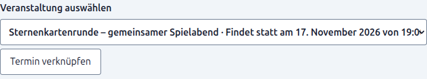
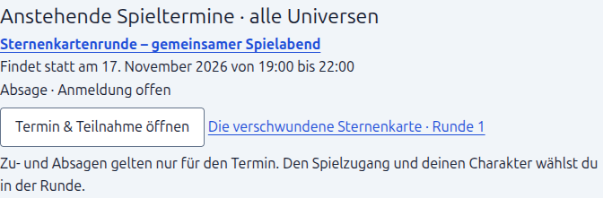
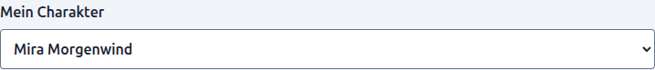
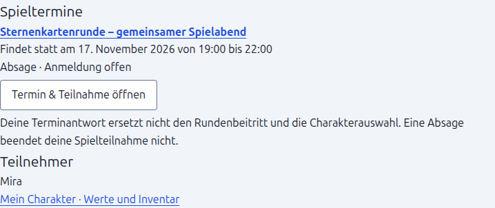

# Erweiterung: PS Events

[Zum Pluginhandbuch](handbuch.md#24-spieltermine-mit-ps-events)

Mit **PS Events / Events & Bookings** können Spielgruppen ihre Spielabende
planen und zu- oder absagen. Pen & Paper zeigt die verknüpften Termine direkt
bei den Spielen an. Ein zweiter Kalender oder eine zweite Anmeldeliste ist
nicht erforderlich.

**Die Aufgaben bleiben getrennt:**

| PS Events | Pen & Paper |
| --- | --- |
| Veranstaltung, Datum, Uhrzeit und Veranstaltungsort | Universum, Kampagne und Spielrunde |
| Anmeldung und Zu-/Absagen | Spielzugang und Charakterwahl |
| Aktivierte Veranstaltungs-Zusatzfunktionen | Figuren, Spielverlauf und Spielstand |

Die Screenshots zeigen echte Browserabläufe mit vorübergehenden Beispieldaten
aus „Die verschwundene Sternenkarte“. Diese Beispieldaten werden nicht
mitinstalliert; die Bilder zeigen unterschiedliche Schritte und Terminantworten.
Das Aussehen der Veranstaltungsseite richtet sich nach dem verwendeten Theme
und den PS-Events-Einstellungen.

## 1. Erweiterung aktivieren

1. **PS Events** installieren, sofern es noch nicht vorhanden ist.
   Der Pluginordner heißt `events-and-bookings`.
2. Unter **Plugins** auf der Website aktivieren, auf der auch Pen & Paper
   verwendet wird. In einem Netzwerk ist die betreffende Unterwebsite gemeint.
3. Die Spielleitung benötigt Verwaltungsrechte für ihre Kampagne oder Runde
   **und** Bearbeitungsrechte für die gewünschte Veranstaltung.
   Kampagnenrechte vergeben nicht automatisch Veranstaltungsrechte.

PS Events bleibt optional. Ohne die Erweiterung sind die Spielfunktionen
weiterhin nutzbar; es erscheinen keine leeren Terminbereiche.

## 2. Einen Spielabend vorbereiten

In der Veranstaltungsverwaltung von PS Events eine Veranstaltung anlegen:

- Einen verständlichen Namen und eine Beschreibung des Spielabends eintragen.
- Gültige Start- und Endzeiten sowie gegebenenfalls den Treffpunkt festlegen.
- Die Anmeldung nach den Möglichkeiten von PS Events konfigurieren.
- Die Sichtbarkeit bewusst wählen und die Veranstaltung veröffentlichen
  oder privat speichern.

Bei wiederkehrenden Veranstaltungen wird später der **einzelne
veröffentlichte Veranstaltungstermin** verknüpft, nicht die Serienvorlage.

**Wichtig zur Sichtbarkeit:** Eine geschlossene Kampagne macht eine öffentliche
Veranstaltung nicht privat. Keine Spielgeheimnisse in öffentliche
Veranstaltungstexte schreiben. Umgekehrt erhalten Kampagnenmitglieder nicht
automatisch Leserechte für eine private Veranstaltung.

## 3. Veranstaltung mit dem Spiel verknüpfen

1. In Pen & Paper ausdrücklich zu **Spielleitung** wechseln und unter
   **Kampagnen → Vorbereiten → Zugang & Einstellungen** die Kampagne öffnen.
   Für einen Rundentermin stattdessen **Spielrunden leiten** und die gewünschte
   Runde öffnen.
2. Dort **Spieltermine verwalten** aufklappen. In der Spieleransicht wird nur
   der verknüpfte Termin angezeigt, nicht seine Verwaltung.
3. Unter **Veranstaltung auswählen** den passenden Termin wählen.
4. **Termin verknüpfen** drücken.

*Die Spielleitung wählt eine vorhandene, für sie bearbeitbare Veranstaltung.*

Die Zuordnung ist auch über die Kampagneneinstellungen erreichbar:

- **An der Kampagne:** Der Termin erscheint im Kampagnenkontext und beim
  Öffnen ihrer Runden.
- **An einer konkreten Runde:** Der Termin gehört zu dieser Runde.

Neue Runden kopieren keine eigenen Terminverknüpfungen aus ihrer
Kampagnenvorlage. Ein gemeinsamer Kampagnentermin kann dennoch weiterhin
über den Kampagnenkontext angezeigt werden.

## 4. Spieltermine in der Game-Lounge finden

Die **Game-Lounge** sammelt anstehende Spieltermine über alle Universen hinweg.
Auch die Verwaltungsübersicht bietet diese Übersicht. Angezeigt werden nur
Termine aus zugänglichen Spielkontexten, die das Mitglied auch nach den
Veranstaltungsrechten lesen darf.

*Die Lounge zeigt Datum, eigene Terminantwort und Links zur Veranstaltung
sowie zur zugehörigen Runde. Im Beispiel wurde bereits abgesagt.*

**Termin & Teilnahme öffnen** führt auf die originale Veranstaltungsseite.
Der danebenstehende Spiel-Link führt zurück zum passenden Spielkontext.
Vergangene Termine verschwinden aus der Liste anstehender Spieltermine,
bleiben aber in ihrer Kampagnen- oder Rundenansicht erreichbar.

## 5. Zu- oder absagen

1. In der Terminanzeige **Termin & Teilnahme öffnen** wählen.
2. Auf der Veranstaltungsseite die gewünschte Antwort geben, beispielsweise
   **Ich nehme teil** oder **Absage**.
3. Zur Lounge oder Runde zurückkehren. Dort wird die eigene Antwort aus
   PS Events angezeigt.

*Die Antwort wird direkt in PS Events abgegeben. Nach der Zusage ist
„Ich nehme teil“ bereits ausgewählt; eine Änderung bleibt möglich.*

Anmeldung, verfügbare Plätze, Zahlungsregeln und weitere aktivierte
Veranstaltungsfunktionen richten sich nach PS Events und seinen Zusatzmodulen.
Pen & Paper führt keine eigene Teilnehmerliste für den Termin.

## 6. Charakter und Rundenbeitritt bleiben getrennt

**Eine Terminzusage ist kein Rundenbeitritt.** In der Runde den passenden
Charakter unter **Mein Charakter** auswählen und anschließend
**Mit diesem Charakter teilnehmen** drücken.

*Die Figur wird ausdrücklich in Pen & Paper gewählt, nicht durch die Terminzusage.*

Ebenso gilt: **Eine Terminabsage beendet keine Spielteilnahme.** Ein bereits
gewählter Charakter, die Rundenmitgliedschaft und der Spielstand bleiben erhalten.
Zum Verlassen der Runde dient weiterhin die separate Aktion **Runde verlassen**.

*Mira hat den Spielabend abgesagt, bleibt aber Teilnehmerin der Runde und
behält den Zugriff auf ihren Charakter.*

Auch eine durch die Veranstaltungsleitung abgesagte Veranstaltung beendet
nicht automatisch die Spielrunde.

## 7. Zuordnungen lösen, deaktivieren und sichern

- **Verknüpfung lösen** entfernt nur die Zuordnung zum Spiel.
  Veranstaltung, Zu-/Absagen, Charaktere und Spielstände bleiben erhalten.
  Auch Verweise auf inzwischen gelöschte oder unzugängliche Veranstaltungen
  lassen sich lösen.
- Wird PS Events deaktiviert, verschwinden Terminanzeigen und
  Zuordnungsformulare. Die gespeicherten Zuordnungen bleiben bestehen und
  werden nach erneuter Aktivierung wieder verwendet, sofern der Termin
  weiterhin vorhanden und zugänglich ist.
- Gelöschte, unveröffentlichte oder nicht lesbare Veranstaltungen werden
  Spielern nicht ausgegeben. Private Solo-Rundentermine anderer Spieler
  bleiben verborgen.
- Eine exportierte **Kampagnensicherung enthält keine Veranstaltungen,
  Anmeldungen oder lokalen Terminverknüpfungen**. Nach Import oder ersetzendem
  Wiederherstellen passende lokale Veranstaltungen neu verknüpfen.
  Die Veranstaltungs- und Buchungsdaten von PS Events müssen separat in der
  Website-Sicherung enthalten sein.

## 8. Hilfe und geprüfter Umfang

**Kein Termin auswählbar:** Aktivierung auf der richtigen Website,
Veranstaltungsrechte und gültige Zeitangaben prüfen. Bereits verknüpfte
Veranstaltungen werden nicht erneut angeboten.

**Spieler sehen einen Termin nicht:** Sowohl den Spielzugang als auch
Veröffentlichung, Privatstatus und Passwortschutz der Veranstaltung prüfen.

**Der Veranstaltungseditor leitet zum Dashboard um:** Eine eingeschränkte
Verwaltungsoberfläche wie Easy Blogging kann diesen Bereich ausblenden oder
umleiten. Die Website-Administration muss den Veranstaltungsbereich für die
zuständige Rolle zugänglich machen. Zusätzliche Kampagnenrechte allein
heben diese Einschränkung nicht auf.

**Die Teilnahme wird als fremde Anmeldung abgewiesen:** PS Events auf den
aktuellen Stand bringen. Im verwendeten Teilnahmeformular wurde bei dieser
Integration eine falsche Benutzerzuordnung korrigiert.

Auf der ClassicPress-Entwicklungswebsite wurden Verknüpfen, Lösen und erneutes
Verknüpfen, die Lounge-Anzeige, native Zusage und Absage sowie die separate
Charakterwahl über echte Browserformulare geprüft. Nach der Zusage blieb die
Runde zunächst ohne Teilnehmer; nach der Charakterwahl entfernte eine Absage
weder Teilnehmer noch Figur. Buchungsantwort und Rundenstand wurden zusätzlich
direkt über die gespeicherten Daten kontrolliert. Ein Außenstehender sah weder
die geschlossene Beispielkampagne noch ihren Rundentermin und erhielt auch
über die direkte Rundenadresse keinen Zugang.

**Grenze dieser Abnahme:** Das Anlegen im nativen Veranstaltungseditor war
wegen der vorhandenen Easy-Mode-Konfiguration nicht im Browser prüfbar.
Die Beispielveranstaltung wurde deshalb über die nativen WordPress- und
PS-Events-Schnittstellen vorbereitet. Die Browserprüfung ersetzt keine
vollständige Prüfung aller Themes, Zahlungswege, Serien und Zusatzmodule.
