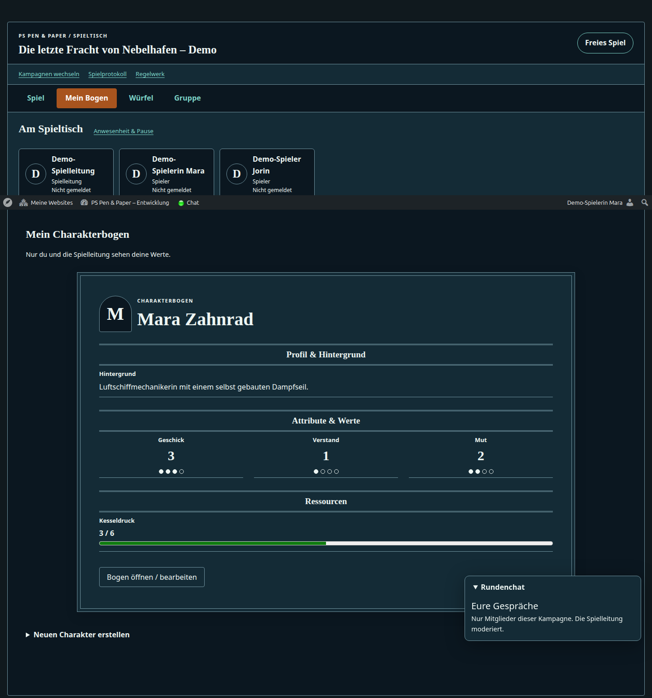
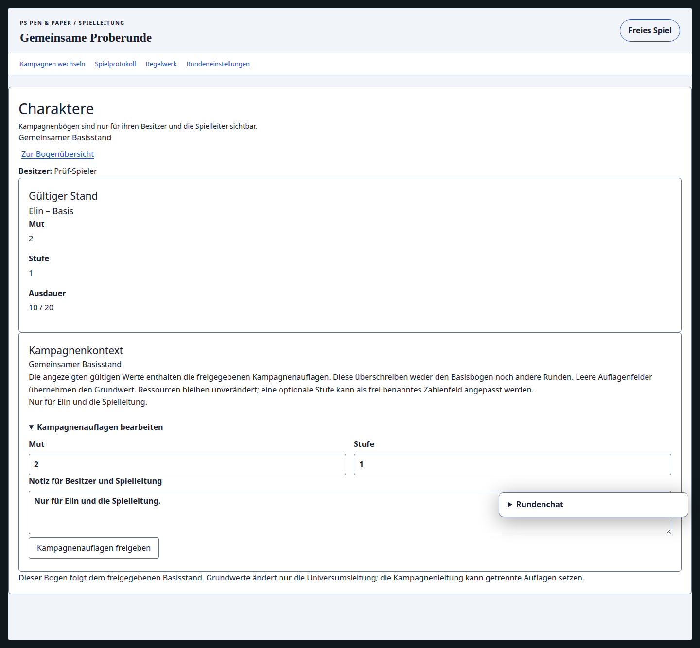
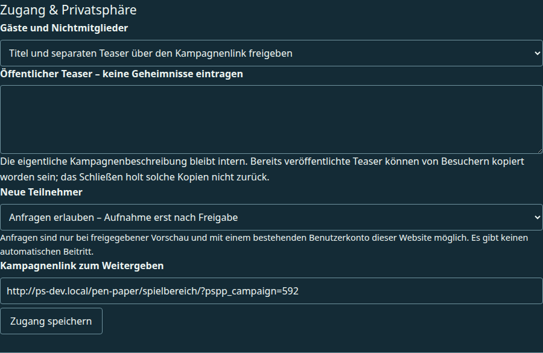
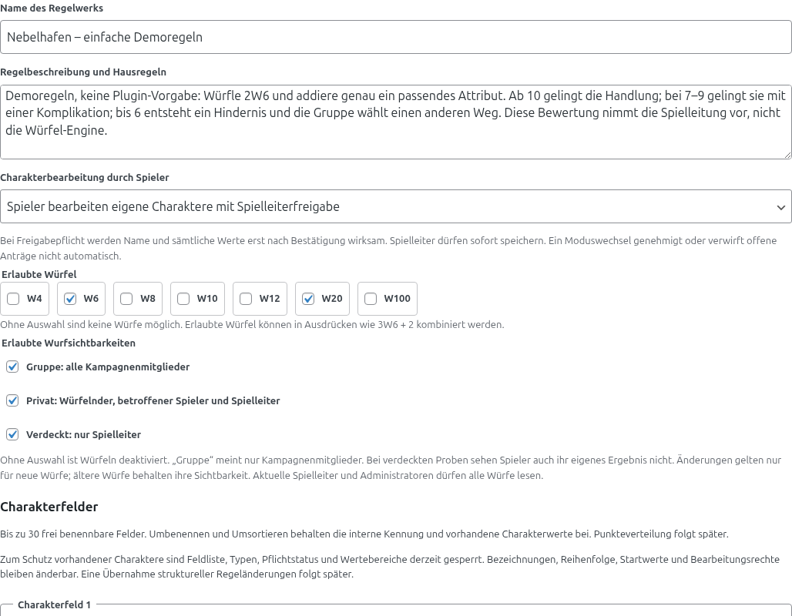
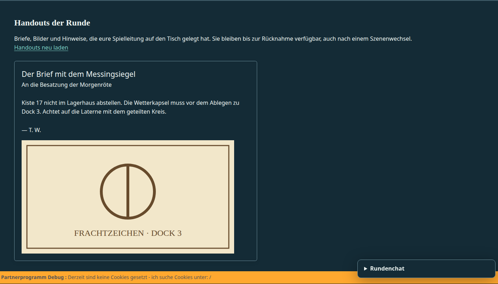
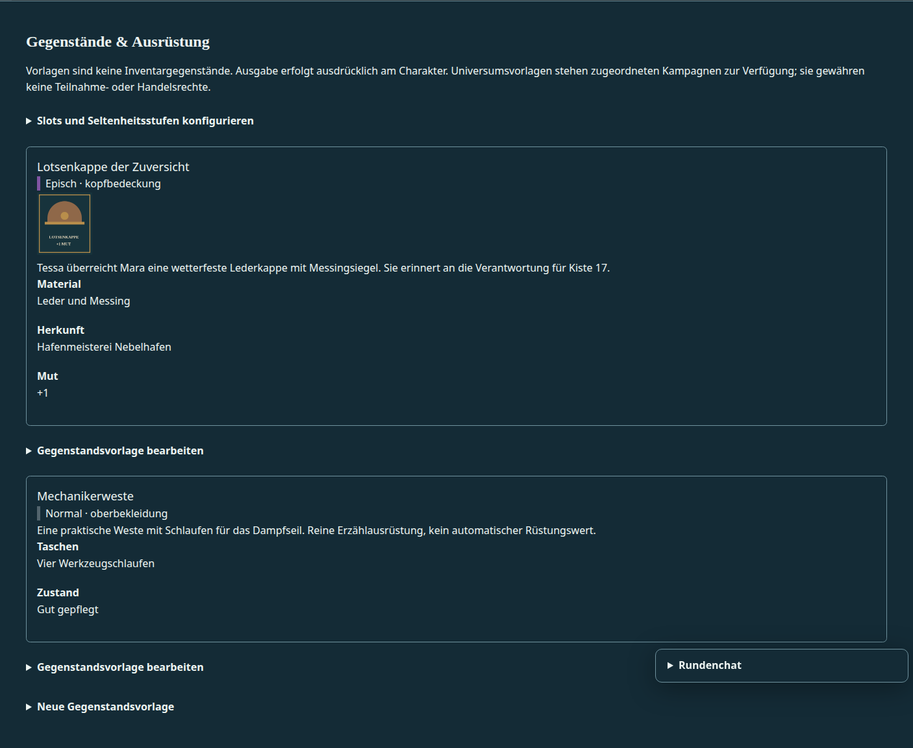

# PS Pen & Paper – Pluginhandbuch

Stand: Version 0.14.0 · 14. November 2026.

Dieses Handbuch beschreibt den vorhandenen Funktionsumfang, nicht die gesamte
Roadmap. Die Abbildungen zur Demorunde stammen aus der tatsächlich angelegten
[Demokampagne „Die letzte Fracht von Nebelhafen“](demokampagne.md).
Ihre Welt, Namen und Demoregeln sind Beispiele, keine Vorgaben des Plugins.
Die Universums- und Kartenabbildungen zeigen getrennte, anschließend entfernte Prüfwelten.
Eine fremde Partnerprogramm-Debugleiste wurde nur für diese Aufnahmen ausgeblendet.

## Inhalt

1. [Ist das schon spielbar?](#1-ist-das-schon-spielbar)
2. [Installation und Spielbereich](#2-installation-und-spielbereich)
3. [Kampagnen und Mitglieder](#3-kampagnen-und-mitglieder)
4. [Regeln und Charakterfelder](#4-regeln-und-charakterfelder)
5. [Charaktere und Freigaben](#5-charaktere-und-freigaben)
6. [Würfeln](#6-würfeln)
7. [Ressourcen verwalten](#7-ressourcen-verwalten)
8. [Spielprotokoll lesen](#8-spielprotokoll-lesen)
9. [Farben anpassen](#9-farben-anpassen)
10. [Handy und Tablet](#10-handy-und-tablet)
11. [Probleme und Grenzen](#11-probleme-und-grenzen)
12. [Szenen und Kartentisch](#12-szenen-und-kartentisch)
13. [Spielleitermappe, Kapitel und Handouts](#13-spielleitermappe-kapitel-und-handouts)
14. [Porträts und Bogenhintergründe](#14-porträts-und-bogenhintergründe)
15. [Community-Profil, Gegenstände und Ausrüstung](#15-community-profil-gegenstände-und-ausrüstung)

## 1. Ist das schon spielbar?

**Ja: Der erste vollständige Ablauf von Szenenvorbereitung und Freigabe bis zum
gemeinsamen Kartentisch ist vorhanden.** Ein umfangreicher Abenteuereditor ist
das noch nicht; Kapitel, eine private Spielleitermappe und Text-/Bild-Handouts
sind seit 0.13.0 enthalten.

| Bereits nutzbar | Noch nicht vorhanden |
|---|---|
| Getrennte Kampagnen, Mitgliedschaften und Kapitel mit Szenenfolge | Sitzungsplanung und öffentliche Zusammenfassungen |
| Szenenentwürfe, getrennte Geheimnisse und bewusste Freigaben | Umfangreiche NPC-Verwaltung und Begegnungen |
| Private Inhaltsvorschau und geschützter Kartentisch | Nebel des Krieges und Zeichenwerkzeuge |
| Frei benennbare Charakterfelder, Basisbögen und Freigaben | Grafischer, frei positionierbarer Slotdesigner |
| Würfel, Attributwerte und geschützte Ergebnisse | Automatische Erfolgsbewertung oder komplexe Würfelmechaniken |
| Änderungs- und Wurfprotokoll | Automatisch geprüfter Punktepool |
| Spielleitermappe, geschützte Text-/Bild-Handouts und responsive Bedienung | Strukturierte NPC-Werte und private PDF-Dateien |
| Private Porträts sowie Community-gebundene Kataloge, Inventare und Ausrüstung | Handel, Stapelmengen und automatische Gegenstandssynchronisierung |

Die Spielleitung kann Szenentexte und Karten vorbereiten und gezielt anzeigen.
Die Kampagnenbeschreibung eignet sich weiter für eine gemeinsame Einleitung,
**nicht für Geheimnisse**. Dafür gibt es das getrennte Geheimnisfeld der Szene.
PS Chat lässt sich mit den ergänzten Spieltisch-Schnittstellen geschützt
einbetten; PS Wiki ist noch nicht mit Kampagnenrechten verbunden.

## 2. Installation und Spielbereich

1. Plugin auf der gewünschten Website aktivieren. In einem Netzwerk auf die
   richtige Unterwebsite achten.
2. Eine normale Seite anlegen und genau einmal `[ps_pen_paper]` einfügen.
3. Optional die Seitenvorlage **„PS Pen & Paper – Spielbereich“** auswählen,
   wenn kein Theme-Layout verwendet werden soll.
4. Die Seite veröffentlichen und angemeldet öffnen.
5. Bei Seiten-Caches oder CDNs die Seite **einschließlich ihrer
   Abfrageparameter vom Caching ausschließen**.

Auf unserer Entwicklungswebsite besteht der
[Spielbereich](http://ps-dev.local/pen-paper/spielbereich/) bereits.
Das Plugin legt eine solche Seite nicht automatisch an.

Standardmäßig erhalten Gäste eine Anmeldeaufforderung. Die Spielleitung kann
einen separaten Teaser ausdrücklich freigeben; der Spieltisch bleibt trotzdem
geschützt. Eine öffentliche Spielseite macht interne Kampagnendaten nicht öffentlich.


*Ausschnitt aus Maras echter Spieleransicht. Zusätzliche Einstellungen für
Spielleiter sind dort nicht eingeblendet.*

### Der Spieltisch

Die kompakte Gruppenleiste steht oberhalb der großen Spielfläche.
„Mein Bogen“ öffnet den gegliederten Charakterbogen mit Profil, Attributen
und Ressourcen. Spielleiter sehen unter „Bögen“ auch die Bögen ihrer Spieler
und offene Anträge. Würfel, Regelwerk und Spielprotokoll öffnen eigene
Bereiche; „Bogen öffnen / bearbeiten“ führt zum privaten Detailbogen.
Das eigentliche Eingabeformular wird dort erst über „Bogen bearbeiten“ geöffnet.

Die Spielleitung bestimmt unter „Wer ist am Zug?“ einen Teilnehmer oder
„Freies Spiel“. Der Zugmarker wird für die Gruppe aktualisiert und im
Protokoll festgehalten. Er ist keine automatische Initiativeberechnung.

### Anwesenheit und kurze Pausen

- „Anwesenheit teilen“ freiwillig aktivieren. Sonst steht dort „Nicht gemeldet“.
- Für eine Pause eine optionale kurze Notiz wie „Küche“ eingeben und
  „Kurze Pause / AFK“ drücken.
- Mit „Wieder da“ zur aktiven Anwesenheit zurückkehren.
- „Status nicht mehr teilen“ beendet die Anzeige.

Die Aktualisierung erfolgt bei sichtbarer Seite alle 30 Sekunden. Mehr als
zwei Minuten ohne Meldung bedeutet „Offline“, nicht zwingend eine Abmeldung.
AFK wird durch Hintergrundmeldungen nicht aufgehoben und überspringt keinen
Zug. Es gibt keine Anwesenheitshistorie; aktuelle Meldungen laufen nach
höchstens einem Tag aus. Verbindungs- und Browserpausen können die Anzeige
verzögern.

### Rundenchat

„Rundenchat“ öffnet die Chatbox in der Bildschirmecke. Nachrichten und
Moderation stammen aus PS Chat; Spielleiter sind Moderatoren ihres Raums.
Zugang haben nur aktuelle Kampagnenmitglieder sowie Website-Administratoren.
Eine getrennte Anmeldung zu einzelnen Sitzungen gibt es noch nicht.



Erforderlich ist PS Chat mit den im
[technischen Überblick](../README.md#optionaler-rundenchat-mit-ps-chat)
beschriebenen Spieltisch-Schnittstellen. Ohne passende Integration erscheint
ein Hinweis. Chatverlauf und Spielprotokoll sind getrennt; Würfelergebnisse
werden nicht automatisch als Nachrichten übertragen.

## 3. Kampagnen und Mitglieder

Unter **Pen & Paper** im Backend:

1. Als Website-Administrator eine Kampagne erstellen oder einem Benutzer die
   Berechtigung **„Kampagnen erstellen“** geben.
2. Name und gemeinsame Beschreibung speichern.
3. Bereits vorhandene Mitglieder dieser Website als **Spieler** oder
   **Spielleiter** aufnehmen.
4. Regelwerk einrichten, bevor die ersten Charaktere entstehen.

Die Kampagnenrolle ist nicht dieselbe wie die WordPress-Benutzerrolle.
Ein Benutzer kann in einer Kampagne Spielleiter und in einer anderen Spieler
sein. Der Ersteller bleibt Spielleiter und kann nicht entfernt werden.
Administratoren können alle Kampagnen verwalten.
Netzwerk-Superadmins sehen und verwalten auch ohne Mitgliedschaft auf der
jeweiligen Unterwebsite sämtliche dortigen Kampagnen, Bögen, Protokolle und Chats.

### Übersichtliche Verwaltungsbereiche

Im Backend unter **Pen & Paper** und auf der Startseite des Frontend-Spielbereichs:

- **Übersicht:** Orientierung und Erklärung des Einstiegs.
- **Universen:** Welten, Regelvorlagen und Basisbögen verwalten; Kampagnen zuordnen.
- **Kampagnen:** Runde wählen; die Backend-Ansicht erlaubt Berechtigten die Anlage.
- **Charakterverwaltung:** eigene und als Spielleitung verwaltbare Bögen finden.
- **Einstellungen:** verwaltbare Runde wählen; Zugang, Anfragen, Bilder und Farben
  direkt im Frontend ändern. Globale Erstellberechtigungen bleiben im Backend.

### Universum anlegen und Kampagnen zuordnen

1. Als Administrator oder mit der Erstellberechtigung unter **Universen**
   einen Namen und eine interne Weltbeschreibung speichern.
2. Unter **Kampagne zuordnen oder lösen** die eigene Kampagne und das
   Zieluniversum wählen. **Ohne Universum** löst eine vorhandene Zuordnung.
3. **Zuordnung prüfen** öffnet die Vorschau. Die bisherige Zuordnung bleibt
   dabei unverändert.
4. Die Vorschau lesen, das Bestätigungsfeld markieren und **Zuordnung bestätigen**
   wählen. Veraltete Zuordnungen oder zwischenzeitlich geänderte Zieluniversen
   erfordern eine neue Vorschau.

Nur Ersteller und Administration verwalten ein Universum. Zum Zuordnen sind
zusätzlich Verwaltungsrechte für die Kampagne und gegebenenfalls das bisherige
Universum erforderlich. Ein Universum zeigt ausschließlich Kampagnen, auf die
die angemeldete Person ohnehin Zugriff hat. Mitgliedschaften und Chat-Rechte
werden nicht vererbt; Spieler sehen auch nicht die interne Weltbeschreibung.

Universumsänderungen stehen im eigenen Änderungsverlauf, Zuordnungen nur für
die Spielleitung im jeweiligen Kampagnenprotokoll. Die Universumsansicht zeigt
die letzten 20 Änderungen; ältere Datensätze bleiben gespeichert.

Die Zuordnung allein verändert weiterhin keine Regeln, Bögen oder Freigaben.
Nutzt eine Kampagne gemeinsame Basisbögen, ist das Lösen oder Wechseln derzeit
gesperrt. Unabhängige Kopien dürfen ihre Universumszuordnung dagegen verlieren.

### Regelvorlage und Basisbögen verwenden

1. Im Universum **Regelwerk & Basischaraktere** öffnen.
2. **Universumsregelwerk bearbeiten** aufklappen. Felder, Wertebereiche, Startwerte,
   erlaubte Würfel und Wurfsichtbarkeiten festlegen und speichern.
   Die Spielerbearbeitung ist eine Vorgabe für spätere Kampagnen; Basisbögen
   bearbeitet unabhängig davon ausschließlich die Universumsleitung.
3. Einen **Basischarakter** für ein leseberechtigtes Mitglied dieser Website
   anlegen. Der Besitz öffnet noch keine Kampagne und keine Universumsverwaltung.
4. Eine neue, noch unkonfigurierte Kampagne zuordnen und den Besitzer dort als
   Teilnehmer aufnehmen. Die persönliche Aufnahme erfolgt weiterhin im Backend,
   alternativ entscheidet die Spielleitung über einen Beitrittsantrag.
5. Unter **In eine Kampagne übernehmen** die **Regelvorlage übernehmen**
   ausdrücklich bestätigen. Das funktioniert nur ohne gespeichertes
   Kampagnenregelwerk und ohne Charaktere. Die Feldkennungen bleiben erhalten;
   spätere Vorlagenänderungen werden nicht automatisch nachgezogen.
6. Einen freigegebenen Basisbogen wählen, **Gemeinsamer Basisstand** oder
   **Unabhängige Kampagnenkopie** auswählen und die Übernahme bestätigen.


*Die getrennte Prüfwelt besitzt einen Basisbogen und zwei zugeordnete Runden.
Die ausdrücklich gewählte Übernahme ändert keine Mitgliedschaften.*

**Gemeinsamer Basisstand:** Änderungen am freigegebenen Basisbogen erscheinen
auch in seinen gemeinsamen Kampagnenbögen. Grundwerte und Ressourcen werden im
Universum bearbeitet, nicht im Kampagnenbogen. Offene Basisanträge bleiben privat.

**Unabhängige Kampagnenkopie:** Nur der aktuelle freigegebene Stand wird
übernommen. Die Kopie hat danach eigene Bearbeitung und Freigaben entsprechend
dem Kampagnenregelwerk; späterer Basisfortschritt verändert sie nicht.
Sie bleibt auch bei fehlender Basis oder gelöster Universumszuordnung nutzbar.

Zur Übernahme muss dieselbe Person Universum und Kampagne verwalten dürfen;
die Feldkennungen und Wertebereiche müssen zusammenpassen. Bestehende
Kampagnen werden nicht automatisch migriert oder überschrieben.

### Kampagnenbezogene Handicaps und Stufen

Die Kampagnenleitung öffnet den übernommenen Bogen und klappt unter
**Kampagnenkontext** den Bereich **Kampagnenauflagen bearbeiten** auf.
Für Zahlen- und Attributfelder lassen sich absolute ganze Werte innerhalb
der Regelgrenzen eintragen, beispielsweise Mut 2 oder Stufe 1.
**Kampagnenauflagen freigeben** macht diese Werte nur in dieser Kampagne wirksam.
Ein leeres Feld übernimmt wieder den Grundwert. Das gilt für gemeinsame Bögen
und unabhängige Kopien gleichermaßen.



*Elins Basis besitzt Mut 8 und Stufe 3. In der gemeinsamen Proberunde gelten
wegen ihrer lokalen Auflagen Mut 2 und Stufe 1. Andere Runden bleiben unverändert.*

Angezeigt und gewürfelt wird mit dem effektiven Stand. Basis und andere Runden
werden nicht überschrieben; auch bei einer Bearbeitung der Kopie bleiben ihre
gesonderten Auflagen erhalten. Notiz und Änderungshistorie sehen nur Besitzer,
aktuelle Spielleitung und Administration. Nur die Kampagnenleitung erteilt
Auflagen; dafür sind keine Verwaltungsrechte am Universum erforderlich.
Basisänderungen stehen dagegen in der geschützten Universumshistorie.

Ressourcenauflagen, ein späterer Wechsel zwischen gemeinsamem Stand und Kopie,
Spieleranträge für Basisbögen sowie universumsweite Mitgliedschaften fehlen noch.
Eine frei benannte numerische Stufe ist möglich, aber noch kein XP-System oder
automatischer Stufenaufstieg. Eine fehlende gemeinsame Basis erzeugt einen
sichtbaren Fehler statt eines veralteten Ersatzbogens.

### Später auf Englisch übersetzen

Die Textdomain heißt **`ps-pen-paper`**. Aus
[`languages/ps-pen-paper.pot`](../languages/ps-pen-paper.pot) lässt sich etwa mit
Poedit ein englischer Katalog erstellen. Diesen als
`languages/ps-pen-paper-en_US.po` und die kompilierte
`languages/ps-pen-paper-en_US.mo` speichern; für britisches Englisch `en_GB`
verwenden. WordPress beziehungsweise ClassicPress wählt die Übersetzung anhand
der Website- oder Benutzersprache.

Noch wird kein fertiger englischer Katalog ausgeliefert. Nicht übersetzte
Plugintexte bleiben deutsch. Selbst verfasste Weltbeschreibungen, Regelbegriffe
und Spielinhalte werden nicht automatisch übersetzt.

### Als Spieler anmelden und einen Bogen erstellen

1. Ein Benutzerkonto beim Website-Betreiber erhalten oder dessen normale
   Registrierung verwenden, falls diese freigegeben ist. Das Plugin selbst
   bietet noch keine Kontoregistrierung an.
2. Im Spielbereich **Anmelden** wählen.
3. Den Kampagnenlink von der Spielleitung öffnen.
4. Falls angeboten, **Teilnahme beantragen** wählen und die Entscheidung abwarten.
   Sonst nimmt die Spielleitung dich persönlich auf.
5. Nach der Aufnahme die Runde unter **Kampagnen** öffnen.
6. **Ersten Charakter erstellen** beziehungsweise **Mein Bogen → Neuen Charakter
   erstellen** öffnen, den Bogen ausfüllen und speichern.
7. Wenn das Regelwerk es verlangt, die Freigabe durch die Spielleitung abwarten.

Eine offene Anfrage gewährt noch keinen Spiel- oder Chat-Zugang.
Die Aufnahme als Spieler gewährt keine Spielleiterrechte.

### Gäste, Vorschau und Beitrittsanfragen

Unter **Rundeneinstellungen → Zugang & Privatsphäre** entscheidet die Spielleitung:

- **Geschlossen:** keine Kampagnendaten für Gäste und Nichtmitglieder.
- **Titel und separaten Teaser freigeben:** nur diese zwei Angaben sind über den
  Kampagnenlink öffentlich sichtbar. Die interne Beschreibung wird nie übernommen.
- **Anfragen erlauben:** angemeldete Mitglieder dieser Website können bei
  freigegebener Vorschau eine Aufnahme beantragen.
- **Persönliche Aufnahme:** die Spielleitung fügt vorhandene Benutzer selbst hinzu.



Teilnehmerliste, Anwesenheit, Hintergrundbild, Bögen, Würfe, Protokoll und Chat
bleiben geschützt. Es gibt keine öffentliche Kampagnenübersicht; die Vorschau
wird über den weitergegebenen Link geöffnet. Unter **Beitrittsanfragen** nimmt
die Spielleitung Antragsteller als Spieler auf oder lehnt sie ab. Bereits offene
Anfragen lassen sich auch nach Schließen der Vorschau noch entscheiden.
Nach einer Ablehnung oder beendeten Teilnahme ist eine erneute automatische
Anfrage gesperrt; für eine spätere Aufnahme die Spielleitung kontaktieren.

Einladungen und die automatische Aufnahme in eine Netzwerk-Unterwebsite sind
noch nicht enthalten. Benutzer müssen dort bereits Mitglied sein.
**„Archiviert“ ist derzeit nur eine Kennzeichnung, keine Schreibsperre.**

**Praxishinweis zur Entwicklungswebsite:** Der normale Demo-Spielleiter wurde
beim Backend-Zugriff umgeleitet. Zugang, Beitrittsanfragen, Bilder und Farben
sind inzwischen direkt im Frontend erreichbar; Anträge, Freigaben und Würfe funktionieren
über den Frontend-Spielbereich auch für die normalen Demokonten.
Für selbstständige Spielleiter muss dieser Backend-Zugriff vor einem Einsatz
auf dieser Website geklärt werden. Nicht pauschal Administratorrechte vergeben.

## 4. Regeln und Charakterfelder

Im **Regelwerk** werden Name, Beschreibung, erlaubte Würfel, Wurfsichtbarkeiten
und die Bearbeitungspolitik für Charaktere festgelegt.



*Ausschnitt aus der Verwaltung: In der Demo sind W6 und W20 sowie alle drei
Sichtbarkeiten erlaubt.*

Bis zu 30 Felder sind möglich:

| Feldtyp | Verwendung |
|---|---|
| Kurzer Text | Herkunft, Beruf oder andere frei benannte Angaben |
| Langer Text | Hintergrundgeschichte und ausführliche Notizen |
| Zahl | Ganzzahliger Wert mit Grenzen und Startwert |
| Attribut | Ganzzahliger Wert, auch zum Addieren bei Würfen |
| Ressource | Aktueller Wert und persönliches Maximum |

Bezeichnungen, Erläuterungen und Reihenfolge sind frei. Bei Zahlenfeldern
liegen Minimum, Maximum und Startwert zwischen −1000000 und 1000000.
Felder werden über Schaltflächen hinzugefügt, verschoben und entfernt.

### Bestehende Regeln ändern

- **Umbenennen** erhält die interne Feldkennung und vorhandene Werte.
- **Neue Startwerte** überschreiben keine bestehenden Charakterwerte.
- Sobald Charaktere existieren, sind Änderungen an Feldliste, Typen,
  Pflichtstatus und Wertebereichen vorläufig gesperrt.
- Neue Regeländerungen werden mit Vorher-/Nachher-Ständen protokolliert.
- Bei einem Konflikt die Seite neu laden und die Änderung erneut prüfen.

Eine automatische Übernahme struktureller Regeländerungen gibt es noch nicht.
In der Demo wurde „Dampf“ nach dem Spielen zu „Kesseldruck“ umbenannt:
Die Ressource blieb erhalten.

## 5. Charaktere und Freigaben

Spieler öffnen ihre Kampagne im Spielbereich und erstellen dort ihren eigenen
Charakter. Spielleiter können auch Charaktere für andere Mitglieder erstellen.
Name und Felder werden serverseitig geprüft.

Die Spielleitung wählt pro Kampagne:

- **Mit Freigabe:** Spieleränderungen bleiben zunächst ein Antrag.
- **Direkt:** Spieleränderungen werden unmittelbar gültig.
- **Nur Spielleiter:** Spieler können ihre Bögen lesen, aber nicht bearbeiten.

Im Freigabemodus zeigt die Charakterseite **„Gültiger Stand“** und gegebenenfalls
**„Offener Antrag“** getrennt. Spielleiter können **„Freigeben“** oder
**„Antrag verwerfen“** wählen. Eine Ablehnung verändert den gültigen Stand nicht.
Ein noch nicht freigegebener neuer Charakter kann nicht für Attributwürfe
verwendet werden.


*Dies ist die historische Vorher-/Nachher-Ansicht von Maras Erstanlage:
Der Antrag war gespeichert, aber noch kein Wert freigegeben. Die spätere
Freigabe ist ein eigener Protokolleintrag.*

Ein neuer Spielerantrag ersetzt den vorherigen Antrag. Eine direkte Speicherung
durch den Spielleiter übernimmt die Werte sofort und entfernt einen offenen
Antrag. Ein Wechsel der Bearbeitungspolitik allein genehmigt keine Anträge.

Charakterbögen sehen derzeit nur Besitzer und aktuelle Spielleiter
beziehungsweise Administratoren, nicht automatisch die ganze Gruppe.
Gewöhnliche Bögen bleiben kampagnengebunden. Aus einem Universum übernommene
Bögen folgen dem ausdrücklich gewählten gemeinsamen oder unabhängigen Modus
und können zusätzliche lokale Zahlenauflagen besitzen; siehe Abschnitt 3.

## 6. Würfeln

Unter **„Würfel / Protokoll“**:

1. Einen erlaubten Würfel über die Schnellwahl wählen oder den Ausdruck eingeben.
2. Optional einen freigegebenen eigenen Charakter auswählen.
3. Optional ein Zahlen- oder Attributfeld addieren.
4. Sichtbarkeit und gegebenenfalls Anlass wählen.
5. **„Jetzt würfeln“** drücken.

Bei übernommenen Basisbögen speichert der Wurf neben dem tatsächlichen
Attributwert auch Basis- und Kontextrevision. Diese stehen unter
**Einzelwürfe und Modifikatoren**. Private Auflagennotizen werden nicht in
Gruppenwürfe übernommen. Spätere Basis- oder Auflagenänderungen verändern
keinen bereits gespeicherten Wurf.

Beispiele: `3W6 + 2`, `W20 + 2W6 - 1`, `D100`.
Erlaubt sind höchstens zehn addierte Würfelgruppen mit insgesamt 100 Würfeln
und ein abschließender ganzzahliger Modifikator bis ±1000000.
Die Kampagne kann die Würfel und Sichtbarkeiten weiter einschränken.

**Attribut nicht doppelt addieren:** Für `2W6 + Geschick` in der Demo nur
`2W6` eingeben und Geschick im Auswahlfeld wählen.
Verwendet wird der freigegebene Zahlenwert, kein automatisch abgeleiteter Bonus.


*Echtes Demowurfergebnis: 1 + 1 + Geschick 3 = 5. Die Würfel wurden nicht
für ein schöneres Ergebnis erneut geworfen.*

| Sichtbarkeit | Wer liest das Ergebnis? |
|---|---|
| Gruppe | Aktuelle Kampagnenmitglieder, keine anonymen Besucher |
| Privat | Würfelnder, ausgewählter Charakterbesitzer und aktuelle Spielleiter |
| Verdeckt | Nur aktuelle Spielleiter und Administratoren |

Bei einer verdeckten Spielerprobe erhält der Spieler nur eine Bestätigung.
Eine Gruppenprobe teilt auch den gewählten Charakternamen und Attributwert.
Spielleiter können für andere Mitglieder würfeln.

Würfe werden auf dem Server gespeichert. Die Animation verändert keine Zahlen.
Neuladen einer Ergebnisseite würfelt nicht erneut.
**Erfolg, Komplikationen und Ressourcenverbrauch bewertet die Spielleitung.**

## 7. Ressourcen verwalten

Ressourcen haben einen aktuellen Wert und ein persönliches Maximum.
Beide müssen im erlaubten Bereich liegen; aktuell darf nicht größer als das
persönliche Maximum sein.

Eine Ressource wird über den Charakterbogen verändert. Im Freigabemodus wird
auch ein Verbrauch zunächst beantragt. Würfeln zieht nicht automatisch etwas ab.


*Vor der Freigabe: gültig 4/6, beantragt 3/6. Nach der Freigabe: gültig 3/6.
Der historische Feldname „Dampf“ bleibt im Protokoll erhalten.*

## 8. Spielprotokoll lesen

**„Spielprotokoll“** zeigt Würfe, Regeländerungen, Charakteränderungen, Anträge,
Freigaben, Ablehnungen und Zugwechsel. Über **„Änderung ansehen: Vorher / Nachher“** werden
die damaligen Stände geöffnet.


- 20 berechtigte Ereignisse pro Seite; weitere Seiten über die Navigation.
- Charakterereignisse bleiben privat für Besitzer und aktuelle Spielleiter.
- Die damalige Bearbeitung allein verschafft ehemaligen Spielleitern keinen
  dauerhaften Zugriff auf fremde Charakterdaten.
- Entfernte Mitglieder verlieren auch den Zugriff auf ältere eigene Einträge.
- Neue Korrekturen erzeugen neue Ereignisse; alte Einträge werden nicht bearbeitet.

Charakter- und Regelhistorie beginnen mit Version 0.7.0. Frühere Änderungen
werden nicht rückwirkend ergänzt. Mitglieder- und Style-Änderungen werden
derzeit nicht protokolliert. Seit 0.12.0 stehen Szenenentwürfe, Freigaben,
Rücknahmen und Kartenbewegungen mit privaten Vorher-/Nachher-Ständen im
Spielleiterprotokoll; die Gruppe sieht Szenenwechsel mit freigegebenem Titel.
Änderungen an Zugang und Teaser werden seit Version 0.9.0 mit Vorher/Nachher
ausschließlich für Spielleitung und Administration protokolliert.

## 9. Farben anpassen

Unter **„Rundeneinstellungen“ → „Farben & Lesbarkeit anpassen“**:

1. Hintergrund, Flächen, Text, Schaltflächen, Links und Rahmen auswählen.
2. Live-Vorschau und Kontrasthinweise prüfen.
3. **„Gestaltung speichern“** drücken.


Hex-Farben haben sechs Stellen, etwa `#142b36`.
Die Schrift auf Schaltflächen wird automatisch schwarz oder weiß gewählt.
Der Kontrastrichtwert beträgt 4,5:1; Hinweise verhindern das Speichern nicht.
**„Standardfarben laden“** setzt zunächst nur die Eingaben zurück.
Die Farben verändern nicht das Theme oder andere Kampagnen.

### Ein eigenes Bild für den Spieltisch

Unter **Rundeneinstellungen → Bild für den Spieltisch** ein PNG-, JPEG- oder
WebP-Bild auswählen und **Hintergrund speichern** drücken. Erlaubt sind
höchstens 2 MiB und 3000 × 3000 Pixel; SVG und externe Bildadressen nicht.
Nur Bilder verwenden, für die die nötigen Rechte vorliegen.

Das Bild wird geschützt in der Datenbank gespeichert und nur an berechtigte
Betrachter ausgeliefert, nicht über eine öffentliche Mediathek-Adresse.
**Hintergrund entfernen** stellt den bildfreien Tisch wieder her und löscht
die gespeicherten Bilddaten. Ein Ersatzbild entfernt das vorherige; auch beim
endgültigen Löschen der Kampagne werden ihre Bilddaten gelöscht.
Für schnelle mobile Darstellung möglichst kleine Dateien verwenden.
Private Charakterporträts und eigene Bogenhintergründe sind seit 0.14.0
vorhanden; siehe Abschnitt 14. Für diese Bilder bleiben historische Stände
erhalten, anders als beim austauschbaren Spieltischhintergrund.

## 10. Handy und Tablet

Die Oberfläche nutzt responsive Anordnung und große Bedienelemente.
Auf schmalen Ansichten wechseln „Spiel“, „Mein Bogen“, „Würfel“ und „Gruppe“
den sichtbaren Bereich. Der Zugstatus bleibt in der Bereichsnavigation sichtbar.
Die Abbildung wurde bei 390 Pixeln Browserbreite aufgenommen.


Es gibt keinen erforderlichen Drag-and-drop-Ablauf. Ein Betriebssystemwunsch
nach reduzierter Bewegung wird berücksichtigt. Ohne JavaScript bleiben
Formulare und Ergebnisse nutzbar; Schnellwahl, Live-Farbvorschau und Änderungen
an der Feldliste sowie Anwesenheit, Zugsteuerung und interaktive Karten benötigen JavaScript.

## 11. Probleme und Grenzen

| Problem | Prüfen |
|---|---|
| Keine Kampagne sichtbar | Anmeldung, richtige Unterwebsite und Mitgliedschaft |
| Kampagne kann nicht erstellt werden | Berechtigung durch einen Website-Administrator |
| Spielleiter landet auf einer anderen Backend-Seite | Weiterleitungen anderer Website-Komponenten prüfen lassen; Frontend-Aktionen gesondert testen |
| Charakter fehlt beim Würfeln | Freigegebener Stand, Besitzerrechte und aktuelle Mitgliedschaft |
| Verdecktes Ergebnis fehlt | Für Spieler beabsichtigt, kein Anzeigefehler |
| Werteänderung wirkt noch nicht | Offenen Freigabeantrag prüfen |
| Würfeln deaktiviert | Mindestens einen Würfel und eine Sichtbarkeit erlauben |
| Speicherkonflikt | Neu laden und gültigen Stand mit eigenen Änderungen abgleichen |
| Administratorprüfung angefordert | Nicht blind erneut speichern; unvollständigen Vorgang prüfen lassen |

Regel- und Charakteränderungen werden bei erkannten Speicherfehlern
revisionsgeschützt zurückgenommen, soweit das ohne Überschreiben anderer
Änderungen möglich ist. Andernfalls erscheint ein ausdrücklicher Fehler.
Das Protokoll ersetzt keine Datensicherung und ist kein manipulationssicheres
Audit-System.

### Was vor einem vollständigen Website-Abenteuer noch fehlt

Der erste **Story-Builder-Ablauf** mit Szenen, getrennten Geheimnissen,
Inhaltsvorschau, Freigabe, Rücknahme und Protokollierung ist vorhanden.
Kapitel mit geordneter Szenenfolge, private Personen-/Orts-/Notizkarten und
Text-/Bild-Handouts sind seit 0.13.0 vorhanden. Community-gebundene Inventare
und Ausrüstung ergänzen seit 0.14.0 den Charakterbereich. Handel,
redaktioneller Komfort und weitere Handoutdateiformate fehlen noch. Eine normale Medien-URL ist nicht
automatisch privat.
Auch die unterstützten WordPress-, ClassicPress- und PHP-Versionen müssen
noch verbindlich festgelegt und plattformübergreifend geprüft werden.

## 12. Szenen und Kartentisch

### Als Spielleitung vorbereiten

1. Im Spielbereich **Szenen & Karten** öffnen. Im Backend befindet sich derselbe
   Editor in der Kampagnenverwaltung.
2. Unter **Neue Szene** Titel und freizugebenden Text eintragen.
3. **Geheimnisse – nur Spielleitung** getrennt ausfüllen. Dieses Feld erscheint
   weder in der Spielervorschau noch in den Kartenantworten für Spieler.
   Für eine reine Erzählszene direkt zu Schritt 7 gehen: Neue Szenen beginnen
   ohne Raster; ohne Bild und Marker wird keine leere Kartenfläche angezeigt.
   Die folgenden Kartenfelder liegen unter **Optionale Karte und Figurenmarker**.
4. Optional ein PNG-, JPEG- oder WebP-Kartenbild hochladen: höchstens 2 MiB und
   3000 × 3000 Pixel. Ohne Bild ist eine neutrale Kartenfläche möglich.
5. **Quadratraster** auf 10–500 Bildpixel setzen; **0** bedeutet ohne Raster
   und ohne Einrasten.
6. Über **Marker hinzufügen** bis zu 30 Figuren oder Gegenstände anlegen:
   sichtbarer Name, Typ, Farbe, Bewegungsberechtigter und Startposition.
   X und Y sind Prozentwerte von 0 bis 100; 50 bedeutet die Kartenmitte.
7. **Entwurf speichern** und **Gespeicherten Entwurf als Spieler ansehen** öffnen.
   Diese private Inhaltsvorschau ist ohne Figurensteuerung und zeigt nur den
   gespeicherten Stand, nicht ungespeicherte Eingaben.


*Die schematische Prüfkarte ist ein Beispiel, kein mitgeliefertes Spielsystem.*

### Bewusst freigeben und anzeigen

1. Das Bestätigungsfeld lesen und **Gespeicherten Entwurf freigeben** wählen.
   Das veröffentlicht noch keine andere Szene am Tisch.
2. **Freigegebene Szene am Tisch anzeigen** wechselt die gemeinsame Ansicht.
3. Neue Änderungen zunächst wieder als Entwurf speichern. Der bisherige
   veröffentlichte Stand bleibt sichtbar, bis du erneut freigibst.
4. **Freigabe zurücknehmen** sperrt weitere Spielerabrufe dieser Szene und ihres
   Bildes. Die Spielansicht kehrt nach der nächsten Aktualisierung zur Einleitung
   zurück. **Zur Rundeneinleitung wechseln** lässt sich auch unabhängig davon nutzen.

**Wichtig:** Eine erneute Freigabe übernimmt die vorbereiteten Startpositionen.
Zwischenzeitlich am Tisch bewegte Positionen werden dabei ersetzt.
Jede Bewegung erhöht die Szenenrevision. War ein Bearbeitungsformular bereits
offen, kann sein Speichern deshalb eine Aktualisierung verlangen; fremde Änderungen
werden nicht still überschrieben.

### Gemeinsam auf der Karte spielen


- **+**, **−** und **Einpassen** steuern den Ausschnitt. Die Karte lässt sich
  ziehen; Mausrad oder zwei Finger verändern den Zoom.
- Eine zugewiesene Figur wählen und ihr Ziel antippen oder die Figur ziehen.
  Alternativ **Figur ohne Ziehen bewegen** öffnen und X/Y eingeben.
  Per Tastatur lässt sich der Figurenmarker mit Eingabe oder Leertaste auswählen;
  danach sind die Positionsfelder fokussiert.
- Die Spielleitung bewegt alle Marker. Spieler bewegen ausschließlich ihre
  ausdrücklich zugewiesenen Marker, nicht automatisch jede Spielerfigur.
- **Ping setzen** wählen und auf die Karte tippen. Der Hinweis trägt den
  tatsächlichen Absender und läuft nach spätestens 15 Sekunden aus.

Die aktuelle Karte wird auf sichtbaren Browserseiten alle fünf Sekunden
aktualisiert. Bewegungen und Szenenwechsel erscheinen deshalb gegebenenfalls
leicht verzögert. Positionen bleiben über Neuladen und Abmelden hinaus gespeichert.
Eine Mitgliedschaftsänderung wird bei neuen Abrufen und Bewegungen geprüft.

Alle freigegebenen Marker sind für die Runde sichtbar. Namen bewusst wählen;
private Charakterwerte werden nicht automatisch an einen Marker angehängt.
Raster und Bewegung prüfen weder Reichweite noch Kollisionen oder Spielregeln.
Nebel des Krieges, versteckte Marker, Zeichenwerkzeuge und Entfernungsmessung
sind noch nicht vorhanden.

### Bildschutz und Aufbewahrung

Kartenbilder liegen in privaten Datensätzen ohne öffentliche Mediathek-Adresse.
Spieler erhalten nur das Bild der aktuellen freigegebenen Szene. Alte Bildstände
bleiben geschützt für die Historie gespeichert und werden beim endgültigen
Löschen der Kampagne entfernt. Kleine Dateien verwenden und die Datenbank sichern.
Bereits betrachtete oder heruntergeladene Inhalte können durch eine Rücknahme
nicht nachträglich aus fremden Browsern oder Kopien entfernt werden.

### Zu den Abbildungen

Die Bilder zeigen echte angemeldete Rollenansichten und gespeicherte Demodaten.
Browsernavigation und fremde Debug-Einblendungen sind für die Abbildungen
ausgespart beziehungsweise nur während der Aufnahme ausgeblendet.

## 13. Spielleitermappe, Kapitel und Handouts

### Abenteuer in der Spielleitermappe vorbereiten

1. Als Spielleitung im Spielbereich **Spielleitermappe** öffnen. Im Backend
   steht derselbe Bereich in der Kampagnenverwaltung zur Verfügung.
2. **Neuer Mappeneintrag** wählen und die Art festlegen: Kapitel, Handout,
   Person, Ort oder Notiz. Die Art lässt sich nach dem Anlegen nicht umstellen.
3. Titel, Inhalt und gegebenenfalls geheime Ergänzungen eintragen.
   Personen, Orte, Kapitel und Notizen bleiben vollständig privat.
4. Über die Sortiernummer die Reihenfolge innerhalb der jeweiligen Rubrik
   festlegen. Kleinere Zahlen erscheinen zuerst.
5. Optional ein Kapitel und eine Szene verknüpfen. Die Verknüpfung dient der
   Vorbereitung und verändert weder Mitgliedschaften noch Freigaben.
6. **Mappeneintrag speichern**. Bei einem Revisionskonflikt den aktuellen
   Stand neu laden; Änderungen werden nicht still überschrieben.

Eine Personenkarte ist eine erzählerische Gedächtnisstütze, kein verpflichtender
Gegnerbogen. Ortskarten sammeln Atmosphäre und Hinweise; Notizen eignen sich
für die eigene Vorbereitung oder eine private Zusammenfassung.

### Kapitel und Szenenfolge

Ein Kapitel zunächst speichern und dann erneut bearbeiten. Unter **Szenen im
Kapitel** neben jeder gewünschten Szene eine Reihenfolgenummer eintragen.
Ein leeres Feld nimmt die Szene nicht auf. Bis zu 100 Szenen sind pro Kapitel
möglich; eine Szene kann in mehreren Kapiteln vermerkt sein.

Die Kapitelübersicht zeigt die geordnete Folge mit Links und Freigabestatus.
Ein Link öffnet die Szenenvorbereitung. **Eine Kapitelzuordnung veröffentlicht
keine Szene und wechselt nicht die aktive Szene.** Dafür weiterhin die
ausdrücklichen Szenenaktionen aus Abschnitt 12 verwenden.


### Ein Handout auf den Tisch legen

1. Einen Eintrag der Art **Handout** mit Titel und Text speichern.
2. Optional ein eigenes PNG-, JPEG- oder WebP-Bild hochladen, höchstens 2 MiB
   und 3000 × 3000 Pixel. PDFs und andere Dateien sind nicht unterstützt.
3. **Private Vorschau des gespeicherten Handoutentwurfs** öffnen.
4. Die Bestätigung markieren und **Handout für die Runde freigeben** wählen.
5. Spieler öffnen **Handouts** beziehungsweise **Handouts neu laden**.

Die Gruppe erhält ausschließlich den freigegebenen Titel, Text und das Bild.
Geheime Ergänzungen, Kapitel- und Szenenverknüpfungen bleiben in der
Spielleitermappe. Handouts bleiben auch nach einem Szenenwechsel zugänglich.
Die Freigabe gilt für die gesamte aktuelle Kampagnengruppe, nicht für einzelne
Empfänger. Auch die Spielleitung sieht unter **Handouts** nur freigegebene Stände.



### Überarbeiten, zurücknehmen und schützen

Entwurfsänderungen verändern ein bereits freigegebenes Handout nicht. Erst eine
erneute bestätigte Freigabe ersetzt den Gruppenstand. Ein Bild kann aus dem
Entwurf entfernt oder ersetzt werden; Entfernung und Ersatz sind getrennte
Aktionen. Historische Bilder bleiben für die Historie bis zur endgültigen
Kampagnenlöschung in der Datenbank.

**Handout zurücknehmen** verhindert die Ausgabe bei neuen Seitenabrufen.
Es gibt keine automatische Handoutaktualisierung und keine Möglichkeit,
bereits gelesene oder gespeicherte Inhalte aus fremden Browsern zurückzuholen.
Nach Entzug der Kampagnenmitgliedschaft sind auch die Handouts nicht mehr
abrufbar. Die Spielbereich-Seite einschließlich ihrer Abfrageparameter darf
nicht öffentlich zwischengespeichert werden.

Mappenänderungen, Handoutfreigaben und Rücknahmen besitzen private
Vorher-/Nachher-Protokolle für die Spielleitung. Die neuen Abbildungen zeigen
die tatsächlich fortgesetzte Nebelhafen-Demo; ihre Charaktere, Regeln und
ursprünglichen Würfe wurden dafür nicht zurückgesetzt.
Für diese Mappenabbildungen wurden keine Spielwerte oder Berechtigungen geändert.

## 14. Porträts und Bogenhintergründe

Diese Gestaltung funktioniert **auch ohne PS Community**.

1. Den eigenen Charakter über **Mein Bogen → Bogen bearbeiten** beziehungsweise
   die Charakterverwaltung öffnen.
2. Unter **Charakterporträt** ein PNG-, JPEG- oder WebP-Bild auswählen.
3. **Porträt einreichen / speichern** drücken. Im Freigabemodus sieht die
   Spielleitung den Antrag getrennt und wählt **Porträt freigeben** oder
   **Porträtantrag verwerfen**. Bis dahin bleibt das bisherige Bild gültig.
4. **Porträt entfernen / beantragen** entfernt das Bild je nach
   Bearbeitungspolitik sofort oder erst nach Freigabe.

Bei **Nur Spielleiter** können Besitzer keine Bilder ändern. Porträtanträge
ändern keine Charakterwerte und benötigen keine erneute Wertefreigabe.
Gemeinsame Basisbögen können trotzdem ein lokales Kampagnenporträt erhalten.
Das Bild erscheint nur auf berechtigten Charakterbögen für Besitzer und
Spielleitung, nicht als öffentlicher Community-Avatar oder Teilnehmeravatar.

Den Hintergrund bestimmt die Spielleitung unter **Rundeneinstellungen →
Bogenhintergrund der Kampagne**. Er erscheint dezent hinter dem gültigen
Charakterbogen. **Bogenhintergrund entfernen** schaltet die Dekoration aus.
Ein Ausschnitt-/Positionseditor ist noch nicht vorhanden.


Alle drei Bildarten – Porträt, Bogenhintergrund und Gegenstandsgrafik –
verwenden den privaten Bildspeicher: höchstens 2 MiB und 3000 × 3000 Pixel,
keine SVGs oder externen Bildadressen. Historische Bilder bleiben für
Protokolle und ausgegebene Gegenstände bis zur Löschung ihres Ursprungs
gespeichert. Nur Bilder mit passenden Nutzungsrechten verwenden und die
Datenbank regelmäßig sichern.

## 15. Community-Profil, Gegenstände und Ausrüstung

### Voraussetzungen und privater Profil-Tab

PS Community auf derselben Website aktivieren. In der lokal geprüften
Community-Version müssen **Profil** und **Aktivität** eingeschaltet sein,
damit die Profil-Tab-Schnittstellen geladen werden. Eine veröffentlichte
Profilseite mit `[cpc-activity-page]` anlegen und in Community zuordnen,
falls noch keine vorhanden ist. Bei aktiviertem Permalinkmodus muss die
zugehörige Community-Profiladresse erreichbar sein.

Im **eigenen** Profil **Pen & Paper** öffnen und den eigenen
Kampagnencharakter auswählen. Alternativ führt **Mein Charakterprofil**
am Spieltisch dorthin. Im Tab lassen sich Bogen, Porträt und Ausrüstung
bearbeiten. **Zur Bogenübersicht** führt zur eigenen Profilauswahl zurück.
Profilformulare werden auf der Frontend-Profilseite verarbeitet und bleiben
nach dem Speichern dort.

Andere Profilbesucher und Freunde erhalten weder fremde Bögen noch Inventare.
Auch ein direkter Community-AJAX-Aufruf vergibt keine zusätzlichen Rechte.
Mitgliedschaft und Charakterbesitz bleiben erforderlich.
**Die Profilseite einschließlich ihrer Parameter vom Seiten-Cache ausschließen.**

### Als Spielleitung Slots und Seltenheiten festlegen

Im Spielbereich **Gegenstände → Slots und Seltenheitsstufen konfigurieren**
öffnen. Derselbe Katalog ist in der Backend-Kampagnenverwaltung und für
Universumsleitungen beim jeweiligen Universum erreichbar.

Beispiel für Slots, eine Zeile pro Slot:

```text
kopf | Kopf | kopfbedeckung
arme | Arme | armschutz
brust | Brust | oberbekleidung
```

Die drei Teile sind **stabile Kennung | sichtbarer Name | passender
Gegenstandstyp**. Eine Kopfbedeckung passt nur in einen entsprechend
konfigurierten Slot. Eine konkrete Instanz darf nicht gleichzeitig mehrere
Slots belegen. Bestehende Kennungen dürfen nicht entfernt und Slottypen
nicht umgedeutet werden; Namen bleiben änderbar.

Beispiel für unabhängige Seltenheitsstufen:

```text
normal | Normal | #52646d
episch | Episch | #8054a3
```

Bezeichnungen und Farben bestimmt die Spielleitung. Eine Farbe ist nie die
einzige Kennzeichnung. **Episch** erzeugt keinen automatischen Multiplikator.
Bis zu 30 Slots und 30 Seltenheiten sind je Vorlage möglich. Kampagnen legen
ihre Slots selbst fest, auch wenn sie Universumsgegenstände verwenden.

### Gegenstandsvorlagen erstellen und Exemplare ausgeben

1. **Neue Gegenstandsvorlage** öffnen.
2. Namen, Beschreibung, Typ und Seltenheit eintragen.
3. Freie Eigenschaften als `Bezeichnung | Wert` ergänzen.
4. Optional ausdrücklich ganzzahlige Boni auf Zahlen- oder Attributfelder
   setzen. Ressourcen und Textfelder sind keine Bonusziele.
5. Optional eine geschützte Grafik hochladen und die Vorlage speichern.
6. Den gewünschten Charakter öffnen und **Ein Exemplar ausgeben: …** wählen.
   Erst diese Aktion erzeugt Besitz; eine Katalogvorlage allein liegt
   noch in keinem Inventar.



Zugeordnete Kampagnen können Universumsvorlagen und eigene Ergänzungen
verwenden. Standalone-Kampagnen verwenden ihren eigenen Katalog.
Vorlagenänderungen gelten nur für spätere Ausgaben, nicht für bereits
ausgegebene Exemplare. Ein Charakter besitzt zunächst höchstens 100
einzelne Exemplare; Stapelmengen und eine Entzugs-/Löschoberfläche fehlen.

### Ausrüstung auswählen und freigeben

Im Charakter unter **Inventar & Ausrüstung** bei jedem Slot ein passendes
eigenes Exemplar oder **Leer** wählen. Über **Ausrüstung speichern /
einreichen** speichern. Im Freigabemodus bleibt die bisherige Belegung
wirksam, bis die Spielleitung **Ausrüstung freigeben** wählt. Die
Auswahlfelder zeigen bei offenem Antrag den beantragten Stand; die Übersicht
darunter zeigt die gültige Belegung. Ein neuer Antrag ersetzt den bisherigen.


Angelegte, freigegebene Boni werden addiert; die Grundwerte bleiben erhalten.
In der Demo gibt die Lotsenkappe **Mut +1**: Grundwert **2**, effektiver
Bogenwert **3**. Im Bearbeitungsformular steht weiter der Grundwert **2**.
Den Bonus beim Würfeln **nicht noch einmal** zum Ausdruck addieren.


Der tatsächliche Wurf verwendet Mut 3 und speichert Ausrüstungsrevision,
Slotrevision und enthaltene Boni. Alte Würfe ändern sich nicht beim Ablegen
oder bei späteren Vorlagenänderungen.

### Grenzen, Fehlerbehebung und Deaktivierung

Feldgrenzen gelten einschließlich Boni. Unzulässiges Anlegen oder eine
unzulässige Grundwert-/Auflagenänderung wird ausdrücklich abgelehnt.
Bei gemeinsamem Basisfortschritt kann eine andere Kampagnenausrüstung
nachträglich ungültig werden. Dann werden keine still gekürzten Werte oder
Würfe erzeugt. Über **Ausrüstung prüfen** in der eigenen Profilübersicht
bleibt die Slotverwaltung zugänglich. Besitzer können das Ablegen beantragen;
die Spielleitung kann es freigeben oder unmittelbar korrigieren.

Ohne aktives, verwendbares PS Community sind Katalog, Inventaroperationen
und Ausrüstung inaktiv; **auch Boni werden dann nicht angewandt**.
Gespeicherte Bestände werden nicht gelöscht. Charakterbögen, Porträts,
Geschichten und Würfel bleiben nutzbar. Bereits gespeicherte Würfe behalten
ihre damaligen Werte. Bei erneuter Aktivierung gelten die gespeicherten
Belegungen wieder, soweit die aktuellen Wertebereiche sie zulassen.

Schema- und Vorlagenänderungen stehen privat im Spielleiterprotokoll;
Inventar- und Porträtänderungen sind nur für Besitzer und aktuelle
Spielleitung sichtbar. Das ist keine Datenbanksicherung.

**Noch offen:** Handel, Stapelmengen, Mehrfachslot-Gegenstände, Entzug/
Entfernen von Exemplaren und ein frei positionierbarer grafischer Slotdesigner.
Die aktuelle Oberfläche verwendet zugängliche Auswahlfelder, kein Drag-and-drop.

Weiterlesen: [Demorunde mit Ergebnissen und Prüfbericht](demokampagne.md) ·
[Technischer Überblick](../README.md) · [Roadmap](../ROADMAP.md).
