# PS Pen & Paper – Pluginhandbuch

Stand: Version 0.25.0 · 15. November 2026.

Dieses Handbuch beschreibt den vorhandenen Funktionsumfang, nicht die gesamte
Roadmap. Die Abbildungen zur Demorunde stammen aus der tatsächlich angelegten
[Demokampagne „Die letzte Fracht von Nebelhafen“](demokampagne.md).
Ihre Welt, Namen und Demoregeln sind Beispiele, keine Vorgaben des Plugins.
Die Universums- und Kartenabbildungen zeigen getrennte, anschließend entfernte Prüfwelten.
Die Wiki-Abbildungen zeigen ein separat erhaltenes Lexikon-Demouniversum.
Eine fremde Partnerprogramm-Debugleiste wurde nur für diese Aufnahmen ausgeblendet.

## Inhalt

1. [Ist das schon spielbar?](#1-ist-das-schon-spielbar)
2. [Installation und Spielbereich](#2-installation-und-spielbereich)
3. [Kampagnen und Mitglieder](#3-kampagnen-und-mitglieder)
4. [Regeln und Charakterfelder](#4-regeln-und-charakterfelder)
5. [Charaktere und Freigaben](#5-charaktere-und-freigaben)
6. [Würfeln](#6-würfeln)
7. [Ressourcen verwalten](#7-ressourcen-verwalten)
8. [Spielprotokoll lesen](#8-spielprotokoll-lesen)
9. [Farben anpassen](#9-farben-anpassen)
10. [Handy und Tablet](#10-handy-und-tablet)
11. [Probleme und Grenzen](#11-probleme-und-grenzen)
12. [Szenen und Kartentisch](#12-szenen-und-kartentisch)
13. [Spielleitermappe, Kapitel und Handouts](#13-spielleitermappe-kapitel-und-handouts)
14. [Porträts und Bogenhintergründe](#14-porträts-und-bogenhintergründe)
15. [Community-Profil, Gegenstände und Ausrüstung](#15-community-profil-gegenstände-und-ausrüstung)
16. [Währung, Guthaben und Gegenstandsbindung](#16-währung-guthaben-und-gegenstandsbindung)
17. [Gegner, NPCs und Universumsvorlagen](#17-gegner-npcs-und-universumsvorlagen)
18. [Beutetabellen und bestätigte Vergabe](#18-beutetabellen-und-bestätigte-vergabe)
19. [Öffentliches Weltlexikon mit PS Wiki](#19-öffentliches-weltlexikon-mit-ps-wiki)
20. [Geschenke, Verkauf und Tausch](#20-geschenke-verkauf-und-tausch)
21. [Soloabenteuer](#21-soloabenteuer)

## 1. Ist das schon spielbar?

**Ja: Der erste vollständige Ablauf von Szenenvorbereitung und Freigabe bis zum
gemeinsamen Kartentisch ist vorhanden.** Ein umfangreicher Abenteuereditor ist
das noch nicht; Kapitel, eine private Spielleitermappe und Text-/Bild-Handouts
sind seit 0.13.0 enthalten.

| Bereits nutzbar | Noch nicht vorhanden |
|---|---|
| Getrennte Kampagnen, Mitgliedschaften und Kapitel mit Szenenfolge | Sitzungsplanung und öffentliche Zusammenfassungen |
| Szenenentwürfe, getrennte Geheimnisse und bewusste Freigaben | Umfangreiche NPC-Verwaltung und Begegnungen |
| Private Inhaltsvorschau und geschützter Kartentisch | Nebel des Krieges und Zeichenwerkzeuge |
| Frei benennbare Charakterfelder, Basisbögen und Freigaben | Grafischer, frei positionierbarer Slotdesigner |
| Würfel, Attributwerte und geschützte Ergebnisse | Automatische Erfolgsbewertung oder komplexe Würfelmechaniken |
| Änderungs- und Wurfprotokoll | Automatisch geprüfter Punktepool |
| Spielleitermappe, geschützte Text-/Bild-Handouts und responsive Bedienung | Strukturierte NPC-Werte und private PDF-Dateien |
| Private Porträts sowie Community-gebundene Inventare, Ausrüstung und kontrollierter Handel | Stapelmengen und automatische Gegenstandssynchronisierung |
| Soloabenteuer mit freigegebenen Szenen, UND-/ODER-Wertebedingungen, Proben, optionalen Kosten und Belohnungen sowie privaten Einzeldurchläufen | Gruppenabenteuer, hybride Freigabeschritte und Verbrauch gemeinsamer Basisressourcen |

Die Spielleitung kann Szenentexte und Karten vorbereiten und gezielt anzeigen.
Die Kampagnenbeschreibung eignet sich weiter für eine gemeinsame Einleitung,
**nicht für Geheimnisse**. Dafür gibt es das getrennte Geheimnisfeld der Szene.
PS Chat lässt sich mit den ergänzten Spieltisch-Schnittstellen geschützt
einbetten. Seit 0.19.0 ergänzt PS Wiki ein ausdrücklich freigegebenes
öffentliches Weltlexikon; private Kampagnen-Wikis sind nicht enthalten.

## 2. Installation und Spielbereich

1. Plugin auf der gewünschten Website aktivieren. In einem Netzwerk auf die
   richtige Unterwebsite achten.
2. Eine normale Seite anlegen und genau einmal `[ps_pen_paper]` einfügen.
3. Optional die Seitenvorlage **„PS Pen & Paper – Spielbereich“** auswählen,
   wenn kein Theme-Layout verwendet werden soll.
4. Die Seite veröffentlichen und angemeldet öffnen.
5. Bei Seiten-Caches oder CDNs die Seite **einschließlich ihrer
   Abfrageparameter vom Caching ausschließen**.

Auf unserer Entwicklungswebsite besteht der
[Spielbereich](http://ps-dev.local/pen-paper/spielbereich/) bereits.
Das Plugin legt eine solche Seite nicht automatisch an.

Standardmäßig erhalten Gäste eine Anmeldeaufforderung. Die Spielleitung kann
einen separaten Teaser ausdrücklich freigeben; der Spieltisch bleibt trotzdem
geschützt. Eine öffentliche Spielseite macht interne Kampagnendaten nicht öffentlich.


*Ausschnitt aus Maras echter Spieleransicht. Zusätzliche Einstellungen für
Spielleiter sind dort nicht eingeblendet.*

### Der Spieltisch

Die kompakte Gruppenleiste steht oberhalb der großen Spielfläche.
„Mein Bogen“ öffnet den gegliederten Charakterbogen mit Profil, Attributen
und Ressourcen. Spielleiter sehen unter „Bögen“ auch die Bögen ihrer Spieler
und offene Anträge. Würfel, Regelwerk und Spielprotokoll öffnen eigene
Bereiche; „Bogen öffnen / bearbeiten“ führt zum privaten Detailbogen.
Das eigentliche Eingabeformular wird dort erst über „Bogen bearbeiten“ geöffnet.

Die Spielleitung bestimmt unter „Wer ist am Zug?“ einen Teilnehmer oder
„Freies Spiel“. Der Zugmarker wird für die Gruppe aktualisiert und im
Protokoll festgehalten. Er ist keine automatische Initiativeberechnung.

### Anwesenheit und kurze Pausen

- „Anwesenheit teilen“ freiwillig aktivieren. Sonst steht dort „Nicht gemeldet“.
- Für eine Pause eine optionale kurze Notiz wie „Küche“ eingeben und
  „Kurze Pause / AFK“ drücken.
- Mit „Wieder da“ zur aktiven Anwesenheit zurückkehren.
- „Status nicht mehr teilen“ beendet die Anzeige.

Die Aktualisierung erfolgt bei sichtbarer Seite alle 30 Sekunden. Mehr als
zwei Minuten ohne Meldung bedeutet „Offline“, nicht zwingend eine Abmeldung.
AFK wird durch Hintergrundmeldungen nicht aufgehoben und überspringt keinen
Zug. Es gibt keine Anwesenheitshistorie; aktuelle Meldungen laufen nach
höchstens einem Tag aus. Verbindungs- und Browserpausen können die Anzeige
verzögern.

### Rundenchat

„Rundenchat“ öffnet die Chatbox in der Bildschirmecke. Nachrichten und
Moderation stammen aus PS Chat; Spielleiter sind Moderatoren ihres Raums.
Zugang haben nur aktuelle Kampagnenmitglieder sowie Website-Administratoren.
Eine getrennte Anmeldung zu einzelnen Sitzungen gibt es noch nicht.


Erforderlich ist PS Chat mit den im
[technischen Überblick](../README.md#optionaler-rundenchat-mit-ps-chat)
beschriebenen Spieltisch-Schnittstellen. Ohne passende Integration erscheint
ein Hinweis. Chatverlauf und Spielprotokoll sind getrennt; Würfelergebnisse
werden nicht automatisch als Nachrichten übertragen.

## 3. Kampagnen und Mitglieder

Unter **Pen & Paper** im Backend:

1. Als Website-Administrator eine Kampagne erstellen oder einem Benutzer die
   Berechtigung **„Kampagnen erstellen“** geben.
2. Name und gemeinsame Beschreibung speichern.
3. Bereits vorhandene Mitglieder dieser Website als **Spieler** oder
   **Spielleiter** aufnehmen.
4. Regelwerk einrichten, bevor die ersten Charaktere entstehen.

Die Kampagnenrolle ist nicht dieselbe wie die WordPress-Benutzerrolle.
Ein Benutzer kann in einer Kampagne Spielleiter und in einer anderen Spieler
sein. Der Ersteller bleibt Spielleiter und kann nicht entfernt werden.
Administratoren können alle Kampagnen verwalten.
Netzwerk-Superadmins sehen und verwalten auch ohne Mitgliedschaft auf der
jeweiligen Unterwebsite sämtliche dortigen Kampagnen, Bögen, Protokolle und Chats.

Aufnahme und Entfernung erscheinen jetzt mit damaligem Anzeigenamen,
Benutzerkennung und Rolle im Spielprotokoll – ausschließlich für aktuelle
Spielleiter und Administratoren. Veraltete Mitgliederformulare werden mit
einer Konfliktmeldung abgewiesen; dann neu laden und den aktuellen Stand prüfen.
Scheitert die zugehörige Protokollierung, bleibt die Mitgliedschaft unverändert.
Frühere Mitgliedschaftsänderungen werden nicht nachträglich eingetragen.

### Übersichtliche Verwaltungsbereiche

Im Backend unter **Pen & Paper** und auf der Startseite des Frontend-Spielbereichs:

- **Übersicht:** Orientierung und Erklärung des Einstiegs.
- **Universen:** Welten, Regelvorlagen und Basisbögen verwalten; Kampagnen zuordnen.
- **Kampagnen:** Runde wählen; die Backend-Ansicht erlaubt Berechtigten die Anlage.
- **Charakterverwaltung:** eigene und als Spielleitung verwaltbare Bögen finden.
- **Einstellungen:** verwaltbare Runde wählen; Zugang, Anfragen, Bilder und Farben
  direkt im Frontend ändern. Globale Erstellberechtigungen bleiben im Backend.

### Universum anlegen und Kampagnen zuordnen

1. Als Administrator oder mit der Erstellberechtigung unter **Universen**
   einen Namen und eine interne Weltbeschreibung speichern.
2. Unter **Kampagne zuordnen oder lösen** die eigene Kampagne und das
   Zieluniversum wählen. **Ohne Universum** löst eine vorhandene Zuordnung.
3. **Zuordnung prüfen** öffnet die Vorschau. Die bisherige Zuordnung bleibt
   dabei unverändert.
4. Die Vorschau lesen, das Bestätigungsfeld markieren und **Zuordnung bestätigen**
   wählen. Veraltete Zuordnungen oder zwischenzeitlich geänderte Zieluniversen
   erfordern eine neue Vorschau.

Nur Ersteller und Administration verwalten ein Universum. Zum Zuordnen sind
zusätzlich Verwaltungsrechte für die Kampagne und gegebenenfalls das bisherige
Universum erforderlich. Ein Universum zeigt ausschließlich Kampagnen, auf die
die angemeldete Person ohnehin Zugriff hat. Mitgliedschaften und Chat-Rechte
werden nicht vererbt; Spieler sehen auch nicht die interne Weltbeschreibung.

Universumsänderungen stehen im eigenen Änderungsverlauf, Zuordnungen nur für
die Spielleitung im jeweiligen Kampagnenprotokoll. Die Universumsansicht zeigt
die letzten 20 Änderungen; ältere Datensätze bleiben gespeichert.

Die Zuordnung allein verändert weiterhin keine Regeln, Bögen oder Freigaben.
Nutzt eine Kampagne gemeinsame Basisbögen, ist das Lösen oder Wechseln derzeit
gesperrt. Unabhängige Kopien dürfen ihre Universumszuordnung dagegen verlieren.

### Regelvorlage und Basisbögen verwenden

1. Im Universum **Regelwerk & Basischaraktere** öffnen.
2. **Universumsregelwerk bearbeiten** aufklappen. Felder, Wertebereiche, Startwerte,
   erlaubte Würfel und Wurfsichtbarkeiten festlegen und speichern.
   Die Spielerbearbeitung ist eine Vorgabe für spätere Kampagnen; Basisbögen
   bearbeitet unabhängig davon ausschließlich die Universumsleitung.
3. Einen **Basischarakter** für ein leseberechtigtes Mitglied dieser Website
   anlegen. Der Besitz öffnet noch keine Kampagne und keine Universumsverwaltung.
4. Eine neue, noch unkonfigurierte Kampagne zuordnen und den Besitzer dort als
   Teilnehmer aufnehmen. Die persönliche Aufnahme erfolgt weiterhin im Backend,
   alternativ entscheidet die Spielleitung über einen Beitrittsantrag.
5. Unter **In eine Kampagne übernehmen** die **Regelvorlage übernehmen**
   ausdrücklich bestätigen. Das funktioniert nur ohne gespeichertes
   Kampagnenregelwerk und ohne Charaktere. Die Feldkennungen bleiben erhalten;
   spätere Vorlagenänderungen werden nicht automatisch nachgezogen.
6. Einen freigegebenen Basisbogen wählen, **Gemeinsamer Basisstand** oder
   **Unabhängige Kampagnenkopie** auswählen und die Übernahme bestätigen.

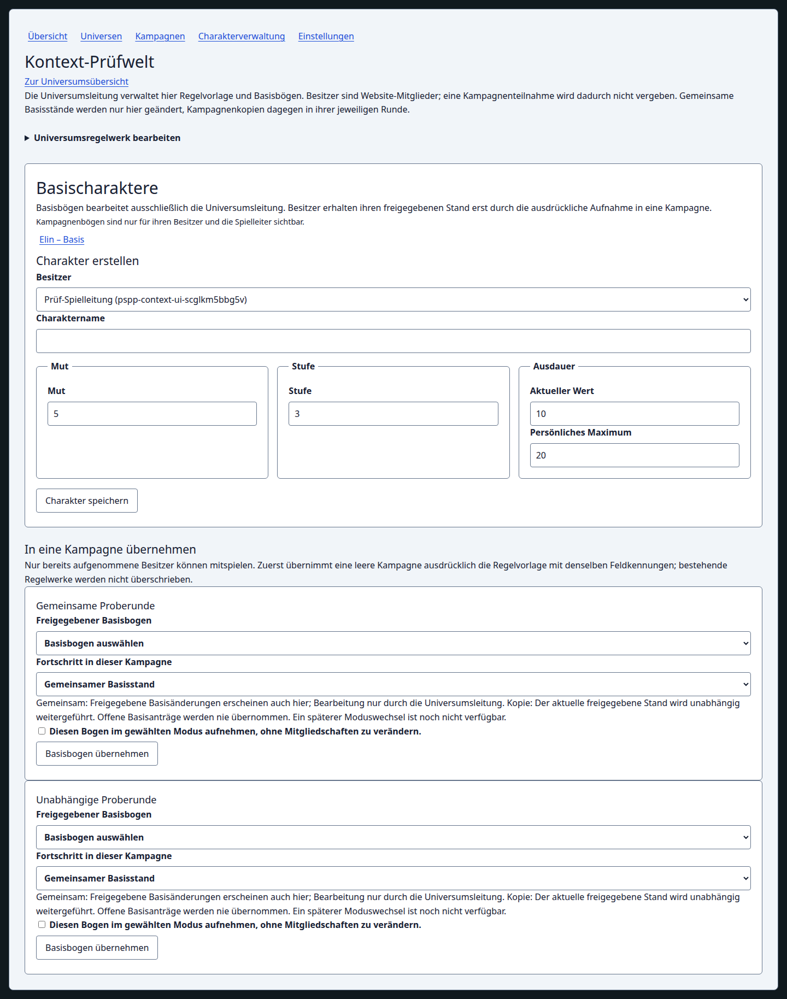

*Die getrennte Prüfwelt besitzt einen Basisbogen und zwei zugeordnete Runden.
Die ausdrücklich gewählte Übernahme ändert keine Mitgliedschaften.*

**Gemeinsamer Basisstand:** Änderungen am freigegebenen Basisbogen erscheinen
auch in seinen gemeinsamen Kampagnenbögen. Grundwerte und Ressourcen werden im
Universum bearbeitet, nicht im Kampagnenbogen. Offene Basisanträge bleiben privat.

**Unabhängige Kampagnenkopie:** Nur der aktuelle freigegebene Stand wird
übernommen. Die Kopie hat danach eigene Bearbeitung und Freigaben entsprechend
dem Kampagnenregelwerk; späterer Basisfortschritt verändert sie nicht.
Sie bleibt auch bei fehlender Basis oder gelöster Universumszuordnung nutzbar.

Zur Übernahme muss dieselbe Person Universum und Kampagne verwalten dürfen;
die Feldkennungen und Wertebereiche müssen zusammenpassen. Bestehende
Kampagnen werden nicht automatisch migriert oder überschrieben.

### Kampagnenbezogene Handicaps und Stufen

Die Kampagnenleitung öffnet den übernommenen Bogen und klappt unter
**Kampagnenkontext** den Bereich **Kampagnenauflagen bearbeiten** auf.
Für Zahlen- und Attributfelder lassen sich absolute ganze Werte innerhalb
der Regelgrenzen eintragen, beispielsweise Mut 2 oder Stufe 1.
**Kampagnenauflagen freigeben** macht diese Werte nur in dieser Kampagne wirksam.
Ein leeres Feld übernimmt wieder den Grundwert. Das gilt für gemeinsame Bögen
und unabhängige Kopien gleichermaßen.


*Elins Basis besitzt Mut 8 und Stufe 3. In der gemeinsamen Proberunde gelten
wegen ihrer lokalen Auflagen Mut 2 und Stufe 1. Andere Runden bleiben unverändert.*

Angezeigt und gewürfelt wird mit dem effektiven Stand. Basis und andere Runden
werden nicht überschrieben; auch bei einer Bearbeitung der Kopie bleiben ihre
gesonderten Auflagen erhalten. Notiz und Änderungshistorie sehen nur Besitzer,
aktuelle Spielleitung und Administration. Nur die Kampagnenleitung erteilt
Auflagen; dafür sind keine Verwaltungsrechte am Universum erforderlich.
Basisänderungen stehen dagegen in der geschützten Universumshistorie.

Ressourcenauflagen, ein späterer Wechsel zwischen gemeinsamem Stand und Kopie,
Spieleranträge für Basisbögen sowie universumsweite Mitgliedschaften fehlen noch.
Eine frei benannte numerische Stufe ist möglich, aber noch kein XP-System oder
automatischer Stufenaufstieg. Eine fehlende gemeinsame Basis erzeugt einen
sichtbaren Fehler statt eines veralteten Ersatzbogens.

### Später auf Englisch übersetzen

Die Textdomain heißt **`ps-pen-paper`**. Aus
[`languages/ps-pen-paper.pot`](../languages/ps-pen-paper.pot) lässt sich etwa mit
Poedit ein englischer Katalog erstellen. Diesen als
`languages/ps-pen-paper-en_US.po` und die kompilierte
`languages/ps-pen-paper-en_US.mo` speichern; für britisches Englisch `en_GB`
verwenden. WordPress beziehungsweise ClassicPress wählt die Übersetzung anhand
der Website- oder Benutzersprache.

Noch wird kein fertiger englischer Katalog ausgeliefert. Nicht übersetzte
Plugintexte bleiben deutsch. Selbst verfasste Weltbeschreibungen, Regelbegriffe
und Spielinhalte werden nicht automatisch übersetzt.

### Als Spieler anmelden und einen Bogen erstellen

1. Ein Benutzerkonto beim Website-Betreiber erhalten oder dessen normale
   Registrierung verwenden, falls diese freigegeben ist. Das Plugin selbst
   bietet noch keine Kontoregistrierung an.
2. Im Spielbereich **Anmelden** wählen.
3. Den Kampagnenlink von der Spielleitung öffnen.
4. Falls angeboten, **Teilnahme beantragen** wählen und die Entscheidung abwarten.
   Sonst nimmt die Spielleitung dich persönlich auf.
5. Nach der Aufnahme die Runde unter **Kampagnen** öffnen.
6. **Ersten Charakter erstellen** beziehungsweise **Mein Bogen → Neuen Charakter
   erstellen** öffnen, den Bogen ausfüllen und speichern.
7. Wenn das Regelwerk es verlangt, die Freigabe durch die Spielleitung abwarten.

Eine offene Anfrage gewährt noch keinen Spiel- oder Chat-Zugang.
Die Aufnahme als Spieler gewährt keine Spielleiterrechte.

### Gäste, Vorschau und Beitrittsanfragen

Unter **Rundeneinstellungen → Zugang & Privatsphäre** entscheidet die Spielleitung:

- **Geschlossen:** keine Kampagnendaten für Gäste und Nichtmitglieder.
- **Titel und separaten Teaser freigeben:** nur diese zwei Angaben sind über den
  Kampagnenlink öffentlich sichtbar. Die interne Beschreibung wird nie übernommen.
- **Anfragen erlauben:** angemeldete Mitglieder dieser Website können bei
  freigegebener Vorschau eine Aufnahme beantragen.
- **Persönliche Aufnahme:** die Spielleitung fügt vorhandene Benutzer selbst hinzu.


Teilnehmerliste, Anwesenheit, Hintergrundbild, Bögen, Würfe, Protokoll und Chat
bleiben geschützt. Es gibt keine öffentliche Kampagnenübersicht; die Vorschau
wird über den weitergegebenen Link geöffnet. Unter **Beitrittsanfragen** nimmt
die Spielleitung Antragsteller als Spieler auf oder lehnt sie ab. Bereits offene
Anfragen lassen sich auch nach Schließen der Vorschau noch entscheiden.
Nach einer Ablehnung oder beendeten Teilnahme ist eine erneute automatische
Anfrage gesperrt; für eine spätere Aufnahme die Spielleitung kontaktieren.

Auch Anfrage, Annahme und Ablehnung werden nur für die Spielleitung protokolliert.
Antragsstatus, gegebenenfalls erteilte Spielerrolle und Protokolleintrag werden
als Einheit gespeichert. Scheitert die Speicherung einer Entscheidung,
bleibt die Anfrage offen; es wird weder unbemerkt eine Rolle vergeben noch
eine Ablehnung übernommen.
Der Antragsteller sieht weiterhin nur den eigenen Antragsstatus, nicht die
private Mitgliederhistorie.

Einladungen und die automatische Aufnahme in eine Netzwerk-Unterwebsite sind
noch nicht enthalten. Benutzer müssen dort bereits Mitglied sein.
**„Archiviert“ ist derzeit nur eine Kennzeichnung, keine Schreibsperre.**

**Praxishinweis zur Entwicklungswebsite:** Der normale Demo-Spielleiter wurde
beim Backend-Zugriff umgeleitet. Zugang, Beitrittsanfragen, Bilder und Farben
sind inzwischen direkt im Frontend erreichbar; Anträge, Freigaben und Würfe funktionieren
über den Frontend-Spielbereich auch für die normalen Demokonten.
Für selbstständige Spielleiter muss dieser Backend-Zugriff vor einem Einsatz
auf dieser Website geklärt werden. Nicht pauschal Administratorrechte vergeben.

## 4. Regeln und Charakterfelder

Im **Regelwerk** werden Name, Beschreibung, erlaubte Würfel, Wurfsichtbarkeiten
und die Bearbeitungspolitik für Charaktere festgelegt.


*Ausschnitt aus der Verwaltung: In der Demo sind W6 und W20 sowie alle drei
Sichtbarkeiten erlaubt.*

Bis zu 30 Felder sind möglich:

| Feldtyp | Verwendung |
|---|---|
| Kurzer Text | Herkunft, Beruf oder andere frei benannte Angaben |
| Langer Text | Hintergrundgeschichte und ausführliche Notizen |
| Zahl | Ganzzahliger Wert mit Grenzen und Startwert |
| Attribut | Ganzzahliger Wert, auch zum Addieren bei Würfen |
| Ressource | Aktueller Wert und persönliches Maximum |

Bezeichnungen, Erläuterungen und Reihenfolge sind frei. Bei Zahlenfeldern
liegen Minimum, Maximum und Startwert zwischen −1000000 und 1000000.
Felder werden über Schaltflächen hinzugefügt, verschoben und entfernt.

### Bestehende Regeln ändern

- **Umbenennen** erhält die interne Feldkennung und vorhandene Werte.
- **Neue Startwerte** überschreiben keine bestehenden Charakterwerte.
- Sobald Charaktere existieren, sind Änderungen an Feldliste, Typen,
  Pflichtstatus und Wertebereichen vorläufig gesperrt.
- Neue Regeländerungen werden mit Vorher-/Nachher-Ständen protokolliert.
- Bei einem Konflikt die Seite neu laden und die Änderung erneut prüfen.

Eine automatische Übernahme struktureller Regeländerungen gibt es noch nicht.
In der Demo wurde „Dampf“ nach dem Spielen zu „Kesseldruck“ umbenannt:
Die Ressource blieb erhalten.

## 5. Charaktere und Freigaben

Spieler öffnen ihre Kampagne im Spielbereich und erstellen dort ihren eigenen
Charakter. Spielleiter können auch Charaktere für andere Mitglieder erstellen.
Name und Felder werden serverseitig geprüft.

Die Spielleitung wählt pro Kampagne:

- **Mit Freigabe:** Spieleränderungen bleiben zunächst ein Antrag.
- **Direkt:** Spieleränderungen werden unmittelbar gültig.
- **Nur Spielleiter:** Spieler können ihre Bögen lesen, aber nicht bearbeiten.

Im Freigabemodus zeigt die Charakterseite **„Gültiger Stand“** und gegebenenfalls
**„Offener Antrag“** getrennt. Spielleiter können **„Freigeben“** oder
**„Antrag verwerfen“** wählen. Eine Ablehnung verändert den gültigen Stand nicht.
Ein noch nicht freigegebener neuer Charakter kann nicht für Attributwürfe
verwendet werden.


*Dies ist die historische Vorher-/Nachher-Ansicht von Maras Erstanlage:
Der Antrag war gespeichert, aber noch kein Wert freigegeben. Die spätere
Freigabe ist ein eigener Protokolleintrag.*

Ein neuer Spielerantrag ersetzt den vorherigen Antrag. Eine direkte Speicherung
durch den Spielleiter übernimmt die Werte sofort und entfernt einen offenen
Antrag. Ein Wechsel der Bearbeitungspolitik allein genehmigt keine Anträge.

Charakterbögen sehen derzeit nur Besitzer und aktuelle Spielleiter
beziehungsweise Administratoren, nicht automatisch die ganze Gruppe.
Gewöhnliche Bögen bleiben kampagnengebunden. Aus einem Universum übernommene
Bögen folgen dem ausdrücklich gewählten gemeinsamen oder unabhängigen Modus
und können zusätzliche lokale Zahlenauflagen besitzen; siehe Abschnitt 3.

## 6. Würfeln

Unter **„Würfel / Protokoll“**:

1. Einen erlaubten Würfel über die Schnellwahl wählen oder den Ausdruck eingeben.
2. Optional einen freigegebenen eigenen Charakter auswählen.
3. Optional ein Zahlen- oder Attributfeld addieren.
4. Sichtbarkeit und gegebenenfalls Anlass wählen.
5. **„Jetzt würfeln“** drücken.

Bei übernommenen Basisbögen speichert der Wurf neben dem tatsächlichen
Attributwert auch Basis- und Kontextrevision. Diese stehen unter
**Einzelwürfe und Modifikatoren**. Private Auflagennotizen werden nicht in
Gruppenwürfe übernommen. Spätere Basis- oder Auflagenänderungen verändern
keinen bereits gespeicherten Wurf.

Beispiele: `3W6 + 2`, `W20 + 2W6 - 1`, `D100`.
Erlaubt sind höchstens zehn addierte Würfelgruppen mit insgesamt 100 Würfeln
und ein abschließender ganzzahliger Modifikator bis ±1000000.
Die Kampagne kann die Würfel und Sichtbarkeiten weiter einschränken.

**Attribut nicht doppelt addieren:** Für `2W6 + Geschick` in der Demo nur
`2W6` eingeben und Geschick im Auswahlfeld wählen.
Verwendet wird der freigegebene Zahlenwert, kein automatisch abgeleiteter Bonus.


*Echtes Demowurfergebnis: 1 + 1 + Geschick 3 = 5. Die Würfel wurden nicht
für ein schöneres Ergebnis erneut geworfen.*

| Sichtbarkeit | Wer liest das Ergebnis? |
|---|---|
| Gruppe | Aktuelle Kampagnenmitglieder, keine anonymen Besucher |
| Privat | Würfelnder, ausgewählter Charakterbesitzer und aktuelle Spielleiter |
| Verdeckt | Nur aktuelle Spielleiter und Administratoren |

Bei einer verdeckten Spielerprobe erhält der Spieler nur eine Bestätigung.
Eine Gruppenprobe teilt auch den gewählten Charakternamen und Attributwert.
Spielleiter können für andere Mitglieder würfeln.

Würfe werden auf dem Server gespeichert. Die Animation verändert keine Zahlen.
Neuladen einer Ergebnisseite würfelt nicht erneut.
**Erfolg, Komplikationen und Ressourcenverbrauch bewertet die Spielleitung.**

## 7. Ressourcen verwalten

Ressourcen haben einen aktuellen Wert und ein persönliches Maximum.
Beide müssen im erlaubten Bereich liegen; aktuell darf nicht größer als das
persönliche Maximum sein.

Eine Ressource wird über den Charakterbogen verändert. Im Freigabemodus wird
auch ein Verbrauch zunächst beantragt. Würfeln zieht nicht automatisch etwas ab.
Eine Ausnahme sind seit 0.23.0 ausdrücklich konfigurierte Kosten im
[Soloabenteuer](#ressourcenkosten-pro-entscheidung): Sie werden ohne zusätzlichen
Werteantrag nach der von der Spielleitung freigegebenen Entscheidung abgezogen.

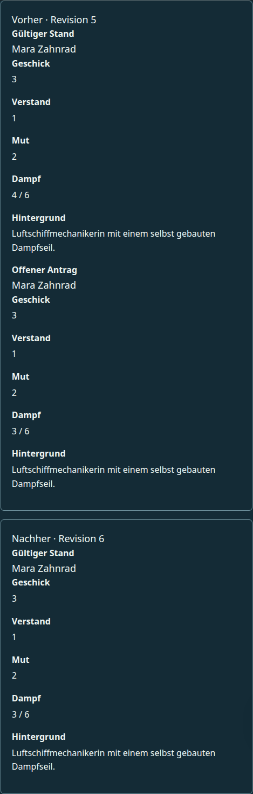

*Vor der Freigabe: gültig 4/6, beantragt 3/6. Nach der Freigabe: gültig 3/6.
Der historische Feldname „Dampf“ bleibt im Protokoll erhalten.*

## 8. Spielprotokoll lesen

**„Spielprotokoll“** zeigt Würfe, Regeländerungen, Charakteränderungen, Anträge,
Freigaben, Ablehnungen und Zugwechsel. Über **„Änderung ansehen: Vorher / Nachher“** werden
die damaligen Stände geöffnet.

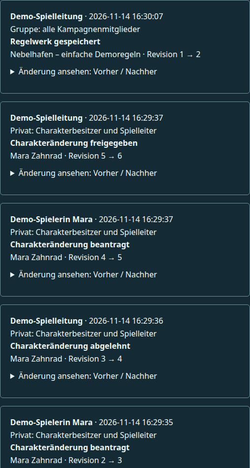

- 20 berechtigte Ereignisse pro Seite; weitere Seiten über die Navigation.
- Charakterereignisse bleiben privat für Besitzer und aktuelle Spielleiter.
- Die damalige Bearbeitung allein verschafft ehemaligen Spielleitern keinen
  dauerhaften Zugriff auf fremde Charakterdaten.
- Entfernte Mitglieder verlieren auch den Zugriff auf ältere eigene Einträge.
- Neue Korrekturen erzeugen neue Ereignisse; alte Einträge werden nicht bearbeitet.

Charakter- und Regelhistorie beginnen mit Version 0.7.0. Frühere Änderungen
werden nicht rückwirkend ergänzt. Mitglieder- und Style-Änderungen werden
derzeit nicht protokolliert. Seit 0.12.0 stehen Szenenentwürfe, Freigaben,
Rücknahmen und Kartenbewegungen mit privaten Vorher-/Nachher-Ständen im
Spielleiterprotokoll; die Gruppe sieht Szenenwechsel mit freigegebenem Titel.
Änderungen an Zugang und Teaser werden seit Version 0.9.0 mit Vorher/Nachher
ausschließlich für Spielleitung und Administration protokolliert.

## 9. Farben anpassen

Unter **„Rundeneinstellungen“ → „Farben & Lesbarkeit anpassen“**:

1. Hintergrund, Flächen, Text, Schaltflächen, Links und Rahmen auswählen.
2. Live-Vorschau und Kontrasthinweise prüfen.
3. **„Gestaltung speichern“** drücken.

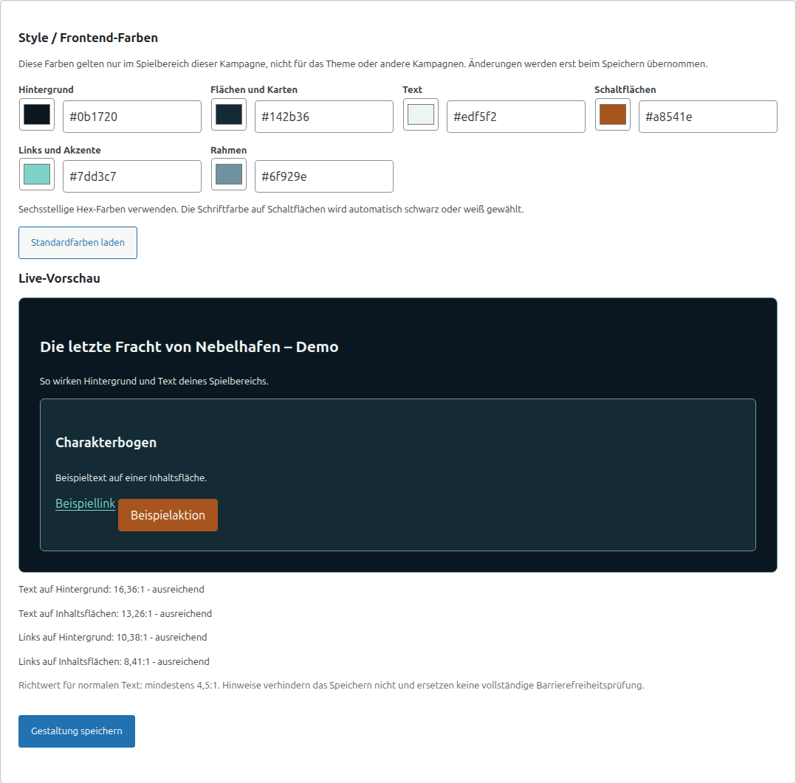

Hex-Farben haben sechs Stellen, etwa `#142b36`.
Die Schrift auf Schaltflächen wird automatisch schwarz oder weiß gewählt.
Der Kontrastrichtwert beträgt 4,5:1; Hinweise verhindern das Speichern nicht.
**„Standardfarben laden“** setzt zunächst nur die Eingaben zurück.
Die Farben verändern nicht das Theme oder andere Kampagnen.

### Ein eigenes Bild für den Spieltisch

Unter **Rundeneinstellungen → Bild für den Spieltisch** ein PNG-, JPEG- oder
WebP-Bild auswählen und **Hintergrund speichern** drücken. Erlaubt sind
höchstens 2 MiB und 3000 × 3000 Pixel; SVG und externe Bildadressen nicht.
Nur Bilder verwenden, für die die nötigen Rechte vorliegen.

Das Bild wird geschützt in der Datenbank gespeichert und nur an berechtigte
Betrachter ausgeliefert, nicht über eine öffentliche Mediathek-Adresse.
**Hintergrund entfernen** stellt den bildfreien Tisch wieder her und löscht
die gespeicherten Bilddaten. Ein Ersatzbild entfernt das vorherige; auch beim
endgültigen Löschen der Kampagne werden ihre Bilddaten gelöscht.
Für schnelle mobile Darstellung möglichst kleine Dateien verwenden.
Private Charakterporträts und eigene Bogenhintergründe sind seit 0.14.0
vorhanden; siehe Abschnitt 14. Für diese Bilder bleiben historische Stände
erhalten, anders als beim austauschbaren Spieltischhintergrund.

## 10. Handy und Tablet

Die Oberfläche nutzt responsive Anordnung und große Bedienelemente.
Auf schmalen Ansichten wechseln „Spiel“, „Mein Bogen“, „Würfel“ und „Gruppe“
den sichtbaren Bereich. Der Zugstatus bleibt in der Bereichsnavigation sichtbar.
Die Abbildung wurde bei 390 Pixeln Browserbreite aufgenommen.

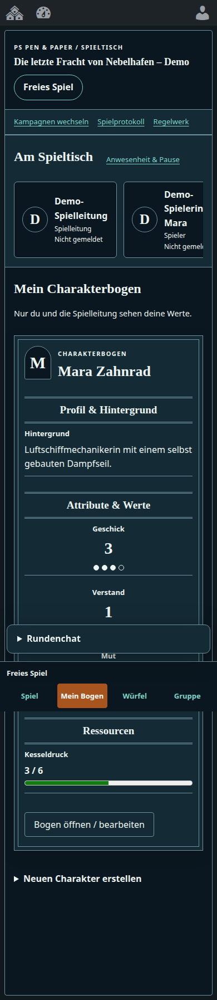

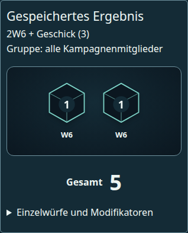

Es gibt keinen erforderlichen Drag-and-drop-Ablauf. Ein Betriebssystemwunsch
nach reduzierter Bewegung wird berücksichtigt. Ohne JavaScript bleiben
Formulare und Ergebnisse nutzbar; Schnellwahl, Live-Farbvorschau und Änderungen
an der Feldliste sowie Anwesenheit, Zugsteuerung und interaktive Karten benötigen JavaScript.

## 11. Probleme und Grenzen

| Problem | Prüfen |
|---|---|
| Keine Kampagne sichtbar | Anmeldung, richtige Unterwebsite und Mitgliedschaft |
| Kampagne kann nicht erstellt werden | Berechtigung durch einen Website-Administrator |
| Spielleiter landet auf einer anderen Backend-Seite | Weiterleitungen anderer Website-Komponenten prüfen lassen; Frontend-Aktionen gesondert testen |
| Charakter fehlt beim Würfeln | Freigegebener Stand, Besitzerrechte und aktuelle Mitgliedschaft |
| Verdecktes Ergebnis fehlt | Für Spieler beabsichtigt, kein Anzeigefehler |
| Werteänderung wirkt noch nicht | Offenen Freigabeantrag prüfen |
| Würfeln deaktiviert | Mindestens einen Würfel und eine Sichtbarkeit erlauben |
| Speicherkonflikt | Neu laden und gültigen Stand mit eigenen Änderungen abgleichen |
| Sichere Datenbanktransaktion nicht verfügbar | Administrator: InnoDB für Beitrags-/Metadatentabelle, Standard-Datenbankverbindung und fremde Transaktionen prüfen |
| Administratorprüfung angefordert | Nicht blind erneut speichern; unvollständigen Vorgang prüfen lassen |

Die zentrale Speicherung übernimmt Regel- und Charakteränderung samt
Protokolleintrag als Einheit: Vor dem Datenbankabschluss werden bei Fehlern
oder Abbruch beide zurückgenommen; nach dem Abschluss sind beide gespeichert.
Ohne geeignete Datenbankunterstützung wird die Änderung abgewiesen. Kann der
Abschluss nicht eindeutig bestätigt werden, erscheint ausdrücklich eine
Aufforderung zur Administratorprüfung. Dann nicht blind erneut speichern.
Das Protokoll ersetzt keine Datensicherung und ist kein manipulationssicheres
Audit-System.

### Was beim Abenteuerablauf noch fehlt

Der erste **Soloabenteuer-Ablauf** ist seit Version 0.21.0 vorhanden. Er
ergänzt den Story-Builder um private Einzeldurchläufe, freigegebene
Szenenpfade, Entscheidungen und optionale Zahlenproben. Seit 0.22.0 ergänzen
Mindestwerte und seit 0.23.0 optionale Ressourcenkosten diesen Ablauf.
Seit 0.24.0 sind feste und tabellenbasierte Belohnungen konfigurierbar.
Seit 0.25.0 lassen sich mehrere Wertebedingungen mit UND oder ODER verknüpfen.
Gruppenabenteuer, gemeinsame Entscheidungen und hybride Freigabeschritte
fehlen weiterhin; Details stehen in Abschnitt 21.
Der **Story-Builder** mit Szenen, getrennten Geheimnissen, Inhaltsvorschau,
Freigabe, Rücknahme und Protokollierung ist vorhanden.
Kapitel mit geordneter Szenenfolge, private Personen-/Orts-/Notizkarten und
Text-/Bild-Handouts sind seit 0.13.0 vorhanden. Community-gebundene Inventare
und Ausrüstung ergänzen seit 0.14.0 den Charakterbereich, kontrollierter Handel
seit 0.20.0. Redaktioneller Komfort und weitere Handoutdateiformate fehlen
noch. Eine normale Medien-URL ist nicht automatisch privat.
Auch die unterstützten WordPress-, ClassicPress- und PHP-Versionen müssen
noch verbindlich festgelegt und plattformübergreifend geprüft werden.

## 12. Szenen und Kartentisch

### Ein Abenteuer am Tisch leiten

Seit **0.15.0** öffnet **Abenteuer & Szenen** zuerst den privaten Abenteuerplan:

1. Kapitel erscheinen mit der in der Spielleitermappe festgelegten Szenenfolge.
   Nicht zugeordnete Szenen stehen gesondert darunter.
2. **Jetzt am Tisch** markiert die aktive freigegebene Szene. Die folgende Szene
   ist als **Nächste Szene im Kapitel** gekennzeichnet. Die Reihenfolge zwingt
   keinen Lösungsweg auf: Die Spielleitung entscheidet selbst, wohin es geht.
3. **Vorbereiten / Vorschau / Freigabe** öffnet den Szeneneditor. Der Plan ist
   beim Bearbeiten eines gespeicherten Entwurfs zunächst eingeklappt.
4. **Am Tisch anzeigen** wechselt zur bereits freigegebenen Fassung und führt
   zurück zum Plan. Ein privater Entwurf bietet diese Schaltfläche nicht.
   Ein Hinweis kennzeichnet Abweichungen zwischen Entwurf und Spielstand;
   auch bewegte Marker können solche Abweichungen verursachen.
5. Unter **Aktuelle Szene leiten** stehen die gespeicherten Geheimnisse und
   direkt mit dieser Szene verknüpfte Personen, Orte, Notizen und Handouts.
   Alles in diesem Bereich bleibt ausschließlich für die Spielleitung sichtbar.
6. Einen noch privaten Hinweis aufklappen, die Freigabe ausdrücklich bestätigen
   und **Handout auf den Tisch legen** wählen. Nur Titel, Text und optionales
   Bild werden übernommen, niemals die geheimen Ergänzungen. Die Gruppe findet
   den Hinweis danach unter **Handouts**. Änderungen und Rücknahmen bereits
   veröffentlichter Handouts erfolgen weiterhin in der Spielleitermappe.

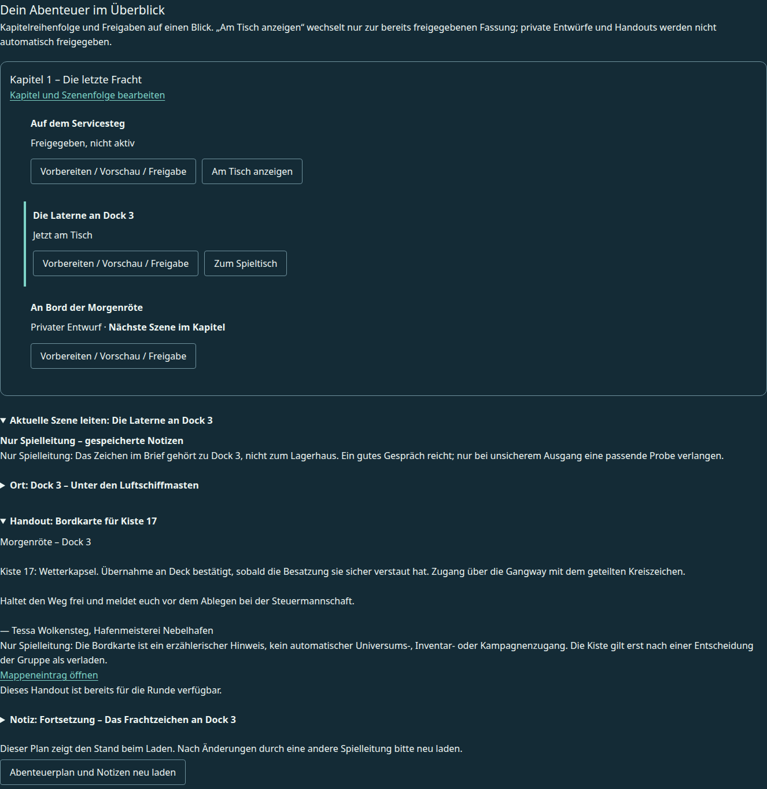

*Die Kapitelreihenfolge ist eine Orientierung für die Spielleitung, kein
automatischer Questablauf. Plan, Entwurfstitel und Geheimnisse erscheinen
nicht in der Spieleransicht.*

Der Plan zeigt den Stand beim Laden. Wenn eine weitere Spielleitung etwas
ändert, **Abenteuerplan und Notizen neu laden** verwenden. Die Spielerszene
aktualisiert sich weiterhin wie im Abschnitt zum Kartentisch beschrieben.

### Probespiel: Von Dock 3 zur Morgenröte

Die bestehende Nebelhafen-Demo steht jetzt in **Die Laterne an Dock 3**.
Die Spielleitung hat die **Bordkarte für Kiste 17** ausdrücklich freigegeben;
Mara und Jorin sehen sie zusammen mit dem bisherigen Brief unter **Handouts**.
**An Bord der Morgenröte** ist die nächste Szene im Kapitel, bleibt aber
ein privater Entwurf ohne Schaltfläche zum Anzeigen am Tisch.

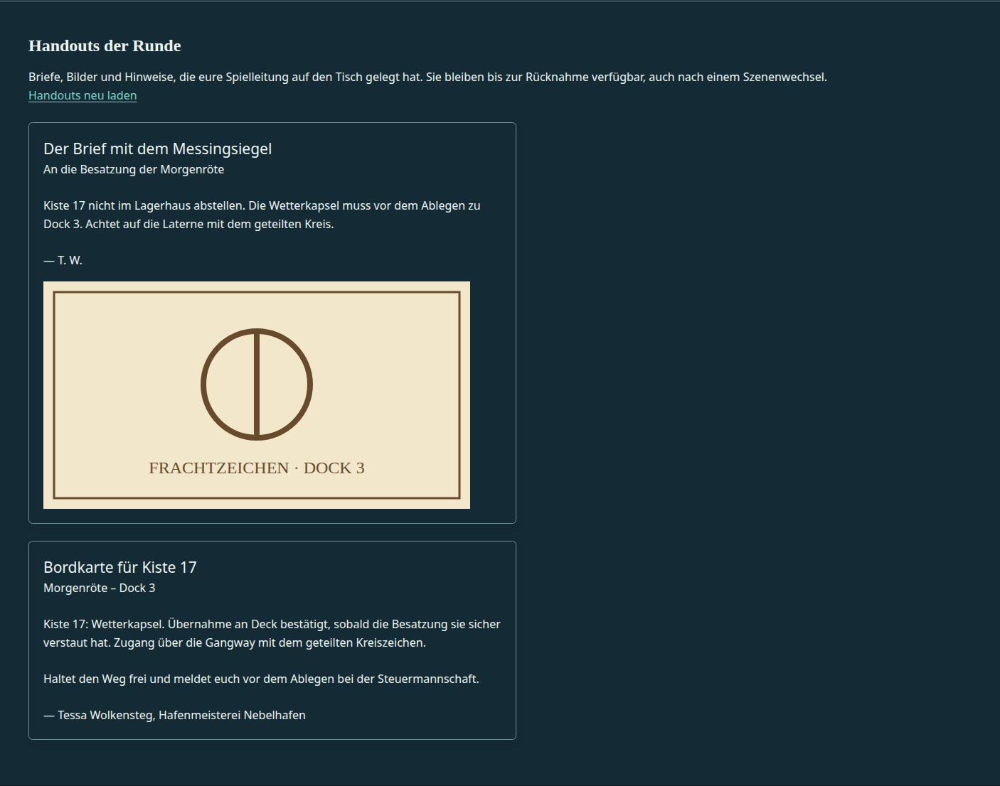

*Die geheimen Ergänzungen aus der Spielleitungsansicht fehlen hier vollständig.
Der Hinweis legt keine automatische Verladung, Abreise oder Probe fest.*

Für diese Fortsetzung wurde kein neuer Wurf benötigt. Maras bereits
gespeicherte Probe 13 bleibt der Ausgangspunkt; Charaktere, Ausrüstung
und Regeln wurden nicht verändert.

### Als Spielleitung vorbereiten

1. Im Spielbereich **Abenteuer & Szenen** öffnen. Im Backend befindet sich derselbe
   Editor in der Kampagnenverwaltung.
2. Unter **Neue Szene** Titel und freizugebenden Text eintragen.
3. **Geheimnisse – nur Spielleitung** getrennt ausfüllen. Dieses Feld erscheint
   weder in der Spielervorschau noch in den Kartenantworten für Spieler.
   Für eine reine Erzählszene direkt zu Schritt 7 gehen: Neue Szenen beginnen
   ohne Raster; ohne Bild und Marker wird keine leere Kartenfläche angezeigt.
   Die folgenden Kartenfelder liegen unter **Optionale Karte und Figurenmarker**.
4. Optional ein PNG-, JPEG- oder WebP-Kartenbild hochladen: höchstens 2 MiB und
   3000 × 3000 Pixel. Ohne Bild ist eine neutrale Kartenfläche möglich.
5. **Quadratraster** auf 10–500 Bildpixel setzen; **0** bedeutet ohne Raster
   und ohne Einrasten.
6. Über **Marker hinzufügen** bis zu 30 Figuren oder Gegenstände anlegen:
   sichtbarer Name, Typ, Farbe, Bewegungsberechtigter und Startposition.
   X und Y sind Prozentwerte von 0 bis 100; 50 bedeutet die Kartenmitte.
7. **Entwurf speichern** und **Gespeicherten Entwurf als Spieler ansehen** öffnen.
   Diese private Inhaltsvorschau ist ohne Figurensteuerung und zeigt nur den
   gespeicherten Stand, nicht ungespeicherte Eingaben.

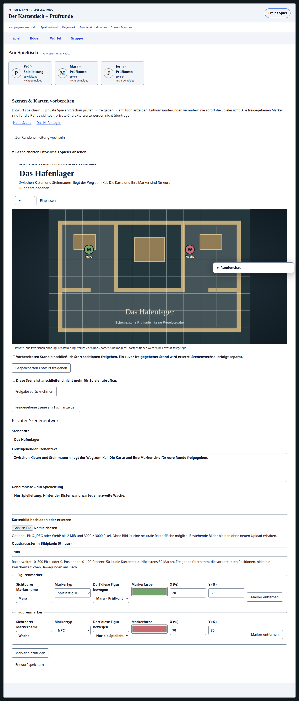

*Die schematische Prüfkarte ist ein Beispiel, kein mitgeliefertes Spielsystem.*

### Bewusst freigeben und anzeigen

1. Das Bestätigungsfeld lesen und **Gespeicherten Entwurf freigeben** wählen.
   Das veröffentlicht noch keine andere Szene am Tisch.
2. **Freigegebene Szene am Tisch anzeigen** wechselt die gemeinsame Ansicht.
3. Neue Änderungen zunächst wieder als Entwurf speichern. Der bisherige
   veröffentlichte Stand bleibt sichtbar, bis du erneut freigibst.
4. **Freigabe zurücknehmen** sperrt weitere Spielerabrufe dieser Szene und ihres
   Bildes. Die Spielansicht kehrt nach der nächsten Aktualisierung zur Einleitung
   zurück. **Zur Rundeneinleitung wechseln** lässt sich auch unabhängig davon nutzen.

**Wichtig:** Eine erneute Freigabe übernimmt die vorbereiteten Startpositionen.
Zwischenzeitlich am Tisch bewegte Positionen werden dabei ersetzt.
Jede Bewegung erhöht die Szenenrevision. War ein Bearbeitungsformular bereits
offen, kann sein Speichern deshalb eine Aktualisierung verlangen; fremde Änderungen
werden nicht still überschrieben.

### Gemeinsam auf der Karte spielen

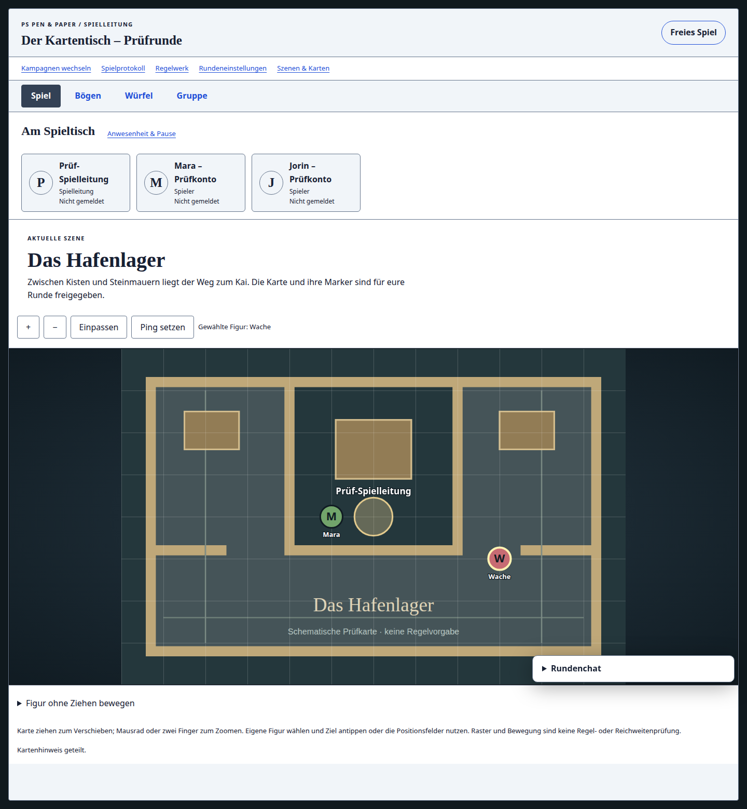

- **+**, **−** und **Einpassen** steuern den Ausschnitt. Die Karte lässt sich
  ziehen; Mausrad oder zwei Finger verändern den Zoom.
- Eine zugewiesene Figur wählen und ihr Ziel antippen oder die Figur ziehen.
  Alternativ **Figur ohne Ziehen bewegen** öffnen und X/Y eingeben.
  Per Tastatur lässt sich der Figurenmarker mit Eingabe oder Leertaste auswählen;
  danach sind die Positionsfelder fokussiert.
- Die Spielleitung bewegt alle Marker. Spieler bewegen ausschließlich ihre
  ausdrücklich zugewiesenen Marker, nicht automatisch jede Spielerfigur.
- **Ping setzen** wählen und auf die Karte tippen. Der Hinweis trägt den
  tatsächlichen Absender und läuft nach spätestens 15 Sekunden aus.

Die aktuelle Karte wird auf sichtbaren Browserseiten alle fünf Sekunden
aktualisiert. Bewegungen und Szenenwechsel erscheinen deshalb gegebenenfalls
leicht verzögert. Positionen bleiben über Neuladen und Abmelden hinaus gespeichert.
Eine Mitgliedschaftsänderung wird bei neuen Abrufen und Bewegungen geprüft.

Alle freigegebenen Marker sind für die Runde sichtbar. Namen bewusst wählen;
private Charakterwerte werden nicht automatisch an einen Marker angehängt.
Raster und Bewegung prüfen weder Reichweite noch Kollisionen oder Spielregeln.
Nebel des Krieges, versteckte Marker, Zeichenwerkzeuge und Entfernungsmessung
sind noch nicht vorhanden.

### Bildschutz und Aufbewahrung

Kartenbilder liegen in privaten Datensätzen ohne öffentliche Mediathek-Adresse.
Spieler erhalten nur das Bild der aktuellen freigegebenen Szene. Alte Bildstände
bleiben geschützt für die Historie gespeichert und werden beim endgültigen
Löschen der Kampagne entfernt. Kleine Dateien verwenden und die Datenbank sichern.
Bereits betrachtete oder heruntergeladene Inhalte können durch eine Rücknahme
nicht nachträglich aus fremden Browsern oder Kopien entfernt werden.

### Zu den Abbildungen

Die Bilder zeigen echte angemeldete Rollenansichten und gespeicherte Demodaten.
Browsernavigation und fremde Debug-Einblendungen sind für die Abbildungen
ausgespart beziehungsweise nur während der Aufnahme ausgeblendet.

## 13. Spielleitermappe, Kapitel und Handouts

### Abenteuer in der Spielleitermappe vorbereiten

1. Als Spielleitung im Spielbereich **Spielleitermappe** öffnen. Im Backend
   steht derselbe Bereich in der Kampagnenverwaltung zur Verfügung.
2. **Neuer Mappeneintrag** wählen und die Art festlegen: Kapitel, Handout,
   Person, Ort oder Notiz. Die Art lässt sich nach dem Anlegen nicht umstellen.
3. Titel, Inhalt und gegebenenfalls geheime Ergänzungen eintragen.
   Personen, Orte, Kapitel und Notizen bleiben vollständig privat.
4. Über die Sortiernummer die Reihenfolge innerhalb der jeweiligen Rubrik
   festlegen. Kleinere Zahlen erscheinen zuerst.
5. Optional ein Kapitel und eine Szene verknüpfen. Die Verknüpfung dient der
   Vorbereitung und verändert weder Mitgliedschaften noch Freigaben.
6. **Mappeneintrag speichern**. Bei einem Revisionskonflikt den aktuellen
   Stand neu laden; Änderungen werden nicht still überschrieben.

Eine Personenkarte ist eine erzählerische Gedächtnisstütze, kein verpflichtender
Gegnerbogen. Ortskarten sammeln Atmosphäre und Hinweise; Notizen eignen sich
für die eigene Vorbereitung oder eine private Zusammenfassung.

### Kapitel und Szenenfolge

Ein Kapitel zunächst speichern und dann erneut bearbeiten. Unter **Szenen im
Kapitel** neben jeder gewünschten Szene eine Reihenfolgenummer eintragen.
Ein leeres Feld nimmt die Szene nicht auf. Bis zu 100 Szenen sind pro Kapitel
möglich; eine Szene kann in mehreren Kapiteln vermerkt sein.

Die Kapitelübersicht zeigt die geordnete Folge mit Links und Freigabestatus.
Ein Link öffnet die Szenenvorbereitung. **Eine Kapitelzuordnung veröffentlicht
keine Szene und wechselt nicht die aktive Szene.** Dafür weiterhin die
ausdrücklichen Szenenaktionen aus Abschnitt 12 verwenden.

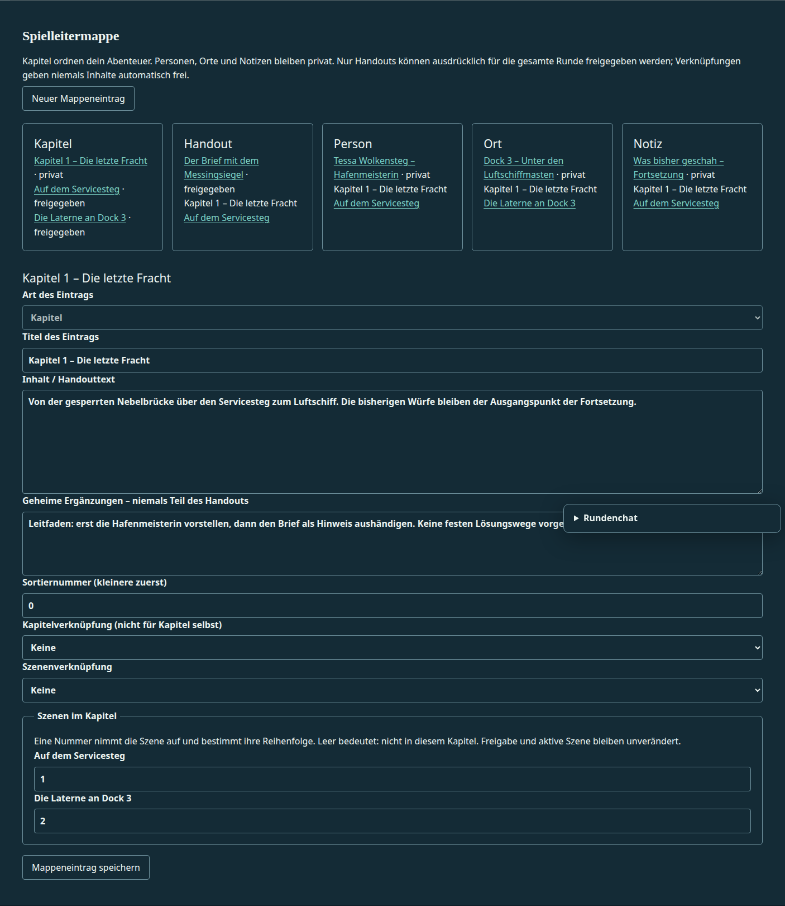

### Ein Handout auf den Tisch legen

1. Einen Eintrag der Art **Handout** mit Titel und Text speichern.
2. Optional ein eigenes PNG-, JPEG- oder WebP-Bild hochladen, höchstens 2 MiB
   und 3000 × 3000 Pixel. PDFs und andere Dateien sind nicht unterstützt.
3. **Private Vorschau des gespeicherten Handoutentwurfs** öffnen.
4. Die Bestätigung markieren und **Handout für die Runde freigeben** wählen.
5. Spieler öffnen **Handouts** beziehungsweise **Handouts neu laden**.

Die Gruppe erhält ausschließlich den freigegebenen Titel, Text und das Bild.
Geheime Ergänzungen, Kapitel- und Szenenverknüpfungen bleiben in der
Spielleitermappe. Handouts bleiben auch nach einem Szenenwechsel zugänglich.
Die Freigabe gilt für die gesamte aktuelle Kampagnengruppe, nicht für einzelne
Empfänger. Auch die Spielleitung sieht unter **Handouts** nur freigegebene Stände.


### Überarbeiten, zurücknehmen und schützen

Entwurfsänderungen verändern ein bereits freigegebenes Handout nicht. Erst eine
erneute bestätigte Freigabe ersetzt den Gruppenstand. Ein Bild kann aus dem
Entwurf entfernt oder ersetzt werden; Entfernung und Ersatz sind getrennte
Aktionen. Historische Bilder bleiben für die Historie bis zur endgültigen
Kampagnenlöschung in der Datenbank.

**Handout zurücknehmen** verhindert die Ausgabe bei neuen Seitenabrufen.
Es gibt keine automatische Handoutaktualisierung und keine Möglichkeit,
bereits gelesene oder gespeicherte Inhalte aus fremden Browsern zurückzuholen.
Nach Entzug der Kampagnenmitgliedschaft sind auch die Handouts nicht mehr
abrufbar. Die Spielbereich-Seite einschließlich ihrer Abfrageparameter darf
nicht öffentlich zwischengespeichert werden.

Mappenänderungen, Handoutfreigaben und Rücknahmen besitzen private
Vorher-/Nachher-Protokolle für die Spielleitung. Die neuen Abbildungen zeigen
die tatsächlich fortgesetzte Nebelhafen-Demo; ihre Charaktere, Regeln und
ursprünglichen Würfe wurden dafür nicht zurückgesetzt.
Für diese Mappenabbildungen wurden keine Spielwerte oder Berechtigungen geändert.

## 14. Porträts und Bogenhintergründe

Diese Gestaltung funktioniert **auch ohne PS Community**.

1. Den eigenen Charakter über **Mein Bogen → Bogen bearbeiten** beziehungsweise
   die Charakterverwaltung öffnen.
2. Unter **Charakterporträt** ein PNG-, JPEG- oder WebP-Bild auswählen.
3. **Porträt einreichen / speichern** drücken. Im Freigabemodus sieht die
   Spielleitung den Antrag getrennt und wählt **Porträt freigeben** oder
   **Porträtantrag verwerfen**. Bis dahin bleibt das bisherige Bild gültig.
4. **Porträt entfernen / beantragen** entfernt das Bild je nach
   Bearbeitungspolitik sofort oder erst nach Freigabe.

Bei **Nur Spielleiter** können Besitzer keine Bilder ändern. Porträtanträge
ändern keine Charakterwerte und benötigen keine erneute Wertefreigabe.
Gemeinsame Basisbögen können trotzdem ein lokales Kampagnenporträt erhalten.
Das Bild erscheint nur auf berechtigten Charakterbögen für Besitzer und
Spielleitung, nicht als öffentlicher Community-Avatar oder Teilnehmeravatar.

Den Hintergrund bestimmt die Spielleitung unter **Rundeneinstellungen →
Bogenhintergrund der Kampagne**. Er erscheint dezent hinter dem gültigen
Charakterbogen. **Bogenhintergrund entfernen** schaltet die Dekoration aus.
Ein Ausschnitt-/Positionseditor ist noch nicht vorhanden.

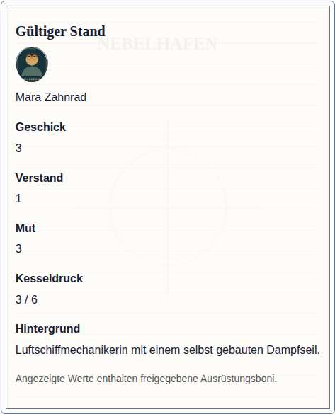

Alle drei Bildarten – Porträt, Bogenhintergrund und Gegenstandsgrafik –
verwenden den privaten Bildspeicher: höchstens 2 MiB und 3000 × 3000 Pixel,
keine SVGs oder externen Bildadressen. Historische Bilder bleiben für
Protokolle und ausgegebene Gegenstände bis zur Löschung ihres Ursprungs
gespeichert. Nur Bilder mit passenden Nutzungsrechten verwenden und die
Datenbank regelmäßig sichern.

## 15. Community-Profil, Gegenstände und Ausrüstung

### Voraussetzungen und privater Profil-Tab

PS Community auf derselben Website aktivieren. In der lokal geprüften
Community-Version müssen **Profil** und **Aktivität** eingeschaltet sein,
damit die Profil-Tab-Schnittstellen geladen werden. Eine veröffentlichte
Profilseite mit `[cpc-activity-page]` anlegen und in Community zuordnen,
falls noch keine vorhanden ist. Bei aktiviertem Permalinkmodus muss die
zugehörige Community-Profiladresse erreichbar sein.

Im **eigenen** Profil **Pen & Paper** öffnen und den eigenen
Kampagnencharakter auswählen. Alternativ führt **Mein Charakterprofil**
am Spieltisch dorthin. Im Tab lassen sich Bogen, Porträt und Ausrüstung
bearbeiten. **Zur Bogenübersicht** führt zur eigenen Profilauswahl zurück.
Profilformulare werden auf der Frontend-Profilseite verarbeitet und bleiben
nach dem Speichern dort.

Andere Profilbesucher und Freunde erhalten weder fremde Bögen noch Inventare.
Auch ein direkter Community-AJAX-Aufruf vergibt keine zusätzlichen Rechte.
Mitgliedschaft und Charakterbesitz bleiben erforderlich.
**Die Profilseite einschließlich ihrer Parameter vom Seiten-Cache ausschließen.**

### Als Spielleitung Slots und Seltenheiten festlegen

Im Spielbereich **Gegenstände → Slots und Seltenheitsstufen konfigurieren**
öffnen. Derselbe Katalog ist in der Backend-Kampagnenverwaltung und für
Universumsleitungen beim jeweiligen Universum erreichbar.

Beispiel für Slots, eine Zeile pro Slot:

```text
kopf | Kopf | kopfbedeckung
arme | Arme | armschutz
brust | Brust | oberbekleidung
```

Die drei Teile sind **stabile Kennung | sichtbarer Name | passender
Gegenstandstyp**. Eine Kopfbedeckung passt nur in einen entsprechend
konfigurierten Slot. Eine konkrete Instanz darf nicht gleichzeitig mehrere
Slots belegen. Bestehende Kennungen dürfen nicht entfernt und Slottypen
nicht umgedeutet werden; Namen bleiben änderbar.

Beispiel für unabhängige Seltenheitsstufen:

```text
normal | Normal | #52646d
episch | Episch | #8054a3
```

Bezeichnungen und Farben bestimmt die Spielleitung. Eine Farbe ist nie die
einzige Kennzeichnung. **Episch** erzeugt keinen automatischen Multiplikator.
Bis zu 30 Slots und 30 Seltenheiten sind je Vorlage möglich. Kampagnen legen
ihre Slots selbst fest, auch wenn sie Universumsgegenstände verwenden.

### Gegenstandsvorlagen erstellen und Exemplare ausgeben

1. **Neue Gegenstandsvorlage** öffnen.
2. Namen, Beschreibung, Typ und Seltenheit eintragen.
3. Freie Eigenschaften als `Bezeichnung | Wert` ergänzen.
4. Optional ausdrücklich ganzzahlige Boni auf Zahlen- oder Attributfelder
   setzen. Ressourcen und Textfelder sind keine Bonusziele.
5. Optional eine geschützte Grafik hochladen und die Vorlage speichern.
6. Den gewünschten Charakter öffnen und **Ein Exemplar ausgeben: …** wählen.
   Erst diese Aktion erzeugt Besitz; eine Katalogvorlage allein liegt
   noch in keinem Inventar.


Zugeordnete Kampagnen können Universumsvorlagen und eigene Ergänzungen
verwenden. Standalone-Kampagnen verwenden ihren eigenen Katalog.
Vorlagenänderungen gelten nur für spätere Ausgaben, nicht für bereits
ausgegebene Exemplare. Ein Charakter besitzt zunächst höchstens 100
einzelne Exemplare; Stapelmengen und eine Entzugs-/Löschoberfläche fehlen.

### Ausrüstung auswählen und freigeben

Im Charakter unter **Inventar & Ausrüstung** bei jedem Slot ein passendes
eigenes Exemplar oder **Leer** wählen. Über **Ausrüstung speichern /
einreichen** speichern. Im Freigabemodus bleibt die bisherige Belegung
wirksam, bis die Spielleitung **Ausrüstung freigeben** wählt. Die
Auswahlfelder zeigen bei offenem Antrag den beantragten Stand; die Übersicht
darunter zeigt die gültige Belegung. Ein neuer Antrag ersetzt den bisherigen.

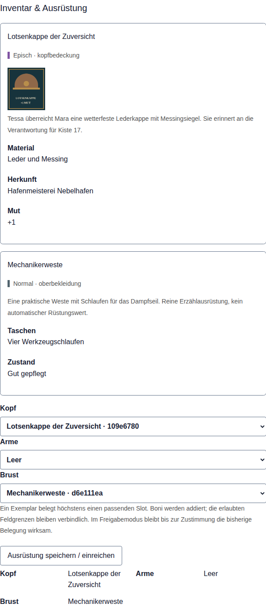

Angelegte, freigegebene Boni werden addiert; die Grundwerte bleiben erhalten.
In der Demo gibt die Lotsenkappe **Mut +1**: Grundwert **2**, effektiver
Bogenwert **3**. Im Bearbeitungsformular steht weiter der Grundwert **2**.
Den Bonus beim Würfeln **nicht noch einmal** zum Ausdruck addieren.

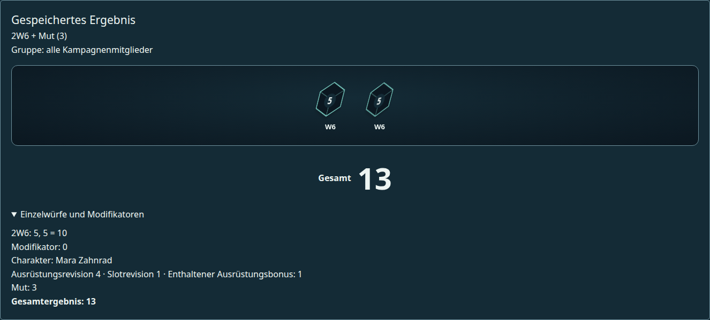

Der tatsächliche Wurf verwendet Mut 3 und speichert Ausrüstungsrevision,
Slotrevision und enthaltene Boni. Alte Würfe ändern sich nicht beim Ablegen
oder bei späteren Vorlagenänderungen.

### Grenzen, Fehlerbehebung und Deaktivierung

Feldgrenzen gelten einschließlich Boni. Unzulässiges Anlegen oder eine
unzulässige Grundwert-/Auflagenänderung wird ausdrücklich abgelehnt.
Bei gemeinsamem Basisfortschritt kann eine andere Kampagnenausrüstung
nachträglich ungültig werden. Dann werden keine still gekürzten Werte oder
Würfe erzeugt. Über **Ausrüstung prüfen** in der eigenen Profilübersicht
bleibt die Slotverwaltung zugänglich. Besitzer können das Ablegen beantragen;
die Spielleitung kann es freigeben oder unmittelbar korrigieren.

Ohne aktives, verwendbares PS Community sind Katalog, Inventaroperationen
und Ausrüstung inaktiv; **auch Boni werden dann nicht angewandt**.
Gespeicherte Bestände werden nicht gelöscht. Charakterbögen, Porträts,
Geschichten und Würfel bleiben nutzbar. Bereits gespeicherte Würfe behalten
ihre damaligen Werte. Bei erneuter Aktivierung gelten die gespeicherten
Belegungen wieder, soweit die aktuellen Wertebereiche sie zulassen.

Schema- und Vorlagenänderungen stehen privat im Spielleiterprotokoll;
Inventar- und Porträtänderungen sind nur für Besitzer und aktuelle
Spielleitung sichtbar. Das ist keine Datenbanksicherung.

**Noch offen:** Stapelmengen, Mehrfachslot-Gegenstände, Entzug/
Entfernen von Exemplaren und ein frei positionierbarer grafischer Slotdesigner.
Die aktuelle Oberfläche verwendet zugängliche Auswahlfelder, kein Drag-and-drop.

## 16. Währung, Guthaben und Gegenstandsbindung

Dieser Bereich benötigt aktives PS Community. Die Währung schreibt kein
Spielsystem vor: Name und Kürzel sind frei, Beträge bleiben **ganze Einheiten**.

### Währung und Kontomodell einstellen

- **Mit Universum:** Unter **Universen → Regelwerk & Basischaraktere →
  Währung & Guthaben** wählt die Universumsleitung beziehungsweise Administration
  Name, Kürzel und Kontomodell.
- **Ohne Universum:** Unter **Rundeneinstellungen → Währung & Guthaben**
  richtet die Kampagnenleitung eine eigene Währung ein.
- Zugeordnete Kampagnen übernehmen die Währung und das gewählte Modell aus
  dem Universum. Es gibt keine automatische Umrechnung oder lokale Zweitwährung.

| Kontomodell im Universum | Wirkung und Buchungsrechte |
|---|---|
| Getrennt je Kampagnencharakter | Jede Runde hat ein eigenes Guthaben, auch bei gemeinsamen Charaktergrundwerten. Es bucht die jeweilige Kampagnenleitung. |
| Gemeinsam am Universumscharakter | Gemeinsam aufgenommene Basisbögen verwenden dasselbe Konto. Nur Universumsleitung beziehungsweise Administration buchen. Lokale Bögen und unabhängige Kopien erhalten kein Ersatzkonto. |

Vor der ersten Buchung kann die Universumsleitung das Modell wechseln.
Danach bleibt es fest, damit Guthaben weder verschwinden noch doppelt
verwendet werden. Name und Kürzel bleiben änderbar. Ein Wechsel der
Universumszuordnung von Kampagnen mit Konten wird gesperrt, bis es eine
ausdrückliche Guthabenmigration gibt.

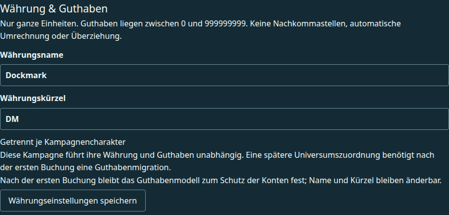

### Beträge vergeben oder abziehen

1. Als zuständige Spielleitung den Charakterbogen öffnen.
2. Unter **Guthaben → Guthaben vergeben oder abziehen** die Buchungsart wählen.
3. Einen **ganzen Betrag ab 1** und eine Begründung eintragen.
4. Betrag und Buchungsart ausdrücklich bestätigen und
   **Guthabenbuchung speichern** wählen.

Ein Kontostand darf zwischen **0 und 999999999** liegen. Nachkommastellen,
Überziehung und Überschreitung der Grenze werden abgewiesen. Ein veraltetes
Formular fordert zum Neuladen auf; es führt keine zweite Buchung aus.
Ohne erforderlichen Protokolleintrag wird auch das Guthaben nicht geändert.
Guthabenbuchungen verändern keine Charakterattribute oder Ressourcen.

Spieler sehen ausschließlich Guthaben ihrer eigenen zugänglichen Charaktere,
auch im privaten Community-Profil, aber keine Buchungsschaltflächen.
Kampagnenbuchungen stehen privat im Protokoll für Besitzer und aktuelle
Spielleitung. Den Verlauf gemeinsamer Konten verwaltet die Universumsleitung
im Universum. Alte Buchungen behalten damalige Bezeichnungen und Begründungen.


### Gegenstände binden

Beim Erstellen oder Bearbeiten einer Gegenstandsvorlage unter
**Gegenstandsbindung** wählen:

- **Charaktergebunden:** Das konkrete Exemplar gehört zu diesem Charakter.
- **Handelbar:** Das Exemplar kann nach den eingestellten Handelsregeln
  angeboten werden.

Beim Ausgeben wird die Auswahl im Exemplar festgehalten. Ein späterer
Vorlagenwechsel verändert vorhandene Exemplare nicht. Die Handelsfunktion
seit 0.20.0 berücksichtigt diese Bindung; siehe Abschnitt 20. Eine manuelle
Geldbuchung ist kein automatischer Kauf.

Der Ausgangsstand der Währungsdemo enthält **Dockmark (DM)**: Mara erhält
12 DM, davon werden 2 DM mit Begründung für Vorräte abgezogen; ihr damaliger Stand beträgt **10 DM**.
Jorin erhält getrennt **8 DM**. Mara besitzt zusätzlich einen gebundenen
**Bordausweis der Morgenröte** und einen handelbar gekennzeichneten
**Messingkompass vom Dock**, beide ohne neue Werteboni.
Spätere Beute und Handel verändern diesen Stand; der aktuelle Abschluss
steht in Abschnitt 20 und im Demobericht.

Ohne verwendbares PS Community sind wirtschaftliche Änderungen inaktiv;
gespeicherte Guthaben und Gegenstände werden nicht gelöscht.

## 17. Gegner, NPCs und Universumsvorlagen

Figuren sind private Werkzeuge der Spielleitung, unabhängig von PS Community
und PS Wiki. Eine Personenkarte bleibt eine Erzählnotiz; sie wird nicht
automatisch in einen Gegner oder NPC umgewandelt.

### Eine Kampagnenfigur vorbereiten

1. **Spielleitermappe → Gegner und NPCs verwalten** öffnen.
2. **Neue Kampagnenfigur** wählen, die Art **NPC** oder **Gegner** einstellen.
3. Name, Beschreibung und getrennte Geheimnisse eintragen.
4. Eigenschaften als `Bezeichnung | Text`, Werte als `Bezeichnung | ganze Zahl`
   eintragen, jeweils eine Zeile pro Eintrag.
5. Optional eine Szene und ein geschütztes Bild auswählen.
6. **Figur speichern** wählen. Die Vorschau zeigt den gespeicherten Stand.

Beispiel für Eigenschaften:

```text
Aufgabe | Hafenlotsin
Haltung | Hilfsbereit
```

Beispiel für Werte:

```text
Ortskenntnis | 4
Überzeugen | 3
```

Es sind höchstens **30 Eigenschaften und 30 Werte** möglich. Zahlen liegen
zwischen **-1000000 und 1000000**; Nachkommastellen und doppelte Bezeichnungen
innerhalb einer Liste werden abgewiesen. Es gibt keine vorgeschriebene
Attributliste. Werte verändern keine Spielerbögen und lösen weder Kämpfe
noch Proben automatisch aus.

Bilder werden wie andere private Spielbilder gespeichert: PNG, JPEG oder
WebP bis 2 MiB und 3000 × 3000 Pixel, ohne öffentliche Mediathek-Adresse.
Eine Szenenzuordnung macht die Figur in der **privaten Regie des
Abenteuerplans** erreichbar. Sie veröffentlicht weder Beschreibung noch
Bild, Werte oder Geheimnisse für Spieler.

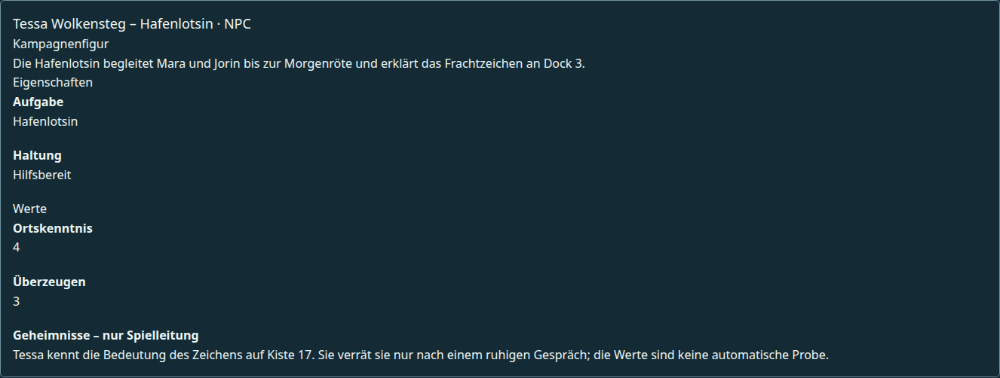

### Ins Universum aufnehmen

Bei einer zugeordneten Kampagne besitzt die gespeicherte Figur eine
ausdrücklich zu bestätigende Aufnahmeaktion. **Dabei werden auch Werte,
Bild und Geheimnisse mit der Universumsleitung geteilt.**

- Leitet dieselbe Person auch das Universum, erstellt **Ins Universum
  aufnehmen** direkt eine Vorlage.
- Andernfalls erzeugt **Aufnahme ins Universum vorschlagen** zunächst einen
  privaten Vorschlag. Andere Kampagnen sehen ihn noch nicht.
- Die Universumsleitung öffnet **Universen → Regelwerk & Basischaraktere →
  Gegner & NPCs**, prüft den Vorschlag und bestätigt **Aufnahme ins Universum
  bestätigen**. Sie kann dort auch eigene Vorlagen erstellen.

Wiederholtes Anbieten derselben Figur erzeugt keine weitere Vorlage, auch
nicht nach einer Umbenennung. Spätere Änderungen werden nicht ungefragt
übertragen. Eine Kampagne ohne Universum behält ihre Figuren ausschließlich lokal.

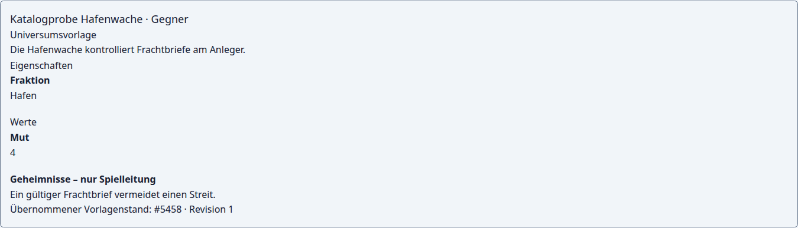

### Vorlagen in einer anderen Kampagne verwenden

1. Als Spielleitung einer zugeordneten Kampagne die Figurenverwaltung öffnen.
2. Unter **Vorlagen aus dem Universum** die Vorlage prüfen.
3. **Als Kampagnenfigur übernehmen** ausdrücklich bestätigen.
4. Name, aktuelle Werte und Szenenverknüpfung der lokalen Figur anpassen.

Jede Übernahme friert den Vorlagenstand ein und kopiert das geschützte Bild.
Die Szenenzuordnung ist zunächst leer. Eine verletzte lokale Wache verändert
keine anderen Wachen; spätere Vorlagenänderungen verändern keine bestehenden
Kopien. Nach einer gelösten Universumszuordnung verschwindet der Katalogzugriff,
die eigenen Kampagnenfiguren bleiben erhalten.

Nach Änderungen oder Freigaben durch eine andere Spielleitung
**Figuren und Vorlagen neu laden** verwenden. Veraltete Speicherformulare
überschreiben keine neueren Stände. Ohne erforderlichen Protokolleintrag
wird die Figurenänderung nicht übernommen.

Die Demo enthält **Tessa Wolkensteg – Hafenlotsin** und die optionale
**Zollwache an Dock 3**. Beide sind Dock 3 zugeordnet und bleiben privat.
Es wird kein Kampf gestartet. Seit 0.18.0 ist eine lokale Beutetabelle
optional verknüpfbar. Die Verknüpfung wird nicht in Universumsvorlagen
übernommen. Für bestätigte Universumsvorlagen kann seit 0.19.0 ein separater
öffentlicher Wiki-Artikel vorbereitet werden.

## 18. Beutetabellen und bestätigte Vergabe

Seit Version 0.18.0 kann die Spielleitung Beute vorbereiten, auswürfeln und
anschließend bewusst vergeben. Das ist keine automatische Kampfbelohnung.
Die Verwaltung bleibt privat und benötigt für Änderungen aktives PS Community.

### Eine Tabelle vorbereiten

1. Als Kampagnenleitung **Spielleitermappe → Beutetabellen** öffnen und
   **Neue Beutetabelle** wählen.
2. Name und einen im Kampagnenregelwerk erlaubten Standardwürfel einstellen.
3. Für jeden Ausgang einen Bereich von/bis einschließlich und einen Namen
   eintragen. **Ausgang hinzufügen** ergänzt weitere Bereiche.
4. Optional eine Gegenstandsvorlage und Menge auswählen sowie einen
   Währungsbetrag eintragen. Ohne Gegenstand muss die Menge **0** sein.
5. **Beutetabelle speichern**.

Alle Würfelwerte müssen genau einmal vorkommen. Eine W6-Tabelle könnte
die Bereiche **1–2**, **3–4** und **5–6** enthalten: Jeder hat die Chance
**2/6**. Lücken, Überschneidungen und mehr als 30 Ausgänge werden abgelehnt.
Ein Ausgang kann keine Beute, einen Gegenstandstyp, Geld oder beides enthalten.

Mengen sind feste ganze Zahlen von **1 bis 100** oder ein erlaubter
Würfelausdruck wie **2W6**. Geld darf **0 bis 999999999** ergeben und benötigt
eine eingerichtete Kampagnen-/Universumswährung. Auch alle theoretisch
möglichen Würfelergebnisse müssen innerhalb der Grenzen liegen.
Nachkommastellen und negative Ergebnisse sind nicht erlaubt. **W3 ist derzeit
nicht unterstützt**; es gelten die vorhandenen Standardwürfel.
Weitere Ausgänge hinzufügen oder entfernen benötigt JavaScript.

Speichern friert die aktuellen Gegenstandsvorlagen samt Bindung ein.
Erneutes Speichern übernimmt den dann aktuellen Vorlagenstand für neue
Vorgänge, verändert aber keine bereits gespeicherten Beutevorschläge.

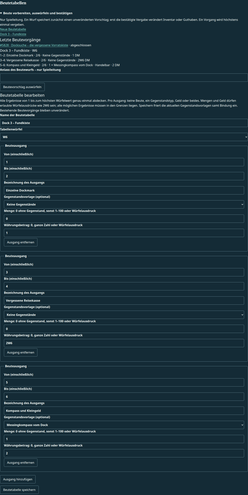

### Auswürfeln ist noch keine Vergabe

1. Die gespeicherte Tabelle öffnen.
2. Einen privaten Anlass eintragen.
3. **Beutevorschlag auswürfeln** wählen.
4. Ergebnis, Menge, Geldbetrag und gegebenenfalls Gegenstandsbindung prüfen.
5. Einen **Empfänger der gesamten Beute** auswählen.
6. Die Bestätigung setzen und **Beute verbindlich vergeben** wählen.

Der Vorschlag enthält den damaligen Tabellenstand sowie sämtliche Einzelwürfe.
Neuladen, späteres Öffnen und eine Wiederholung derselben Anfrage würfeln
nicht neu. **Ein bewusst neu gestarteter Wurf ist dagegen ein neuer Vorgang.**
Bis zur bestätigten Vergabe verändern sich weder Inventar noch Guthaben.
Ein Ergebnis ohne Belohnung wird mit **Ohne Beute abschließen** abgeschlossen.

Die gesamte Vergabe wird gemeinsam gespeichert: konkrete Gegenstandsexemplare,
Guthaben, Abschluss und erforderliche Protokolle. Scheitert ein Teil,
beispielsweise wegen eines vollen Inventars, bleibt auch das Geld unvergeben.
Ein abgeschlossener Vorgang kann nicht erneut auszahlen.
Ausgegebene Gegenstände sind nicht automatisch ausgerüstet.

Die bisherigen Buchungsrechte gelten unverändert: Bei gemeinsamem
Universumsguthaben benötigt die vergebende Kampagnenleitung zusätzlich das
zuständige Universumsrecht. Veraltete Empfänger-/Guthabenstände werden nicht
überschrieben; bei einem Konflikt den Vorgang neu laden und erneut prüfen.

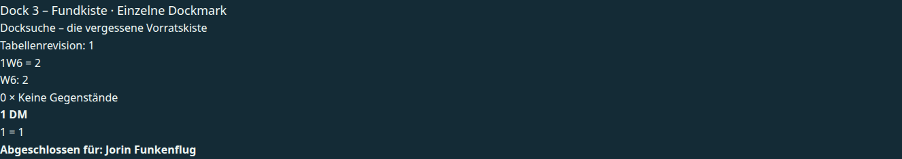

### Verknüpfung, Sichtbarkeit und Grenzen

Im Gegner-/NPC-Editor kann eine lokale Beutetabelle ausgewählt werden.
Der Link öffnet die Tabelle für die Spielleitung; er startet keinen Wurf und
keine automatische Auszahlung. Universumsvorlagen und daraus erstellte
Kampagnenkopien übernehmen diese lokale Tabellenreferenz nicht.

Tabellen, Chancen, private Anlässe und Vorschläge sehen nur Spielleitungen.
Charakterbesitzer sehen ihre erhaltenen Gegenstände und Guthabenbuchungen,
nicht die geheime Tabelle. Ohne aktives PS Community bleiben gespeicherte
Tabellen und Vorgänge erhalten; Änderungen sind gesperrt.

Noch nicht enthalten sind Gegenstandsgruppen, verschachtelte Tabellen,
universumsweite Beutekataloge, Aufteilung auf mehrere Empfänger und
automatische Vergaben. In der Demo ist **Dock 3 – Fundkiste** mit der
Zollwache verknüpft. Der gespeicherte W6-Wurf **2** ergab **1 Dockmark**
für Jorin: Sein Guthaben stieg von **8 auf 9 DM**.

## 19. Öffentliches Weltlexikon mit PS Wiki

Seit Version 0.19.0 kann jedes Universum ein optionales öffentliches
Regel-/Weltlexikon erhalten. PS Wiki muss auf derselben Website aktiv sein
und seine Kategorien bereitstellen. PS Community ist dafür nicht erforderlich.
**Das ist kein privates Kampagnen-Wiki.**

### Einmalig aktivieren und Kategorien festlegen

1. **Universen → Regelwerk & Basischaraktere → Öffentliches Weltlexikon**
   öffnen.
2. Unter **Öffentliche Kategorien und Anbindung** einen öffentlichen
   Lexikonnamen wählen. Der private Universumsname wird nicht vorausgefüllt.
3. Die sechs Unterkategorien **Personen, Gegner, Orte, Fraktionen, Gegenstände
   und Regeln** nach Wunsch benennen.
4. **Aktivieren** auswählen, die ausdrückliche Freigabe bestätigen und
   **Lexikonanbindung speichern** wählen.

Einrichten, Kategorien umbenennen und Pausieren benötigen neben den
Universumsrechten zusätzlich die nativen PS-Wiki-Rechte zum Veröffentlichen
und Verwalten von Kategorien. Fehlen diese, kann beispielsweise die
Administration die Einrichtung übernehmen. **Sie erlaubt damit ausdrücklich
der Universumsleitung, die zugeordneten Artikel dieses Lexikons über den
Pen-&-Paper-Adapter vorzubereiten und zu veröffentlichen.** Allgemeine
Wiki-Rechte oder Administratorrollen werden dadurch nicht vergeben.

Die Hauptkategorie und ihre sechs Unterkategorien entstehen automatisch
mit stabiler Zuordnung. **Ihre Namen sind sofort öffentlich sichtbar,
auch wenn noch kein Artikel veröffentlicht ist.** Kategorien schützen keine
Geheimnisse. Zusätzliche freie Kategorieebenen sind noch nicht vorgesehen.

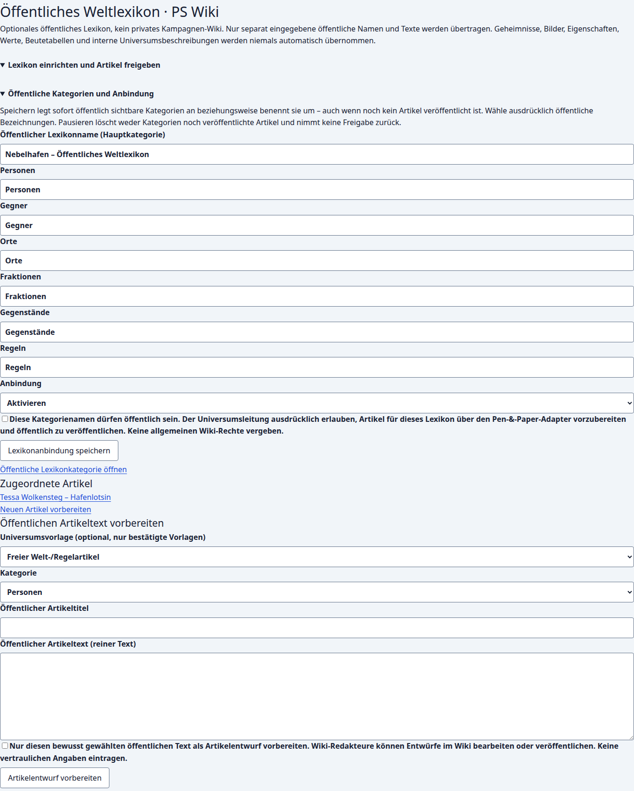

### Einen Artikel bewusst vorbereiten

1. Als Universumsleitung **Neuen Artikel vorbereiten** wählen.
2. Optional eine **bestätigte Universumsvorlage** auswählen. Vorgeschlagene
   und noch nicht aufgenommene Kampagnenfiguren können nicht verknüpft werden.
   Für Orte, Fraktionen oder Hausregeln **Freier Welt-/Regelartikel** verwenden.
3. Kategorie sowie einen separaten **öffentlichen Artikeltitel** und
   **öffentlichen Artikeltext** eintragen.
4. Die Bestätigung setzen und **Artikelentwurf vorbereiten** wählen.

Es werden keine internen Texte vorausgefüllt. Geheimnisse, private Identitäten,
Bilder, Eigenschaften, Zahlenwerte und Beuteinformationen werden nicht
automatisch übertragen. **Nur die separat eingegebenen Titel und Texte**
werden für den Artikel verwendet. Der Text ist reiner Text; Shortcodes werden
nicht ausgeführt.

Beim ersten Vorbereiten entsteht ein nativer PS-Wiki-Entwurf, noch kein über
diesen Ablauf veröffentlichter Artikel. Trotzdem niemals Geheimnisse eintragen:
**Wiki-Redakteure können Entwürfe mit den eigenen Wiki-Rechten lesen, ändern
oder außerhalb dieses Ablaufs veröffentlichen.**

Jede Figur kann genau einen solchen Artikeleintrag erhalten. Umbenennen der
Figur oder erneutes Anbieten erzeugt keine zweite Zuordnung. Zum Weiterarbeiten
den vorhandenen Eintrag unter **Zugeordnete Artikel** öffnen.
Eine Regelbeschreibung im Wiki verändert keine überprüfbaren Spielregeln.

### Veröffentlichen und später ändern

1. Den gespeicherten öffentlichen Titel und Text prüfen.
2. Die eigene Veröffentlichungsbestätigung setzen.
3. **Artikel öffentlich veröffentlichen** wählen.
4. Über **Öffentlichen Wiki-Artikel öffnen** die tatsächliche Gastansicht prüfen.

Veröffentlicht wird genau der gespeicherte Stand. Ein veraltetes oder
wiederholtes Freigabeformular wird abgelehnt. Neue vorbereitete Änderungen
lassen die bisherige öffentliche Fassung unverändert; erst die nächste
bewusste Freigabe ersetzt sie.

Kategorien, Artikel, Zuordnungen und erforderliche Protokolle werden gemeinsam
gespeichert oder zurückgenommen. Dazu müssen auch die beteiligten
WordPress-Taxonomietabellen InnoDB unterstützen. Native Wiki-Benachrichtigungen
werden erst nach erfolgreichem Abschluss ausgelöst.

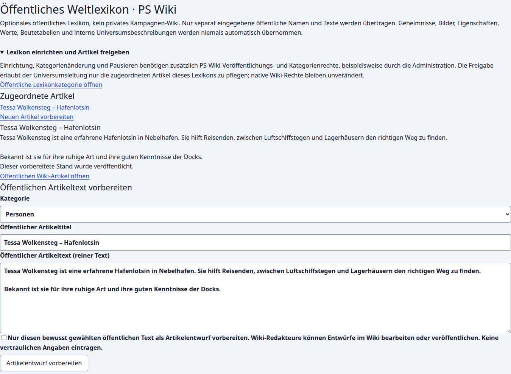

### Redaktionelle Konflikte, Pausieren und Grenzen

Ändert jemand den Artikel direkt in PS Wiki, überschreibt der Adapter diese
Ergänzungen nicht. Stattdessen erscheint ein Konflikthinweis; den Artikel
anschließend direkt im Wiki weiterpflegen. Ein automatischer Wiederabgleich
oder eine Zusammenführung ist noch nicht vorhanden. Dasselbe Schutzprinzip
gilt für außerhalb der Integration veränderte Kategorien.

**Pausieren nimmt keine Veröffentlichung zurück.** Kategorien, veröffentlichte
Artikel und deren frühere Wiki-Revisionen bleiben bestehen. Auch Deaktivieren
von PS Wiki oder Lösen einer Kampagnenzuordnung entfernt keine bereits
veröffentlichten Inhalte. Inhalte im Wiki nach dessen eigenen Möglichkeiten
verwalten; Veröffentlichung ist kein Weg, Geheimnisse zwischenzuspeichern.

Ohne aktives PS Wiki bleiben gespeicherte Zuordnungen und die gesamte
Pen-&-Paper-Runde erhalten; Wiki-Änderungen sind gesperrt. Private
Kampagnenleserechte, automatische Übernahme aller Figuren, zusätzliche
Kategorieebenen und Verknüpfungen zu einzelnen Szenen/Feldern folgen später.

Die öffentliche Demo **Tessa Wolkensteg – Hafenlotsin** gehört zum getrennten
**Nebelhafen – Wiki-Demouniversum**. Die bestehende Nebelhafen-Kampagne mit
ihren Charakteren und Guthaben wurde dafür nicht umgehängt.

## 20. Geschenke, Verkauf und Tausch

Seit Version 0.20.0 gibt es kontrollierten Handel mit aktivem **PS Community**.
Die Regeln legt die Spielleitung fest, nicht das Plugin für jede Runde gleich.

### Handelsregeln einstellen

- **Ohne Universum:** **Rundeneinstellungen → Handelsregeln** öffnen.
- **Mit Universum:** Die Universumsleitung öffnet **Universen → Regelwerk &
  Basischaraktere → Handelsregeln**. Kampagnen übernehmen diese Regeln
  unverändert und können sie nicht lokal überschreiben.
- **Geschenk**, **Verkauf** und **Tausch** einzeln erlauben oder ausschalten.
- Unter **Nach Zustimmung beider Besitzer** zusätzliche Spielleiterfreigabe
  verlangen oder den direkten Abschluss wählen.
- **Handelsregeln speichern**.

Standardmäßig sind **alle Arten ausgeschaltet** und die zusätzliche Freigabe
ist voreingestellt. Jede gespeicherte Regeländerung macht bisher offene
Angebote nicht mehr ausführbar, auch wenn dieselben Arten gewählt bleiben.
Diese Angebote zuerst zurückziehen oder ablehnen und bei Bedarf neu erstellen.

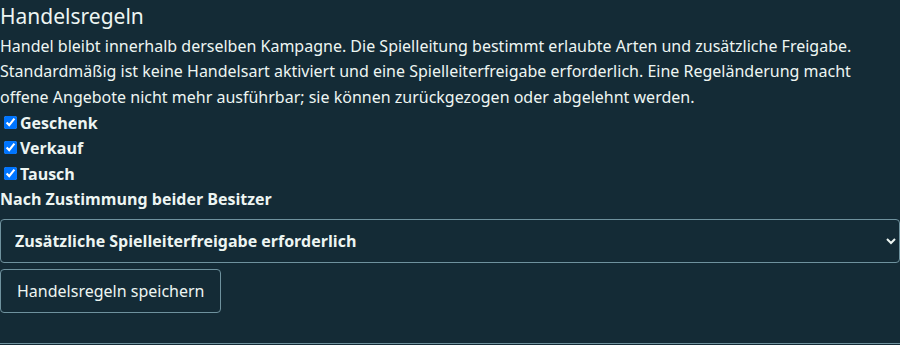

### Ein konkretes Exemplar anbieten

1. Im Spielbereich den **eigenen Charakterbogen** öffnen, alternativ den
   eigenen privaten **Pen-&-Paper-Profilbereich**.
2. Unter **Handel → Neues Angebot** die erlaubte Handelsart wählen.
3. Ein eigenes **handelbares, abgelegtes Exemplar** auswählen. Gebundene,
   bereits reservierte oder aktiv/in einem Ausrüstungsantrag angelegte
   Exemplare können nicht angeboten werden.
4. Einen freigegebenen Charakter eines **anderen Besitzers derselben
   Kampagne** wählen. Nur dessen freigegebener Name wird zur Auswahl gezeigt,
   nicht Bogenwerte, Inventar oder Guthaben.
5. Beim **Verkauf** einen ganzen Preis ab 1 eintragen; Geschenk und Tausch
   verwenden **0**. Der Käufer zahlt in der konfigurierten Währung.
6. Exemplar und Bedingungen bestätigen und **Handelsangebot erstellen** wählen.

Angebotene Exemplare sind bis zum Abschluss oder zur Ablehnung reserviert
und können nicht angelegt oder nochmals angeboten werden. **Geld wird nicht
reserviert:** Das tatsächliche Guthaben wird erst beim Abschluss geprüft.

### Zustimmen und abschließen

- **Geschenk/Verkauf:** Der Empfänger öffnet den eigenen Bogen, prüft das
  gespeicherte Exemplar und gegebenenfalls den Preis und nimmt verbindlich an.
- **Tausch:** Der Empfänger wählt zunächst ein eigenes zulässiges
  Gegenexemplar und bestätigt dieses Gegenangebot. Anschließend muss der
  ursprüngliche Anbieter den jetzt vollständig bestimmten Tausch bestätigen.
- Ist zusätzliche Spielleiterfreigabe eingestellt, bleibt der Vorgang
  **Wartet auf Spielleiterfreigabe**. Erst die Spielleitung bestätigt am
  betreffenden Bogen **Handel freigeben und abschließen**.
- Ohne zusätzliche Freigabe erfolgt der Abschluss nach der letzten nötigen
  Besitzerzustimmung. Die Spielleitung kann diese Zustimmung nicht ersetzen.

**Abgeschlossen** bedeutet: Gegenstände, gegebenenfalls Geld und alle nötigen
Protokolle sind gemeinsam gespeichert. Schlägt etwas fehl, bleibt nichts
teilweise übertragen. Volle Inventare, fehlendes Guthaben, entzogene
Mitgliedschaft oder geänderte Bedingungen führen zu einem ausdrücklichen Fehler.
Die Gegenstands-UUID und der eingefrorene Stand bleiben erhalten; auch offene
Ausrüstungsanträge werden angepasst, damit eine spätere Freigabe nichts
verdoppelt oder zurückholt. Empfangene Exemplare bleiben abgelegt.
Verkäufe verwenden je nach Kontomodell getrennte Kampagnenkonten oder die
ausdrücklich eingebundenen gemeinsamen Basisguthaben, keine Ersatzkonten.

Besitzer sehen ihre betreffenden Angebote und Abschlüsse; die Spielleitung
sieht die Kampagnenvorgänge und deren zentrale Historie. Weitere Inventarteile
und fremde Kontostände bleiben privat. Veraltete Abschlussformulare und
Neuladen übertragen nichts ein zweites Mal.

### Abbrechen, Grenzen und Demo

Der Anbieter kann ein offenes Angebot **zurückziehen**, der Empfänger
**ablehnen**, die Spielleitung **als Spielleitung ablehnen**. Das löst die
Reservierungen, auch wenn inzwischen die Handelsregeln geändert wurden.
Ohne Community bleiben Angebote und Nachweise gespeichert und im Spielbereich
lesbar; alle wirtschaftlichen Änderungen einschließlich Handelsentscheidungen
sind inaktiv.

Zunächst gilt **ein Exemplar je Seite, dieselbe Kampagne, unterschiedliche
Besitzer**. Pakete, Mengen, reine Geldgeschenke, Übertragungen eigener Figuren
untereinander und kampagnenübergreifender Handel fehlen noch.

In der Nebelhafen-Demo verkauft Mara den **Messingkompass vom Dock** für
**3 DM** an Jorin. Beide Besitzer stimmen zu; die Demo-Spielleitung gibt frei.
Mara besitzt anschließend **13 DM**, Jorin **6 DM** und genau dasselbe
Kompass-Exemplar. Der gebundene Bordausweis bleibt bei Mara. Der alte
Beschreibungstext des ausgegebenen Kompasses bleibt bewusst unverändert.

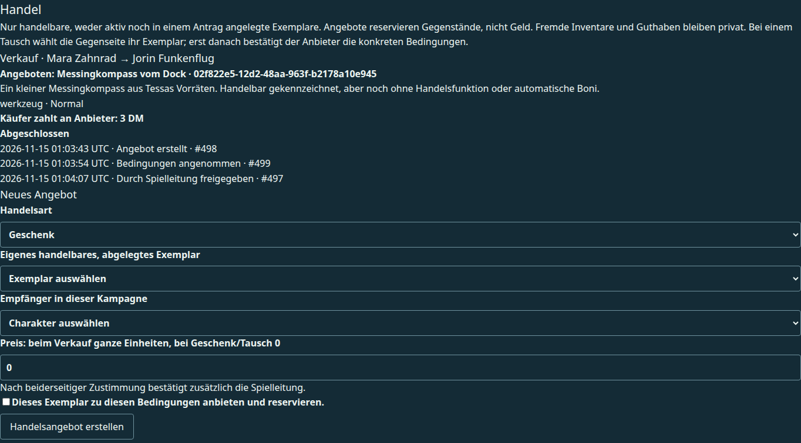

Weiterlesen: [Demorunde mit Ergebnissen und Prüfbericht](demokampagne.md) ·
[Technischer Überblick](../README.md) · [Roadmap](../ROADMAP.md).

## 21. Soloabenteuer

Seit Version **0.21.0** kann die Spielleitung aus freigegebenen Szenen ein
kleines, individuell gespieltes Abenteuer vorbereiten. Jeder Charakter erhält
einen eigenen privaten Durchlauf. Dieser Ablauf ist eine Ergänzung zum
gemeinsam geleiteten Spieltisch, kein automatisches Regelwerk und keine
Änderung an der aktiven Gruppenszene.

### Abenteuer vorbereiten und freigeben

1. Öffne als Spielleitung **Abenteuer & Szenen** und bearbeite die gewünschten
   Szenen wie gewohnt. Soloabenteuer dürfen ausschließlich auf Szenen
   verweisen, die regulär freigegeben sind.
2. Unter **Soloabenteuer** einen Titel und eine freigegebene Startszene
   auswählen und den privaten Entwurf speichern.
3. Für jede Entscheidung einen sichtbaren Entscheidungstext und eine
   freigegebene Folgeszene festlegen. Alternativ kann die Entscheidung den
   Durchlauf beenden.
4. Optional eine Probe mit einem im Kampagnenregelwerk erlaubten
   Würfelausdruck, einem Zahlenattribut oder einem festen Zahlenwert und
   Zielwert konfigurieren. Erfolgs- und Misserfolgsfolgen müssen jeweils auf
   eine freigegebene Szene oder das Ende verweisen.
5. Den Entwurf prüfen und **Soloabenteuer freigeben**. Das Freigeben speichert
   einen eigenen Szenen- und Entscheidungsstand samt Regelrevision. Neue oder
   geänderte Entwürfe werden erst nach ausdrücklicher erneuter Freigabe für
   neu begonnene Durchläufe verwendet. Bereits freigegebene Würfelproben
   bleiben in laufenden Durchläufen zulässig, auch wenn die aktuellen
   erlaubten Würfel später geändert werden.

Die aktuelle Umsetzung ist absichtlich begrenzt: höchstens 30 Szenen und
100 Entscheidungen pro Abenteuer, ohne Zyklen. Proben werten nur die gespeicherten erlaubten
Würfelgruppen und Zahlenattribute aus. Es gibt keine freie Skriptsprache,
keine frei programmierten Effekte. Ressourcen werden nur durch ausdrücklich
konfigurierte Kosten, Bestände nur durch konfigurierte Belohnungen verändert.

### Mindestwerte für Entscheidungen

Seit **0.22.0** kann eine Entscheidung zusätzlich eine Voraussetzung besitzen:

1. Unter **Entscheidung oder Probe ergänzen → Optionale Wertebedingungen**
   ein Zahlen- oder Attributfeld wählen. Seit 0.25.0 ersetzt dieser Bereich
   die einfache Mindestwerteingabe für neue Entscheidungen.
2. Den Vergleich **mindestens (≥)** und einen ganzzahligen **Vergleichswert**
   zwischen −1000000 und 1000000 wählen. **Keine Bedingung** mit Vergleichswert
   0 lässt eine Zeile ungenutzt; ohne ausgewählte Felder gibt es keine Bedingung.
   Für eine Entscheidung ohne Würfelprobe den Würfelausdruck und das
   Probe-Attribut leer lassen, den Erfolgszielwert auf 0 lassen und bei
   Misserfolg **Abenteuer beenden** wählen.
3. Entscheidung speichern und den Abenteuerentwurf ausdrücklich freigeben.
   Begonnene Durchläufe behalten ihre bisherigen Entscheidungen.

Die Voraussetzung ist unabhängig von der optionalen Würfelprobe. Beispiel:
**Tür aufbrechen** erfordert Stärke mindestens 5; erst dann darf die
Entscheidung gewählt und gegebenenfalls gewürfelt werden.
Der aktuelle freigegebene Charakterwert einschließlich wirksamer Ausrüstung
zählt, nicht ein offener Änderungsantrag. Die ältere einfache Mindestwertstruktur
gilt nur für Zahlen-/Attributfelder; die neuen Wertebedingungen unterstützen
zusätzlich Ressourcen. Die Prüfung selbst verbraucht nichts.

Bei einem zu niedrigen Wert bleiben Entscheidung, Voraussetzung und aktueller
Wert sichtbar, aber die Schaltfläche ist gesperrt. Nach einer Wertefreigabe
den Bogen neu laden. Auch ein zuvor geöffnetes, noch auswählbares Formular
wird serverseitig abgewiesen, wenn der Wert inzwischen zu niedrig ist.
Sind alle Entscheidungen gesperrt, bleibt der Durchlauf stehen; das Plugin
erfindet keine Ausweichentscheidung und senkt keine Mindestwerte.

Eine erfolgreiche Entscheidung speichert Feld, damaligen Wert und Mindestwert
gemeinsam mit dem Fortschritt und Pflichtereignis. Spätere Werteänderungen
schreiben diesen privaten Nachweis nicht um. Ältere Abenteuer, Durchläufe
und Ereignisse ohne Voraussetzungen bleiben lesbar und unverändert.

### Mehrere Wertebedingungen mit UND oder ODER

Seit **0.25.0** kann jede Entscheidung bis zu 20 Wertebedingungen erhalten.
Die Spielleitung entscheidet unter **Bedingungen verknüpfen**, ob **alle**
erfüllt sein müssen (UND) oder **mindestens eine** genügt (ODER).
Mit **Weitere Bedingung** lassen sich zusätzliche Zeilen ergänzen und wieder
entfernen. Ohne JavaScript stehen zwei Eingabezeilen zur Verfügung.

Jede Zeile wählt ein Feld, den Wertbestandteil, einen Vergleich und einen
ganzzahligen Vergleichswert von −1000000 bis 1000000:

- Zahlen und Attribute: den aktuellen freigegebenen wirksamen Wert verwenden.
- Ressourcen: **aktuellen Wert** oder persönliches **Maximum** wählen.
- Vergleiche: **mindestens (≥)**, **größer als (>)**, **höchstens (≤)**,
  **kleiner als (<)**, **gleich (=)** oder **ungleich (≠)**.

Beispiele: Stärke mindestens 6 **UND** Ausdauer aktuell mindestens 3;
oder Verstand mindestens 8 **ODER** Geschicklichkeit mindestens 7.
Offene Werteanträge zählen nicht. Aktive Ausrüstungsboni wirken auf Zahlen-
und Attributbedingungen genauso wie auf Proben. Ressourcenprüfungen ziehen
keine Punkte ab; etwaige Kosten werden separat und erst danach abgerechnet.
Eine zusätzlich vorhandene ältere Mindestwert-Voraussetzung muss unabhängig
von der neuen UND-/ODER-Gruppe ebenfalls erfüllt sein.

Alle Bedingungen bleiben mit freigegebenem Wert und Vergleichsergebnis
sichtbar. Bei ODER dürfen einzelne Bedingungen unerfüllt sein, solange eine
andere genügt. Ist die gesamte Gruppe nicht erfüllt, bleibt die Entscheidung
gesperrt; ein veraltetes Formular kann die erneute Serverprüfung nicht umgehen.
Es entstehen dabei weder Kosten, Belohnungen noch Fortschritt.

Der private Verlauf speichert die Gruppe mit allen damaligen Werten und
Einzelergebnissen, auch die unerfüllten Bedingungen einer erfolgreichen
ODER-Gruppe. Neufreigaben ändern laufende Durchläufe nicht; ältere Durchläufe
werden nicht migriert. Text-, Gegenstands- und verschachtelte Bedingungsgruppen
sind nicht Teil dieses Ausbaus.

### Ressourcenkosten pro Entscheidung

Seit **0.23.0** können Entscheidungen unabhängig von Mindestwerten und Proben
optionale Kosten erhalten. Die Spielleitung legt die Spielregel je Entscheidung
fest; keine Ressource oder feste Verbrauchsregel wird vorgegeben.

1. Unter **Entscheidung oder Probe ergänzen** bei **Optionale Ressourcenkosten**
   ein Ressourcenfeld wählen, beispielsweise Mana, Ausdauer oder Vorräte.
2. Positive ganzzahlige Kosten bis 1000000 angeben. Ohne Ressource den Betrag
   auf **0** lassen; dann verändert die Entscheidung keine Ressourcen.
3. Unter **Wann werden Kosten abgezogen?** wählen:
   - **Bei jedem ausgeführten Versuch, auch bei Misserfolg**: Eine misslungene
     Probe kostet genauso viel wie eine erfolgreiche.
   - **Nur bei Erfolg; ohne Würfelprobe immer**: Eine misslungene Probe
     verbraucht nichts. Eine Entscheidung ohne Probe bezahlt die Kosten immer.
4. Entscheidung speichern und den Abenteuerentwurf ausdrücklich freigeben.
   Bereits begonnene Durchläufe behalten ihren gespeicherten Kostenstand.

Die Ressource muss **vor jedem Versuch** reichen, auch bei erfolgsabhängigen
Kosten. Es gibt keine Überziehung: Der Rest darf weder unter 0 noch unter
die konfigurierte positive Ressourcen-Untergrenze fallen. Zu teure
Entscheidungen bleiben mit Betrag, Bestand und Kostenzeitpunkt sichtbar,
aber gesperrt; auch veraltete Formulare werden serverseitig erneut geprüft.

Der erste Ausbau unterstützt **eigenständige lokale Bögen und unabhängige
Kampagnenkopien**. Eine Kopie verbraucht nur ihren eigenen Bestand, nicht den
Universums-Basisbogen. Kostenpflichtige Versuche mit gemeinsamen Basisbögen
sind vorläufig gesperrt; kostenfreie Alternativen bleiben spielbar.
Ein offener Werteantrag muss vor einem kostenpflichtigen Versuch freigegeben
oder abgelehnt werden, damit er bereits abgezogene Kosten nicht später ersetzt.

Verbrauch verändert nur den aktuellen Wert der gewählten Ressource und die
Charakterrevision. Maximum, übrige Werte, Inventar und Basisverbindung bleiben
unverändert. Verbrauch, Durchlauf und private Pflichtereignisse werden gemeinsam
gespeichert: Scheitert eine Pflichtänderung, werden weder Kosten noch Fortschritt
übernommen. Wiederholtes Absenden zieht nichts ein zweites Mal ab.
Der Verlauf hält die damaligen Kosten und Vorher-/Nachherwerte fest; bei einer
misslungenen erfolgsabhängigen Probe zeigt er ausdrücklich den Nichtverbrauch.
Ältere kostenfreie Abenteuer und Durchläufe bleiben unverändert nutzbar.

### Belohnungen pro Entscheidung

Seit **0.24.0** kann die Spielleitung jede Entscheidung unabhängig von
Voraussetzung, Probe und Kosten mit einer optionalen Belohnung versehen.
Gegenstände und Währung benötigen **PS Community**; der erzählerische Ablauf
ohne Belohnungen bleibt davon unabhängig.

1. Unter **Optionale Abenteuerbelohnung → Belohnungsart** wählen:
   - **Keine Belohnung**: Alle zusätzlichen Auswahlen/Beträge auf 0 lassen.
   - **Feste Gegenstände und/oder Währung**: Einen Kataloggegenstand mit
     positiver Anzahl bis 100 und/oder einen ganzzahligen Währungsbetrag bis
     999999999 wählen. Ohne Gegenstand die Anzahl auf 0 lassen; keine Tabelle wählen.
   - **Vorhandene Beutetabelle**: Eine Tabelle der Kampagne wählen. Feste
     Gegenstandsauswahl, Anzahl und Währungsbetrag auf 0 lassen. Die Tabelle
     liefert den Ausgang und ihre bereits konfigurierten Mengen-/Geldwürfe.
2. Den Auslöser je Entscheidung festlegen: **Nach jeder ausgeführten
   Entscheidung, auch bei Misserfolg** oder **Nur bei Erfolg; ohne
   Würfelprobe immer**. Eine misslungene erfolgsabhängige Probe vergibt nichts.
3. Entscheidung speichern und das Abenteuer ausdrücklich freigeben.
   Eine Belohnung an der letzten Entscheidung kann den Abenteuerabschluss belohnen.

Beim Speichern der Entscheidung wird der gewählte Gegenstands- oder
Tabellenstand eingefroren, einschließlich Gegenstandsbindung und Währungsbezug.
Spätere Vorlagen-/Tabellenänderungen schreiben weder laufende Durchläufe noch
deren Vergaben um. **Mit der Abenteuerfreigabe wird der gewählte Stand Teil des
für berechtigte Spieler lesbaren Soloabenteuers.** Keine vertraulichen
Tabellendaten dafür auswählen; andere Tabellen und manuelle Beutevorgänge
bleiben privat.

Vor jedem Versuch müssen das aktive und gegebenenfalls beantragte Inventar
sowie das Guthaben **jedes mögliche Ergebnis** aufnehmen können. So wird eine
Tabelle bei vollem Inventar nicht so lange neu gewürfelt, bis ein kleineres
Ergebnis passt. Eine gesperrte Entscheidung bleibt mit Belohnungsregel und
Fehlermeldung sichtbar. Belohnungen werden ins Inventar gelegt, nicht ausgerüstet;
ein offener Ausrüstungsantrag erhält dieselben neuen Exemplare.

Gemeinsame Universumsguthaben benötigen bei der Abenteuerfreigabe die
Autorisierung der Universumsleitung oder Administration. Diese Berechtigung
wird vor der Auszahlung erneut geprüft. Lokale Bögen und unabhängige Kopien
erhalten bei einem gemeinsamen Kontomodell kein Ersatzkonto. Währungswechsel,
fehlende Community oder entzogene Vergaberechte werden ausdrücklich abgewiesen.

Kosten, tatsächliche Belohnung, Bestandsereignisse und Fortschritt werden
gemeinsam gespeichert oder vollständig zurückgenommen. Dieselbe Entscheidung
kann im Charakterdurchlauf nicht erneut auszahlen; es gibt keine Wiederholung
oder Rücksetzung des Durchlaufs. Der private Verlauf zeigt erhaltene Gegenstände,
Betrag, gegebenenfalls Tabellenwurf oder die ausgebliebene Belohnung bei Misserfolg.
Ältere Abenteuer ohne Belohnungen bleiben unverändert nutzbar.

### Solo spielen

1. Öffne den eigenen Charakterbogen oder den eigenen privaten
   Pen-&-Paper-Profilbereich.
2. Ein freigegebenes Abenteuer mit **Solo starten** beginnen. Ein Durchlauf
   gehört genau diesem Charakter und kann nicht zurückgesetzt werden.
3. Die angezeigte Szene lesen und eine der verfügbaren Entscheidungen wählen.
   Proben werden serverseitig durchgeführt; der gespeicherte Verlauf enthält
   Entscheidung, Würfelergebnis, verwendeten Zahlenwert und Szenenübergang.
4. Bei einer abgeschlossenen Szene ohne weitere Entscheidungen ist der
   Durchlauf beendet. Ein Neuladen oder wiederholtes Absenden erzeugt keinen
   zweiten Fortschritt.

Durchläufe und ihre Würfe sind nur für den Charakterbesitzer und die aktuelle
Spielleitung sichtbar. Das Entfernen aus der Kampagne entzieht den Zugriff;
ein erneuter Beitritt gewährt dem Besitzer wieder Zugriff auf den eigenen
Durchlauf. Die Spielleitung kann neue Starts pausieren oder wieder zulassen,
ohne laufende Durchläufe zu löschen. Ein pausiertes, bereits begonnenes
Abenteuer kann weitergespielt werden. Der Spielstand speichert keinen
separaten Charakterbogen: Zahlenproben verwenden den bei der Entscheidung
aktuellen, freigegebenen Zahlenwert des Charakters.

**Keine ungefragten Änderungen:** Ein Soloabenteuer verändert die aktive
Kampagnenszene nicht. Ressourcenverbrauch und Gegenstands-/Geldvergaben erfolgen
ausschließlich nach ausdrücklich konfigurierten und freigegebenen Regeln.
Es benötigt keine Gruppenentscheidung und
funktioniert unabhängig von PS Community. Teamdurchläufe, Rücksetzen,
Voraussetzungen jenseits der beschriebenen Wertebedingungen, automatische
Ressourcenregeneration sowie hybride Freigabeschritte bleiben spätere, getrennt zu planende
Erweiterungen.

In der Nebelhafen-Demo ist **Die Wetterkapsel vor dem Ablegen** als
Soloabenteuer freigegeben. Jorins Durchlauf endete nach einer erfolgreichen
Verstandprobe mit 9 gegen Zielwert 7 an der Szene **Auf dem Servicesteg**.
Die aktive Gruppenszene und Jorins Charakterbogen blieben dabei unverändert.
