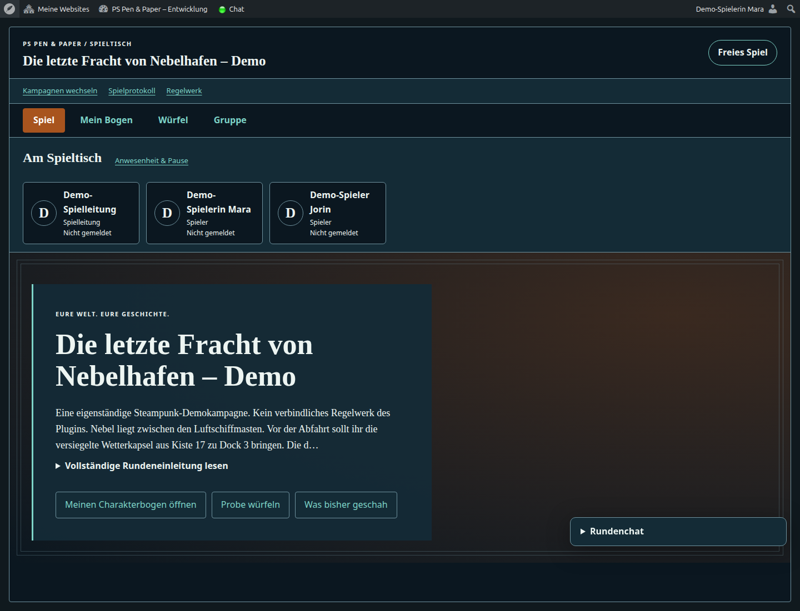
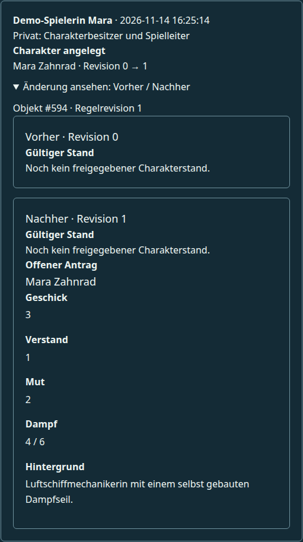
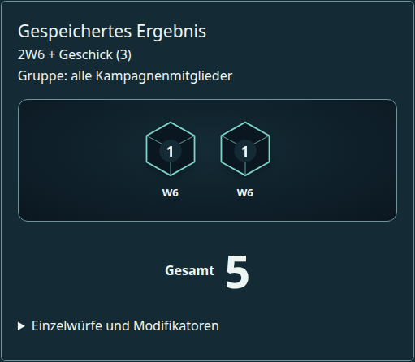

# PS Pen & Paper – Pluginhandbuch

Stand: Version 0.11.0 · 14. November 2026.

Dieses Handbuch beschreibt den vorhandenen Funktionsumfang, nicht die gesamte
Roadmap. Die Abbildungen zur Demorunde stammen aus der tatsächlich angelegten
[Demokampagne „Die letzte Fracht von Nebelhafen“](demokampagne.md).
Ihre Welt, Namen und Demoregeln sind Beispiele, keine Vorgaben des Plugins.
Die Universumsabbildungen zeigen eine getrennte, anschließend entfernte Prüfwelt.
Eine fremde Partnerprogramm-Debugleiste wurde nur für diese Aufnahmen ausgeblendet.

## Inhalt

1. [Ist das schon spielbar?](#1-ist-das-schon-spielbar)
2. [Installation und Spielbereich](#2-installation-und-spielbereich)
3. [Kampagnen und Mitglieder](#3-kampagnen-und-mitglieder)
4. [Regeln und Charakterfelder](#4-regeln-und-charakterfelder)
5. [Charaktere und Freigaben](#5-charaktere-und-freigaben)
6. [Würfeln](#6-würfeln)
7. [Ressourcen verwalten](#7-ressourcen-verwalten)
8. [Spielprotokoll lesen](#8-spielprotokoll-lesen)
9. [Farben anpassen](#9-farben-anpassen)
10. [Handy und Tablet](#10-handy-und-tablet)
11. [Probleme und Grenzen](#11-probleme-und-grenzen)

## 1. Ist das schon spielbar?

**Als Werkzeug für eine moderierte Pen-and-Paper-Runde: ja. Als vollständiger
Abenteuer-Spielbereich mit Szenenverwaltung: noch nicht.**

| Bereits nutzbar | Noch nicht vorhanden |
|---|---|
| Getrennte Kampagnen und Mitgliedschaften | Kapitel- und Szeneneditor |
| Frei benennbare Attribute, Texte und Ressourcen | Geschützte Spielleitergeheimnisse und Szenenfreigaben |
| Charakterbögen mit direkter Bearbeitung oder Freigabepflicht | Entwürfe und Spielervorschau für Abenteuertexte |
| Würfel, Attributwerte und geschützte Ergebnisse | Automatische Erfolgsbewertung oder komplexe Würfelmechaniken |
| Änderungs- und Wurfprotokoll | Automatisch geprüfter Punktepool |
| Kampagnenfarben und responsive Bedienung | Inventar, NPC-Verwaltung und private Handouts |

Die Spielleitung erzählt derzeit beispielsweise mündlich oder über ein
geeignetes separates Kommunikationsmittel. Die Kampagnenbeschreibung eignet
sich für eine gemeinsame Einleitung, **nicht für Geheimnisse**.
PS Chat lässt sich mit den ergänzten Spieltisch-Schnittstellen geschützt
einbetten; PS Wiki ist noch nicht mit Kampagnenrechten verbunden.

## 2. Installation und Spielbereich

1. Plugin auf der gewünschten Website aktivieren. In einem Netzwerk auf die
   richtige Unterwebsite achten.
2. Eine normale Seite anlegen und genau einmal `[ps_pen_paper]` einfügen.
3. Optional die Seitenvorlage **„PS Pen & Paper – Spielbereich“** auswählen,
   wenn kein Theme-Layout verwendet werden soll.
4. Die Seite veröffentlichen und angemeldet öffnen.
5. Bei Seiten-Caches oder CDNs die Seite **einschließlich ihrer
   Abfrageparameter vom Caching ausschließen**.

Auf unserer Entwicklungswebsite besteht der
[Spielbereich](http://ps-dev.local/pen-paper/spielbereich/) bereits.
Das Plugin legt eine solche Seite nicht automatisch an.

Standardmäßig erhalten Gäste eine Anmeldeaufforderung. Die Spielleitung kann
einen separaten Teaser ausdrücklich freigeben; der Spieltisch bleibt trotzdem
geschützt. Eine öffentliche Spielseite macht interne Kampagnendaten nicht öffentlich.

*Ausschnitt aus Maras echter Spieleransicht. Zusätzliche Einstellungen für
Spielleiter sind dort nicht eingeblendet.*

### Der Spieltisch

Die kompakte Gruppenleiste steht oberhalb der großen Spielfläche.
„Mein Bogen“ öffnet den gegliederten Charakterbogen mit Profil, Attributen
und Ressourcen. Spielleiter sehen unter „Bögen“ auch die Bögen ihrer Spieler
und offene Anträge. Würfel, Regelwerk und Spielprotokoll öffnen eigene
Bereiche; „Bogen öffnen / bearbeiten“ führt zum privaten Detailbogen.
Das eigentliche Eingabeformular wird dort erst über „Bogen bearbeiten“ geöffnet.

Die Spielleitung bestimmt unter „Wer ist am Zug?“ einen Teilnehmer oder
„Freies Spiel“. Der Zugmarker wird für die Gruppe aktualisiert und im
Protokoll festgehalten. Er ist keine automatische Initiativeberechnung.

### Anwesenheit und kurze Pausen

- „Anwesenheit teilen“ freiwillig aktivieren. Sonst steht dort „Nicht gemeldet“.
- Für eine Pause eine optionale kurze Notiz wie „Küche“ eingeben und
  „Kurze Pause / AFK“ drücken.
- Mit „Wieder da“ zur aktiven Anwesenheit zurückkehren.
- „Status nicht mehr teilen“ beendet die Anzeige.

Die Aktualisierung erfolgt bei sichtbarer Seite alle 30 Sekunden. Mehr als
zwei Minuten ohne Meldung bedeutet „Offline“, nicht zwingend eine Abmeldung.
AFK wird durch Hintergrundmeldungen nicht aufgehoben und überspringt keinen
Zug. Es gibt keine Anwesenheitshistorie; aktuelle Meldungen laufen nach
höchstens einem Tag aus. Verbindungs- und Browserpausen können die Anzeige
verzögern.

### Rundenchat

„Rundenchat“ öffnet die Chatbox in der Bildschirmecke. Nachrichten und
Moderation stammen aus PS Chat; Spielleiter sind Moderatoren ihres Raums.
Zugang haben nur aktuelle Kampagnenmitglieder sowie Website-Administratoren.
Eine getrennte Anmeldung zu einzelnen Sitzungen gibt es noch nicht.

Erforderlich ist PS Chat mit den im
[technischen Überblick](../README.md#optionaler-rundenchat-mit-ps-chat)
beschriebenen Spieltisch-Schnittstellen. Ohne passende Integration erscheint
ein Hinweis. Chatverlauf und Spielprotokoll sind getrennt; Würfelergebnisse
werden nicht automatisch als Nachrichten übertragen.

## 3. Kampagnen und Mitglieder

Unter **Pen & Paper** im Backend:

1. Als Website-Administrator eine Kampagne erstellen oder einem Benutzer die
   Berechtigung **„Kampagnen erstellen“** geben.
2. Name und gemeinsame Beschreibung speichern.
3. Bereits vorhandene Mitglieder dieser Website als **Spieler** oder
   **Spielleiter** aufnehmen.
4. Regelwerk einrichten, bevor die ersten Charaktere entstehen.

Die Kampagnenrolle ist nicht dieselbe wie die WordPress-Benutzerrolle.
Ein Benutzer kann in einer Kampagne Spielleiter und in einer anderen Spieler
sein. Der Ersteller bleibt Spielleiter und kann nicht entfernt werden.
Administratoren können alle Kampagnen verwalten.
Netzwerk-Superadmins sehen und verwalten auch ohne Mitgliedschaft auf der
jeweiligen Unterwebsite sämtliche dortigen Kampagnen, Bögen, Protokolle und Chats.

### Übersichtliche Verwaltungsbereiche

Im Backend unter **Pen & Paper** und auf der Startseite des Frontend-Spielbereichs:

- **Übersicht:** Orientierung und Erklärung des Einstiegs.
- **Universen:** Welten, Regelvorlagen und Basisbögen verwalten; Kampagnen zuordnen.
- **Kampagnen:** Runde wählen; die Backend-Ansicht erlaubt Berechtigten die Anlage.
- **Charakterverwaltung:** eigene und als Spielleitung verwaltbare Bögen finden.
- **Einstellungen:** verwaltbare Runde wählen; Zugang, Anfragen, Bilder und Farben
  direkt im Frontend ändern. Globale Erstellberechtigungen bleiben im Backend.

### Universum anlegen und Kampagnen zuordnen

1. Als Administrator oder mit der Erstellberechtigung unter **Universen**
   einen Namen und eine interne Weltbeschreibung speichern.
2. Unter **Kampagne zuordnen oder lösen** die eigene Kampagne und das
   Zieluniversum wählen. **Ohne Universum** löst eine vorhandene Zuordnung.
3. **Zuordnung prüfen** öffnet die Vorschau. Die bisherige Zuordnung bleibt
   dabei unverändert.
4. Die Vorschau lesen, das Bestätigungsfeld markieren und **Zuordnung bestätigen**
   wählen. Veraltete Zuordnungen oder zwischenzeitlich geänderte Zieluniversen
   erfordern eine neue Vorschau.

Nur Ersteller und Administration verwalten ein Universum. Zum Zuordnen sind
zusätzlich Verwaltungsrechte für die Kampagne und gegebenenfalls das bisherige
Universum erforderlich. Ein Universum zeigt ausschließlich Kampagnen, auf die
die angemeldete Person ohnehin Zugriff hat. Mitgliedschaften und Chat-Rechte
werden nicht vererbt; Spieler sehen auch nicht die interne Weltbeschreibung.

Universumsänderungen stehen im eigenen Änderungsverlauf, Zuordnungen nur für
die Spielleitung im jeweiligen Kampagnenprotokoll. Die Universumsansicht zeigt
die letzten 20 Änderungen; ältere Datensätze bleiben gespeichert.

Die Zuordnung allein verändert weiterhin keine Regeln, Bögen oder Freigaben.
Nutzt eine Kampagne gemeinsame Basisbögen, ist das Lösen oder Wechseln derzeit
gesperrt. Unabhängige Kopien dürfen ihre Universumszuordnung dagegen verlieren.

### Regelvorlage und Basisbögen verwenden

1. Im Universum **Regelwerk & Basischaraktere** öffnen.
2. **Universumsregelwerk bearbeiten** aufklappen. Felder, Wertebereiche, Startwerte,
   erlaubte Würfel und Wurfsichtbarkeiten festlegen und speichern.
   Die Spielerbearbeitung ist eine Vorgabe für spätere Kampagnen; Basisbögen
   bearbeitet unabhängig davon ausschließlich die Universumsleitung.
3. Einen **Basischarakter** für ein leseberechtigtes Mitglied dieser Website
   anlegen. Der Besitz öffnet noch keine Kampagne und keine Universumsverwaltung.
4. Eine neue, noch unkonfigurierte Kampagne zuordnen und den Besitzer dort als
   Teilnehmer aufnehmen. Die persönliche Aufnahme erfolgt weiterhin im Backend,
   alternativ entscheidet die Spielleitung über einen Beitrittsantrag.
5. Unter **In eine Kampagne übernehmen** die **Regelvorlage übernehmen**
   ausdrücklich bestätigen. Das funktioniert nur ohne gespeichertes
   Kampagnenregelwerk und ohne Charaktere. Die Feldkennungen bleiben erhalten;
   spätere Vorlagenänderungen werden nicht automatisch nachgezogen.
6. Einen freigegebenen Basisbogen wählen, **Gemeinsamer Basisstand** oder
   **Unabhängige Kampagnenkopie** auswählen und die Übernahme bestätigen.

*Die getrennte Prüfwelt besitzt einen Basisbogen und zwei zugeordnete Runden.
Die ausdrücklich gewählte Übernahme ändert keine Mitgliedschaften.*

**Gemeinsamer Basisstand:** Änderungen am freigegebenen Basisbogen erscheinen
auch in seinen gemeinsamen Kampagnenbögen. Grundwerte und Ressourcen werden im
Universum bearbeitet, nicht im Kampagnenbogen. Offene Basisanträge bleiben privat.

**Unabhängige Kampagnenkopie:** Nur der aktuelle freigegebene Stand wird
übernommen. Die Kopie hat danach eigene Bearbeitung und Freigaben entsprechend
dem Kampagnenregelwerk; späterer Basisfortschritt verändert sie nicht.
Sie bleibt auch bei fehlender Basis oder gelöster Universumszuordnung nutzbar.

Zur Übernahme muss dieselbe Person Universum und Kampagne verwalten dürfen;
die Feldkennungen und Wertebereiche müssen zusammenpassen. Bestehende
Kampagnen werden nicht automatisch migriert oder überschrieben.

### Kampagnenbezogene Handicaps und Stufen

Die Kampagnenleitung öffnet den übernommenen Bogen und klappt unter
**Kampagnenkontext** den Bereich **Kampagnenauflagen bearbeiten** auf.
Für Zahlen- und Attributfelder lassen sich absolute ganze Werte innerhalb
der Regelgrenzen eintragen, beispielsweise Mut 2 oder Stufe 1.
**Kampagnenauflagen freigeben** macht diese Werte nur in dieser Kampagne wirksam.
Ein leeres Feld übernimmt wieder den Grundwert. Das gilt für gemeinsame Bögen
und unabhängige Kopien gleichermaßen.

*Elins Basis besitzt Mut 8 und Stufe 3. In der gemeinsamen Proberunde gelten
wegen ihrer lokalen Auflagen Mut 2 und Stufe 1. Andere Runden bleiben unverändert.*

Angezeigt und gewürfelt wird mit dem effektiven Stand. Basis und andere Runden
werden nicht überschrieben; auch bei einer Bearbeitung der Kopie bleiben ihre
gesonderten Auflagen erhalten. Notiz und Änderungshistorie sehen nur Besitzer,
aktuelle Spielleitung und Administration. Nur die Kampagnenleitung erteilt
Auflagen; dafür sind keine Verwaltungsrechte am Universum erforderlich.
Basisänderungen stehen dagegen in der geschützten Universumshistorie.

Ressourcenauflagen, ein späterer Wechsel zwischen gemeinsamem Stand und Kopie,
Spieleranträge für Basisbögen sowie universumsweite Mitgliedschaften fehlen noch.
Eine frei benannte numerische Stufe ist möglich, aber noch kein XP-System oder
automatischer Stufenaufstieg. Eine fehlende gemeinsame Basis erzeugt einen
sichtbaren Fehler statt eines veralteten Ersatzbogens.

### Später auf Englisch übersetzen

Die Textdomain heißt **`ps-pen-paper`**. Aus
[`languages/ps-pen-paper.pot`](../languages/ps-pen-paper.pot) lässt sich etwa mit
Poedit ein englischer Katalog erstellen. Diesen als
`languages/ps-pen-paper-en_US.po` und die kompilierte
`languages/ps-pen-paper-en_US.mo` speichern; für britisches Englisch `en_GB`
verwenden. WordPress beziehungsweise ClassicPress wählt die Übersetzung anhand
der Website- oder Benutzersprache.

Noch wird kein fertiger englischer Katalog ausgeliefert. Nicht übersetzte
Plugintexte bleiben deutsch. Selbst verfasste Weltbeschreibungen, Regelbegriffe
und Spielinhalte werden nicht automatisch übersetzt.

### Als Spieler anmelden und einen Bogen erstellen

1. Ein Benutzerkonto beim Website-Betreiber erhalten oder dessen normale
   Registrierung verwenden, falls diese freigegeben ist. Das Plugin selbst
   bietet noch keine Kontoregistrierung an.
2. Im Spielbereich **Anmelden** wählen.
3. Den Kampagnenlink von der Spielleitung öffnen.
4. Falls angeboten, **Teilnahme beantragen** wählen und die Entscheidung abwarten.
   Sonst nimmt die Spielleitung dich persönlich auf.
5. Nach der Aufnahme die Runde unter **Kampagnen** öffnen.
6. **Ersten Charakter erstellen** beziehungsweise **Mein Bogen → Neuen Charakter
   erstellen** öffnen, den Bogen ausfüllen und speichern.
7. Wenn das Regelwerk es verlangt, die Freigabe durch die Spielleitung abwarten.

Eine offene Anfrage gewährt noch keinen Spiel- oder Chat-Zugang.
Die Aufnahme als Spieler gewährt keine Spielleiterrechte.

### Gäste, Vorschau und Beitrittsanfragen

Unter **Rundeneinstellungen → Zugang & Privatsphäre** entscheidet die Spielleitung:

- **Geschlossen:** keine Kampagnendaten für Gäste und Nichtmitglieder.
- **Titel und separaten Teaser freigeben:** nur diese zwei Angaben sind über den
  Kampagnenlink öffentlich sichtbar. Die interne Beschreibung wird nie übernommen.
- **Anfragen erlauben:** angemeldete Mitglieder dieser Website können bei
  freigegebener Vorschau eine Aufnahme beantragen.
- **Persönliche Aufnahme:** die Spielleitung fügt vorhandene Benutzer selbst hinzu.

Teilnehmerliste, Anwesenheit, Hintergrundbild, Bögen, Würfe, Protokoll und Chat
bleiben geschützt. Es gibt keine öffentliche Kampagnenübersicht; die Vorschau
wird über den weitergegebenen Link geöffnet. Unter **Beitrittsanfragen** nimmt
die Spielleitung Antragsteller als Spieler auf oder lehnt sie ab. Bereits offene
Anfragen lassen sich auch nach Schließen der Vorschau noch entscheiden.
Nach einer Ablehnung oder beendeten Teilnahme ist eine erneute automatische
Anfrage gesperrt; für eine spätere Aufnahme die Spielleitung kontaktieren.

Einladungen und die automatische Aufnahme in eine Netzwerk-Unterwebsite sind
noch nicht enthalten. Benutzer müssen dort bereits Mitglied sein.
**„Archiviert“ ist derzeit nur eine Kennzeichnung, keine Schreibsperre.**

**Praxishinweis zur Entwicklungswebsite:** Der normale Demo-Spielleiter wurde
beim Backend-Zugriff umgeleitet. Zugang, Beitrittsanfragen, Bilder und Farben
sind inzwischen direkt im Frontend erreichbar; Anträge, Freigaben und Würfe funktionieren
über den Frontend-Spielbereich auch für die normalen Demokonten.
Für selbstständige Spielleiter muss dieser Backend-Zugriff vor einem Einsatz
auf dieser Website geklärt werden. Nicht pauschal Administratorrechte vergeben.

## 4. Regeln und Charakterfelder

Im **Regelwerk** werden Name, Beschreibung, erlaubte Würfel, Wurfsichtbarkeiten
und die Bearbeitungspolitik für Charaktere festgelegt.

*Ausschnitt aus der Verwaltung: In der Demo sind W6 und W20 sowie alle drei
Sichtbarkeiten erlaubt.*

Bis zu 30 Felder sind möglich:

| Feldtyp | Verwendung |
|---|---|
| Kurzer Text | Herkunft, Beruf oder andere frei benannte Angaben |
| Langer Text | Hintergrundgeschichte und ausführliche Notizen |
| Zahl | Ganzzahliger Wert mit Grenzen und Startwert |
| Attribut | Ganzzahliger Wert, auch zum Addieren bei Würfen |
| Ressource | Aktueller Wert und persönliches Maximum |

Bezeichnungen, Erläuterungen und Reihenfolge sind frei. Bei Zahlenfeldern
liegen Minimum, Maximum und Startwert zwischen −1000000 und 1000000.
Felder werden über Schaltflächen hinzugefügt, verschoben und entfernt.

### Bestehende Regeln ändern

- **Umbenennen** erhält die interne Feldkennung und vorhandene Werte.
- **Neue Startwerte** überschreiben keine bestehenden Charakterwerte.
- Sobald Charaktere existieren, sind Änderungen an Feldliste, Typen,
  Pflichtstatus und Wertebereichen vorläufig gesperrt.
- Neue Regeländerungen werden mit Vorher-/Nachher-Ständen protokolliert.
- Bei einem Konflikt die Seite neu laden und die Änderung erneut prüfen.

Eine automatische Übernahme struktureller Regeländerungen gibt es noch nicht.
In der Demo wurde „Dampf“ nach dem Spielen zu „Kesseldruck“ umbenannt:
Die Ressource blieb erhalten.

## 5. Charaktere und Freigaben

Spieler öffnen ihre Kampagne im Spielbereich und erstellen dort ihren eigenen
Charakter. Spielleiter können auch Charaktere für andere Mitglieder erstellen.
Name und Felder werden serverseitig geprüft.

Die Spielleitung wählt pro Kampagne:

- **Mit Freigabe:** Spieleränderungen bleiben zunächst ein Antrag.
- **Direkt:** Spieleränderungen werden unmittelbar gültig.
- **Nur Spielleiter:** Spieler können ihre Bögen lesen, aber nicht bearbeiten.

Im Freigabemodus zeigt die Charakterseite **„Gültiger Stand“** und gegebenenfalls
**„Offener Antrag“** getrennt. Spielleiter können **„Freigeben“** oder
**„Antrag verwerfen“** wählen. Eine Ablehnung verändert den gültigen Stand nicht.
Ein noch nicht freigegebener neuer Charakter kann nicht für Attributwürfe
verwendet werden.

*Dies ist die historische Vorher-/Nachher-Ansicht von Maras Erstanlage:
Der Antrag war gespeichert, aber noch kein Wert freigegeben. Die spätere
Freigabe ist ein eigener Protokolleintrag.*

Ein neuer Spielerantrag ersetzt den vorherigen Antrag. Eine direkte Speicherung
durch den Spielleiter übernimmt die Werte sofort und entfernt einen offenen
Antrag. Ein Wechsel der Bearbeitungspolitik allein genehmigt keine Anträge.

Charakterbögen sehen derzeit nur Besitzer und aktuelle Spielleiter
beziehungsweise Administratoren, nicht automatisch die ganze Gruppe.
Gewöhnliche Bögen bleiben kampagnengebunden. Aus einem Universum übernommene
Bögen folgen dem ausdrücklich gewählten gemeinsamen oder unabhängigen Modus
und können zusätzliche lokale Zahlenauflagen besitzen; siehe Abschnitt 3.

## 6. Würfeln

Unter **„Würfel / Protokoll“**:

1. Einen erlaubten Würfel über die Schnellwahl wählen oder den Ausdruck eingeben.
2. Optional einen freigegebenen eigenen Charakter auswählen.
3. Optional ein Zahlen- oder Attributfeld addieren.
4. Sichtbarkeit und gegebenenfalls Anlass wählen.
5. **„Jetzt würfeln“** drücken.

Bei übernommenen Basisbögen speichert der Wurf neben dem tatsächlichen
Attributwert auch Basis- und Kontextrevision. Diese stehen unter
**Einzelwürfe und Modifikatoren**. Private Auflagennotizen werden nicht in
Gruppenwürfe übernommen. Spätere Basis- oder Auflagenänderungen verändern
keinen bereits gespeicherten Wurf.

Beispiele: `3W6 + 2`, `W20 + 2W6 - 1`, `D100`.
Erlaubt sind höchstens zehn addierte Würfelgruppen mit insgesamt 100 Würfeln
und ein abschließender ganzzahliger Modifikator bis ±1000000.
Die Kampagne kann die Würfel und Sichtbarkeiten weiter einschränken.

**Attribut nicht doppelt addieren:** Für `2W6 + Geschick` in der Demo nur
`2W6` eingeben und Geschick im Auswahlfeld wählen.
Verwendet wird der freigegebene Zahlenwert, kein automatisch abgeleiteter Bonus.

*Echtes Demowurfergebnis: 1 + 1 + Geschick 3 = 5. Die Würfel wurden nicht
für ein schöneres Ergebnis erneut geworfen.*

| Sichtbarkeit | Wer liest das Ergebnis? |
|---|---|
| Gruppe | Aktuelle Kampagnenmitglieder, keine anonymen Besucher |
| Privat | Würfelnder, ausgewählter Charakterbesitzer und aktuelle Spielleiter |
| Verdeckt | Nur aktuelle Spielleiter und Administratoren |

Bei einer verdeckten Spielerprobe erhält der Spieler nur eine Bestätigung.
Eine Gruppenprobe teilt auch den gewählten Charakternamen und Attributwert.
Spielleiter können für andere Mitglieder würfeln.

Würfe werden auf dem Server gespeichert. Die Animation verändert keine Zahlen.
Neuladen einer Ergebnisseite würfelt nicht erneut.
**Erfolg, Komplikationen und Ressourcenverbrauch bewertet die Spielleitung.**

## 7. Ressourcen verwalten

Ressourcen haben einen aktuellen Wert und ein persönliches Maximum.
Beide müssen im erlaubten Bereich liegen; aktuell darf nicht größer als das
persönliche Maximum sein.

Eine Ressource wird über den Charakterbogen verändert. Im Freigabemodus wird
auch ein Verbrauch zunächst beantragt. Würfeln zieht nicht automatisch etwas ab.

*Vor der Freigabe: gültig 4/6, beantragt 3/6. Nach der Freigabe: gültig 3/6.
Der historische Feldname „Dampf“ bleibt im Protokoll erhalten.*

## 8. Spielprotokoll lesen

**„Spielprotokoll“** zeigt Würfe, Regeländerungen, Charakteränderungen, Anträge,
Freigaben, Ablehnungen und Zugwechsel. Über **„Änderung ansehen: Vorher / Nachher“** werden
die damaligen Stände geöffnet.

- 20 berechtigte Ereignisse pro Seite; weitere Seiten über die Navigation.
- Charakterereignisse bleiben privat für Besitzer und aktuelle Spielleiter.
- Die damalige Bearbeitung allein verschafft ehemaligen Spielleitern keinen
  dauerhaften Zugriff auf fremde Charakterdaten.
- Entfernte Mitglieder verlieren auch den Zugriff auf ältere eigene Einträge.
- Neue Korrekturen erzeugen neue Ereignisse; alte Einträge werden nicht bearbeitet.

Charakter- und Regelhistorie beginnen mit Version 0.7.0. Frühere Änderungen
werden nicht rückwirkend ergänzt. Mitglieder- und Style-Änderungen werden
derzeit nicht protokolliert; Szenenereignisse folgen mit dem Story Builder.
Änderungen an Zugang und Teaser werden seit Version 0.9.0 mit Vorher/Nachher
ausschließlich für Spielleitung und Administration protokolliert.

## 9. Farben anpassen

Unter **„Rundeneinstellungen“ → „Farben & Lesbarkeit anpassen“**:

1. Hintergrund, Flächen, Text, Schaltflächen, Links und Rahmen auswählen.
2. Live-Vorschau und Kontrasthinweise prüfen.
3. **„Gestaltung speichern“** drücken.

Hex-Farben haben sechs Stellen, etwa `#142b36`.
Die Schrift auf Schaltflächen wird automatisch schwarz oder weiß gewählt.
Der Kontrastrichtwert beträgt 4,5:1; Hinweise verhindern das Speichern nicht.
**„Standardfarben laden“** setzt zunächst nur die Eingaben zurück.
Die Farben verändern nicht das Theme oder andere Kampagnen.

### Ein eigenes Bild für den Spieltisch

Unter **Rundeneinstellungen → Bild für den Spieltisch** ein PNG-, JPEG- oder
WebP-Bild auswählen und **Hintergrund speichern** drücken. Erlaubt sind
höchstens 2 MiB und 3000 × 3000 Pixel; SVG und externe Bildadressen nicht.
Nur Bilder verwenden, für die die nötigen Rechte vorliegen.

Das Bild wird geschützt in der Datenbank gespeichert und nur an berechtigte
Betrachter ausgeliefert, nicht über eine öffentliche Mediathek-Adresse.
**Hintergrund entfernen** stellt den bildfreien Tisch wieder her und löscht
die gespeicherten Bilddaten. Ein Ersatzbild entfernt das vorherige; auch beim
endgültigen Löschen der Kampagne werden ihre Bilddaten gelöscht.
Für schnelle mobile Darstellung möglichst kleine Dateien verwenden.
Bild-Avatare und eigene Hintergrundbilder für Charakterbögen folgen später.

## 10. Handy und Tablet

Die Oberfläche nutzt responsive Anordnung und große Bedienelemente.
Auf schmalen Ansichten wechseln „Spiel“, „Mein Bogen“, „Würfel“ und „Gruppe“
den sichtbaren Bereich. Der Zugstatus bleibt in der Bereichsnavigation sichtbar.
Die Abbildung wurde bei 390 Pixeln Browserbreite aufgenommen.

Es gibt keinen erforderlichen Drag-and-drop-Ablauf. Ein Betriebssystemwunsch
nach reduzierter Bewegung wird berücksichtigt. Ohne JavaScript bleiben
Formulare und Ergebnisse nutzbar; Schnellwahl, Live-Farbvorschau und Änderungen
an der Feldliste sowie Anwesenheit und Zugsteuerung benötigen JavaScript.

## 11. Probleme und Grenzen

| Problem | Prüfen |
|---|---|
| Keine Kampagne sichtbar | Anmeldung, richtige Unterwebsite und Mitgliedschaft |
| Kampagne kann nicht erstellt werden | Berechtigung durch einen Website-Administrator |
| Spielleiter landet auf einer anderen Backend-Seite | Weiterleitungen anderer Website-Komponenten prüfen lassen; Frontend-Aktionen gesondert testen |
| Charakter fehlt beim Würfeln | Freigegebener Stand, Besitzerrechte und aktuelle Mitgliedschaft |
| Verdecktes Ergebnis fehlt | Für Spieler beabsichtigt, kein Anzeigefehler |
| Werteänderung wirkt noch nicht | Offenen Freigabeantrag prüfen |
| Würfeln deaktiviert | Mindestens einen Würfel und eine Sichtbarkeit erlauben |
| Speicherkonflikt | Neu laden und gültigen Stand mit eigenen Änderungen abgleichen |
| Administratorprüfung angefordert | Nicht blind erneut speichern; unvollständigen Vorgang prüfen lassen |

Regel- und Charakteränderungen werden bei erkannten Speicherfehlern
revisionsgeschützt zurückgenommen, soweit das ohne Überschreiben anderer
Änderungen möglich ist. Andernfalls erscheint ein ausdrücklicher Fehler.
Das Protokoll ersetzt keine Datensicherung und ist kein manipulationssicheres
Audit-System.

### Was vor einem vollständigen Website-Abenteuer noch fehlt

Als Nächstes braucht es den **Story Builder**: Kapitel und Szenen, geschützte
Spielleiternotizen, Entwürfe, Spielervorschau, Freigabe und Rücknahme sowie
die passenden Protokolleinträge. Private Dateien benötigen zusätzlichen
Zugriffsschutz; eine normale Medien-URL ist nicht automatisch privat.
Auch die unterstützten WordPress-, ClassicPress- und PHP-Versionen müssen
noch verbindlich festgelegt und plattformübergreifend geprüft werden.

### Zu den Abbildungen

Die Bilder zeigen echte angemeldete Rollenansichten und gespeicherte Demodaten.
Browsernavigation und fremde Debug-Einblendungen sind für die Abbildungen
ausgespart beziehungsweise nur während der Aufnahme ausgeblendet.
Keine Spielwerte oder Berechtigungen wurden für die Bilder geändert.

Weiterlesen: [Demorunde mit Ergebnissen und Prüfbericht](demokampagne.md) ·
[Technischer Überblick](../README.md) · [Roadmap](../ROADMAP.md).
